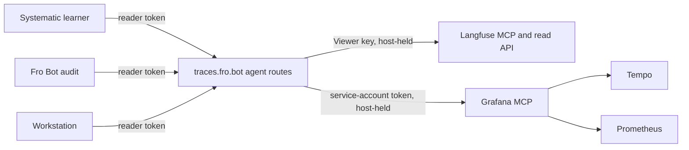

# Agent Read Access to Traces and Metrics

## Summary

traces.fro.bot gains two read-only agent routes, each gated by a per-consumer reader token. One reaches Langfuse with full trace content, through its MCP server and its read API. The other reaches Tempo and Prometheus through a Grafana MCP server. The read credentials for both stores stay on the host. Scheduled Fro Bot runs and local OpenCode sessions use the same URLs.

---

## Problem Frame

The trace stack records every Fro Bot run across 23 repositories: agent turns, subagent runs, tool calls, token and cache counts, and the Action's lifecycle. Only the operator can read it, and only through an SSH tunnel to UIs bound to loopback. No agent can read it.

So a Systematic agent cannot learn from its own subagent runs: which tools go unused or fail, where the prompt cache is lost, how a subagent actually behaves. A Fro Bot run cannot audit its past runs across repositories. A local session cannot ask the stores a question unless the operator drives the UI by hand.

The stack keeps content and structure apart. Langfuse holds everything, including system instructions, tool definitions, messages and tool input and output. Tempo receives only a fixed keep-list of structural attributes. Both stores are reachable only through the tunnel, and the collector's Langfuse key can only write.

---

## Actors

- A1. Systematic learner: a scheduled or dispatched Fro Bot run in marcusrbrown/systematic that reads subagent traces and proposes changes to Systematic.
- A2. Fro Bot audit: a scheduled or dispatched Fro Bot run in fro-bot/.github that reads runs across repositories and reports findings.
- A3. Workstation: the operator's local OpenCode session. It queries the stores directly or directs A1 and A2.
- A4. Operator: adds, lists and revokes reader tokens, manages the host-held read credentials, and approves the deploys that change the routes.

---

## Key Flows

- F1. Agent reads traces
  - **Trigger:** A1 or A2 starts on `schedule` or `workflow_dispatch`, or A3 asks a question.
  - **Actors:** A1, A2 or A3.
  - **Steps:**
    1. The consumer's OpenCode configuration names both routes and sends its reader token.
    2. The route checks the token.
    3. The route removes the token and any credentials the caller sent, then adds the store's read credential.
    4. The agent queries Langfuse, Grafana or both.
  - **Outcome:** the agent sees full Langfuse content and the Tempo and Prometheus data, and cannot change either store.
  - **Escape:** these are all refused before they reach Langfuse or Grafana:
    - a missing, unknown, revoked or sender token;
    - a path or method not on the allowlist;
    - a token over its limits.
  - **Covered by:** R1–R8, R12, R13.
- F2. Operator revokes a consumer
  - **Trigger:** A4 decides a consumer should lose access.
  - **Actors:** A4.
  - **Steps:** A4 runs one revoke command, and the command proves the token is refused on both routes.
  - **Outcome:** that consumer can read neither store, and the other consumers are unaffected.
  - **Covered by:** R9, R10.

---

## Requirements

**Access**

- R1. Agents can read Langfuse traces, observations, sessions, scores and metrics with full content. They do so through Langfuse's MCP server and its read API.
- R2. Agents can query Tempo (TraceQL) and Prometheus through a Grafana MCP server.
- R3. Both routes are on traces.fro.bot, and each is gated by a reader token. CI runs and local sessions use the same URLs. Agent reads need no SSH tunnel.
- R4. Each agent route forwards only an exact allowlist:
  - the Langfuse MCP endpoint;
  - `GET` on the Langfuse read endpoints for traces, sessions, observations, scores and metrics;
  - the Grafana MCP endpoint.

  Every other path or method is refused. The Langfuse and Grafana UIs stay reachable only through the tunnel.

**Credentials and roles**

- R5. A consumer holds only its reader token. The Langfuse read key and the Grafana read token stay on the host, and the route adds them to forwarded requests.
- R6. The route forwards neither the reader token nor any credential the caller supplies. Only the host-held credential reaches Langfuse or Grafana.
- R7. The host-held credentials cannot write, delete or administer anything. Langfuse uses the Viewer role only. Grafana uses a Viewer service account, and the Grafana MCP server runs with write tools disabled.
- R8. Reader tokens and sender tokens are separate. A sender token cannot read, and a reader token cannot ingest.
- R9. The operator creates the Langfuse Viewer key and the Grafana service account through a documented step. Both live only on the host and never appear in a deploy input, a GitHub secret or deploy output. The operator can rotate each with a step that proves the old credential is refused.

**Reader token lifecycle**

- R10. There is one reader token per named consumer: the Systematic learner, the Fro Bot audit and the workstation. The operator manages them with `traces reader add|list|revoke`, which mirror the sender-token commands. `list` never prints a token. Revoking a token cuts that consumer's access to both stores at once, and the command proves the token is refused on both routes.
- R11. For a CI consumer, `traces reader add` writes the token straight into a repository secret in the consumer's repository. The token never appears in the operator's terminal output.

**Load and isolation**

- R12. Each reader token has a request limit and a concurrency limit on the agent routes.
- R13. Reader services start after the ingest route decision. Their failures never hold ingest and never change the ingest verdict. Reads may add load to the stores they share with ingest, and the existing ingest-loss and refusal alerts cover any harm. The first deploy that adds the routes may hold ingest once.

**Privacy**

- R14. Before the first reader token is issued, the trace privacy page states three things: named agents read full trace content; those agents send it to their model providers through the proxy; and the content includes other people's text from public repositories.

**Structure in Tempo**

- R15. From the collector change onward, Tempo keeps two more attributes: cache-write token counts, under the attribute name the senders emit, and the subagent session id. Traces recorded before the change lack them. Consumers treat their absence there as unknown, not zero. This requirement can ship separately from the routes.

**Consumer contract**

- R16. Each consumer gets a short contract with these parts:
  - the OpenCode MCP configuration to add;
  - where its token lives;
  - a statement that access is read-only.

  CI consumers also learn three things:
  - fro-bot/agent loads remote MCP servers only on `schedule` and `workflow_dispatch` runs;
  - the token secret is passed only to those jobs;
  - queries page to completion and report when a result is incomplete.

---

## Acceptance Examples

- AE1. **Covers R10.** Given three reader tokens, when the operator revokes the workstation token, requests with it are refused on both routes. The Systematic and audit tokens still read.
- AE2. **Covers R8.** Given a valid sender token, when it is sent to an agent route, it is refused. Given a valid reader token, when it is sent to an ingest route, it is refused.
- AE3. **Covers R7.** Given a valid reader token, when an agent calls a Langfuse MCP tool that writes, such as creating a score, Langfuse refuses it by role. The Grafana MCP server offers no write tools.
- AE4. **Covers R4, R6.** Given a valid reader token, these requests are refused or not routed:
  - a `POST` or `DELETE` to a Langfuse REST path;
  - a request to the Langfuse or Grafana UI path;
  - a request that carries its own Langfuse Basic credentials. None of them reaches the store with the caller's credentials.
- AE5. **Covers R12, R13.** Given one reader token sending requests above its limits, its excess requests are refused. Given the Grafana MCP server down, the ingest verdict is unchanged and ingest stays open.
- AE6. **Covers R15.** Given a trace sent after the collector change, a TraceQL query returns its cache-write count and subagent session id.

---

## Success Criteria

- From a local OpenCode session with no tunnel open, the operator can ask "which tools did each subagent call last week, how often did they fail, and what were the cache-read counts". The answer comes from both stores.
- A scheduled Fro Bot run in marcusrbrown/systematic that follows its contract can read its own subagent traces, including system instructions and tool definitions.
- Removing a consumer's access takes one command, and that command proves the token is refused.
- A planner can build the routes, credentials, token lifecycle and privacy change without deciding who can read what, under which role, or who holds which credential. Only the technical questions below remain.

---

## Scope Boundaries

- The learner's and the audit's own behaviour is out of scope: cadence, signals, thresholds, and the shape of their PRs and issues. Each use case decides these in its own repository, and those repositories add their own workflow configuration from the contract.
- No writing back into Langfuse (scores, comments, annotation queues). v1 is read-only, and findings go to GitHub issues and PRs.
- Short-lived reader tokens minted by the broker from GitHub OIDC are deferred until long-lived reader secrets in repositories become a problem.
- No public Langfuse or Grafana UIs. They stay on the tunnel.
- No content in Tempo. The structure-only split stays, apart from the two attributes in R15.
- A token cannot be limited to one repository, environment or sender group. Langfuse keys can be scoped only to a project, so every reader sees every trace.
- No reader tokens for the other trace-sending repositories in v1. `traces reader add` adds one when a new use case needs it.

---

## Key Decisions

- **Reader route with host-held credentials, over broker-minted tokens or handing out store credentials.** This follows the collector's custody rule and reuses the sender-token pattern. One revoke cuts both stores. Broker-minted tokens remain a later option.
- **Full content for CI agents, with no read-side filtering.** In the operator's words: "I don't consider an already recorded trace a prompt injection attack - it's my work generating the traces to begin with". Traces do include other people's text from public repositories, and R14 discloses that.
- **An agent can read its own reader token.** This was accepted when the route was chosen. The token is read-only, belongs to one consumer, and can be revoked on its own.
- **MCP plus GET-only read API.** The MCP server has no trace or session tools. The read API covers them and is what the Langfuse CLI and its agent skill use.
- **Read-only in v1.** Langfuse has no role between Viewer and Member, and Member would also let agents write prompts, datasets and eval rules.
- **Named consumers, not every sending repository.** Three tokens keep adding and revoking manageable. Adding a consumer is one command.
- **Repository secret for CI tokens, passed only to scheduled and dispatched jobs.** The single operator controls both consumer repositories' workflows. A main-only GitHub Environment per repository was the alternative. The operator accepted the gap it would close: a `workflow_dispatch` run on an unreviewed branch also receives the secret.
- **Bounded read load instead of zero impact.** Reads share ClickHouse and Tempo with ingest, so "never slows ingest" cannot be guaranteed. Reader failures are kept out of the ingest path. Load is bounded per token, and the existing ingest alerts catch harm.

---

## Dependencies / Assumptions

- fro-bot/agent loads remote MCP servers only on `schedule` and `workflow_dispatch` runs. Other triggers drop them (`src/services/setup/mcp-servers-v2.ts:4-22` at fro-bot/agent `f6a28af`).
- Langfuse v4.86.0 serves its MCP server at `/api/public/mcp`, using Basic auth with project keys. It rejects a Host header that does not match its base URL or `LANGFUSE_MCP_ALLOWED_HOSTS` (`web/src/features/mcp/server/security.ts:56-83`).
- The Langfuse Viewer role can read traces, observations, sessions, scores and metrics. It has no create, update or delete rights (`packages/shared/src/features/rbac/projectAccessRights.ts:331-360`).
- Self-hosted Langfuse applies no API rate limits (`web/src/features/public-api/server/RateLimitService.ts:89-90`), so R12 has to be enforced in front of it.
- Langfuse's MCP server has no trace or session tools. Its observation listing allows at most 15 days per query and 100 rows per page.
- `grafana/mcp-grafana` supports streamable HTTP, service-account token auth and `--disable-write`, and provides TraceQL and PromQL tools.
- Unverified: whether Langfuse checks a key's role inside each MCP tool call. AE3 has to be proven on the host.
- Unverified: whether an agent under `isolate-agent: true` can read its MCP configuration, and with it the reader token. The decision that an agent can read its own reader token covers either case.

---

## Outstanding Questions

### Deferred to Planning

- [Affects R3, R12][Technical] How the route checks reader tokens. It must reload without a restart, avoid a per-request bcrypt cost, and enforce per-token request and concurrency limits. Stock Caddy has no per-key limiter.
- [Affects R3, R6][Technical] Which header carries the reader token, and how the Host header and `LANGFUSE_MCP_ALLOWED_HOSTS` are set so that Langfuse accepts forwarded MCP requests.
- [Affects R2, R7, R9][Technical] Where the Grafana MCP server runs, and how the Viewer service account and its token are provisioned, stored and rotated.
- [Affects R7][Needs research] Prove that a Viewer key's call to a Langfuse MCP write tool is refused.
- [Affects R10][Technical] How soon a revoke cuts a streamable-HTTP MCP response that is already open.
- [Affects R10][Technical] Whether the agent routes need a hold switch separate from per-token revoke, the way ingest has one.
- [Affects R16][Technical] Where the workstation's MCP configuration lives (global or per project), and how `traces reader add` delivers its token to a local file.
- [Affects R12][Technical] The limit values, and whether health and status show per-consumer use.

---

## Sources / Research

- `docs/plans/2026-11-20-001-feat-trace-collection-stack-plan.md`: tunnel-only UIs, collector custody, the Tempo keep-list and the sender-token design.
- `apps/traces/config/otelcol.yaml:139-194`: the Tempo keep-list.
- `apps/docs/src/content/docs/trace-privacy.md`: current promises about who reads traces.
- `docs/solutions/best-practices/monitoring-must-not-gate-the-ingest-it-monitors-2026-11-26.md`: the post-route start pattern behind R13.
- Langfuse docs: [agentic access](https://langfuse.com/docs/observability/features/agentic-access), [MCP server](https://langfuse.com/docs/api-and-data-platform/features/mcp-server), [read-only API keys](https://langfuse.com/faq/all/read-only-api-keys).
- Grafana docs: [MCP server](https://grafana.com/docs/grafana/latest/developer-resources/mcp).
- fro-bot/agent plugin span attributes: `packages/opencode-plugin/src/tracing/genai-attributes.ts:104-113` (usage and cache tokens) and `:211` (subagent session id), at `f6a28af`.
