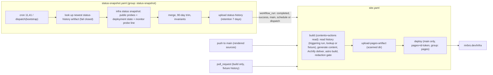

# feat: Add the infra docs platform with typed status, public history and a redaction gate

## Overview

The work ships in three phases, one after another:

1. **Typed status contract.** `status --json` becomes a schema-versioned contract. Each app reports typed observations, and each observation states what it proves.
2. **Public snapshot.** A secretless scheduled snapshot records public-safe observations every 30 minutes. It keeps a 90-day history window in a GitHub Actions artifact.
3. **Public site.** An Astro Starlight site at `mrbro.dev/infra` renders the operator docs, Archify diagrams and the status history. A redaction gate runs before anything is published.

Phase A can be reverted on its own only before Phase B lands, because the snapshot imports Phase A's probe code. After that, reverting A means reverting B too. Phase C can be reverted on its own: disable `site.yaml` and unpublish Pages.

## Problem Frame

Deployment status is spread across the CLI, the daily report issue, the dashboard, workflow runs and Discord, and none of them keeps history. Every check reports a flat string that doesn't say what it proved. On 10-30 the OpenCode V2 rollout passed every deploy and health check while every model call failed, and the cliproxy disk filled over months with nothing reporting it. The architecture exists only as prose, and the rule against publishing public IPs and named services is enforced only in review (see origin: `docs/brainstorms/2026-10-31-infra-docs-platform-requirements.md`).

## Requirements Trace

- R1–R5. Typed, schema-versioned `status --json`:
  - "not measured" and "unknown" results
  - partial failures that stay local to one observation
  - the table and MCP keep working
  - documented consumers are updated
  - shipped first as a minor release
- R6–R9:
  - Secretless 30-minute snapshot covering reachability, deploy state and the auth monitor's live probe result.
  - A snapshot-age row in the daily report.
  - VPN reports deploy state only.
- R10–R12:
  - Artifact-backed history, fail-closed when it's missing or invalid.
  - A one-time bootstrap.
  - A 45-minute gap rule.
  - Observed availability, never an uptime percentage.
- R13–R17:
  - Starlight on Pages at `mrbro.dev/infra`, with build and deploy split.
  - Rendered operator docs and service pages; controls appear as links only.
  - The v1 Archify diagram set.
- R18–R19:
  - The redaction gate catches routable IPs (including defanged forms), hostnames not on the allowlist, and secret patterns, with secrets reported by pattern ID only.
  - A new hostname needs an allowlist change in the same PR.
- Success criteria:
  - A phone view of status with the proof label for each observation and gaps visible.
  - Diagrams reviewed as code.
  - Nothing unsafe gets published.
  - The daily report flags a stalled snapshot within a day.

## Scope Boundaries

- No private view or hosting. Deep signals (disk, memory, container health, VPN peers) stay in the CLI, MCP and the daily report.
- No operator controls on the site.
- No new SSH or secret path for status, and no resident service.
- The daily report table is not ingested, and no new alerting channel is added.
- No analytics. Plans, brainstorms and ideation docs are not rendered.
- Per-app `<app> status --json` commands keep their current output. Only the unified `status` moves to the typed contract.

### Deferred to Separate Tasks

- Diagram drift detection (ideation #3): its own brainstorm, after this ships.
- Rollout passport (ideation #5) and detector coverage map (ideation #7): their own brainstorms.
- Back-filling every monitor run between snapshots: revisit if 30-minute end-to-end sampling proves too coarse.

## Context & Research

### Relevant Code and Patterns

**Unified status (`packages/cli/src/commands/status.ts`)**

- `StatusSummary` is a set of flat strings. `http` is misnamed: it carries SSH results for gateway, umami, dashboard and vpn.
- `unifiedStatusAction` runs a `Promise.allSettled` over seven collectors. A rejection becomes `errorSummary` (`❌` in every field).
- `toJsonPayload` builds the JSON, the table has 6 columns, and the exit code is always 0.
- `StatusDependencies` makes the collectors injectable.

**Per-app collectors**

| App       | Collector                 | Transport                                                               |
| --------- | ------------------------- | ----------------------------------------------------------------------- |
| keeweb    | `keeweb/status.ts:326`    | HTTP plus `gh run list`                                                 |
| cliproxy  | `cliproxy/status.ts:684`  | HTTP `/healthz`, management API, SSH for the running version            |
| gateway   | `gateway/status.ts:244`   | SSH, plus the structured `workspace` from `gateway/workspace-memory.ts` |
| umami     | `umami/status.ts:165`     | SSH                                                                     |
| dashboard | `dashboard/status.ts:170` | SSH                                                                     |
| vpn       | `vpn/shared.ts:143`       | SSH                                                                     |
| broker    | `broker/status.ts:45`     | HTTP                                                                    |

**Reusable public probes**

- `checkBrokerHealth` (`broker/status.ts:19`) and `checkHttpReachability` (`cliproxy/status.ts:80`) can be reused.
- Umami heartbeat (`apps/umami/src/deploy.ts:1176-1206`), dashboard `/api/healthz` (`apps/dashboard/src/deploy.ts:10`) and gateway operator health (`apps/gateway/src/deploy.ts:2608`, `parseOperatorContractVersion`) are written inline and not exported.
- `packages/` must never import `apps/`, so these probes have to be reimplemented under `packages/cli`.

**MCP (`packages/cli/src/commands/mcp.ts:46-56`)**

- Exact-name allowlist. Its output is the captured stdout of `console.log`, so `status --json` passes through verbatim.
- `mcp.test.ts:49-59` pins 9 tool names.

**Tests that pin the current shape**

- `status.test.ts:120-320`
- `packages/cli/src/__snapshots__/cli.test.ts.snap:271-274` (help text)
- The per-app summary tests

**Auth monitor (`.github/workflows/cliproxy-auth-monitor.yaml`)**

- Cron `7,22,37,52 * * * *`, plus a dispatch input `validation`.
- `packages/cli/src/commands/cliproxy/monitor.ts` prints `CLIProxy auth monitor summary: probe=… reason=… at <ISO>` only in `finish()` (around line 471), after issue reconciliation.
- A reconciliation, Discord or GitHub API failure exits 1 through `safeError` (around lines 532-540) without printing the line.
- The job concludes `success` for every probe outcome.

**Deploy-state rules**

- The daily report classifies deploy state with LLM prompt text in `.github/workflows/fro-bot.yaml:234-279`. The snapshot doesn't reuse it.
- Each deployed app has a GitHub environment named for the app. The Deployments API gives the newest deployment per environment. A gated deploy's statuses run `waiting > queued > in_progress > success` (observed live 2026-11-01).

**Daily report table**

- `fro-bot.yaml:776-805`. The precedent for a non-deploy row is the auth-monitor row at line 787, with its decision tree at 316-346.
- `conventions.test.ts` checks:
  - exactly 7 `Last deploy-… run` rows (lines 3502-3522)
  - the category slice (3110-3111)
  - the closing line (3534-3542)

**Workflow conventions (`packages/cli/src/conventions.test.ts`)**

- `.yaml` extension only.
- Pinned `uses:` lines need a version comment, and no exact-SHA assertions.
- Each workflow gets its own tests for the Node 26 pin, `--frozen-lockfile --ignore-scripts` and permissions.
- The changeset rules require every new workspace to be `private: true`.
- The `renovate-changesets.yaml` exclude list already covers `apps/**`.

**Workspace**

- `workspaces: ["apps/*","packages/*"]`, so `apps/docs` is added automatically.
- Root `tsconfig.json` includes `**/*.ts`.
- `eslint.config.ts` ignores root `docs/`, but not `apps/docs`.

**Archify (`.agents/skills/archify`)**

- `bin/archify.mjs deliver <type> <spec> [out] --json` validates and renders without a browser. It writes the HTML plus `<stem>.delivery.json`. `finalize` needs Chrome.
- The output is self-contained, about 846 KB, and embeds third-party URL strings: w3.org, github.com/JetBrains, apache.org, rust-lang.org, openai.com, openfontlicense.org.
- Example specs are in `examples/*.json`, for example `web-app.architecture.json` and `release-delivery.workflow.json`.

**Starlight precedent**

- `marcusrbrown/dev-like` `docs/astro.config.mjs` sets `site: https://mrbro.dev`, `base: /dev-like`.
- Its `.github/workflows/site.yaml` has:
  - triggers on push to `main` with paths, and dispatch
  - `contents: read`
  - concurrency `pages`
  - a read-only build job that runs `upload-pages-artifact`
  - a deploy job with `pages: write` + `id-token: write` in the `github-pages` environment
- `marcusrbrown/systematic` writes generated content into a gitignored `src/content/docs` before `astro build`.

**Doc frontmatter parsing**

- The parser and validator are private to `packages/cli/src/docs-frontmatter.test.ts` (`validateSolution`).

### Institutional Learnings

- `docs/solutions/workflow-issues/approval-gated-run-cancellation-2026-09-02.md`: a gated job may run no steps, and waiting runs can ignore cancellation. Read deploy state fail-closed.
- `docs/solutions/workflow-issues/aggregate-deploy-concurrency-cancels-gated-deploys-2026-06-25.md`: a newer pending run replaces an older one in the same group. Scope groups so one kind of run can't evict another.
- `docs/solutions/best-practices/cli-bun-build-publish-model-2026-06-20.md`: `--ignore-scripts` skips `prepack`, so test the packed CLI, not a local `dist/`.
- `docs/solutions/workflow-issues/fro-bot-schedule-session-bloat-no-op-2026-06-14.md`: a green cron run doesn't prove the output exists. Verify the artifact.
- `docs/plans/2026-05-23-001-feat-mcp-fidelity-status-only-plan.md` (recorded completed): keep MCP output structured and the allowlist explicit.
- `docs/plans/2026-07-21-001-feat-cliproxy-anthropic-auth-monitor-plan.md` (recorded completed): keep `healthy`/`dead`/`unknown` separate, and never leak raw URLs, responses or errors into public output.
- `docs/plans/2026-09-11-002-feat-fro-bot-progressive-autoheal-plan.md` (recorded completed): changes to the daily prompt need conventions coverage.
- `docs/plans/2026-09-11-001-test-release-alert-synthetic-validation-plan.md` (recorded completed): test workflow shell against a fake `gh` boundary.
- `docs/solutions/workflow-issues/opencode-v2-gateway-rollout-deploy-checks-do-not-prove-provider-routing-2026-10-31.md`: the lesson behind the proof labels.

### External References

**Astro and Starlight**

- Astro 7.4.4 and Starlight 0.42.7 are current. Starlight needs Astro ≥ 7.2.10.
- `site: 'https://mrbro.dev'` with `base: '/infra'` works because project sites inherit the user site's custom domain: https://docs.github.com/en/pages/configuring-a-custom-domain-for-your-github-pages-site/about-custom-domains-and-github-pages
- Every page needs `title`: https://starlight.astro.build/reference/frontmatter/
- Pagefind is a local static index with no telemetry: https://starlight.astro.build/guides/site-search/

**Pages actions**

- Current versions: `upload-pages-artifact` v5.0.0, `deploy-pages` v5.0.1, `configure-pages` v6.0.0.
- The 10-builds-per-hour soft limit doesn't apply to custom Actions workflows: https://docs.github.com/en/pages/getting-started-with-github-pages/github-pages-limits
- Concurrency `queue: max` exists (2026-05): https://github.blog/changelog/2026-05-07-actions-concurrency-groups-now-allow-larger-queues/

**Artifacts and workflow runs**

- `download-artifact` accepts `run-id` + `github-token` and needs `actions: read`. Artifacts expire after their `retention-days` regardless of references, and the API exposes `expired`: https://docs.github.com/en/rest/actions/artifacts
- Deployments and deployment statuses: https://docs.github.com/en/rest/deployments/deployments, https://docs.github.com/en/rest/deployments/statuses
- Scheduled runs can be delayed or dropped. Avoid minute `:00`. Public repos disable schedules after 60 days without activity: https://docs.github.com/en/actions/reference/workflows-and-actions/events-that-trigger-workflows

**IP classification and secret rules**

- IANA IPv4 and IPv6 special-purpose registries define what is globally reachable: https://www.iana.org/assignments/iana-ipv4-special-registry, https://www.iana.org/assignments/iana-ipv6-special-registry
- Gitleaks rules are MIT-licensed and can be vendored as a pinned snapshot: https://github.com/gitleaks/gitleaks

**Embedding diagrams**

- Use a sandboxed iframe. Don't combine `allow-scripts` with `allow-same-origin`: https://developer.mozilla.org/en-US/docs/Web/HTML/Reference/Elements/iframe

## Prior-Art Survey

```json
{
  "schema_version": 2,
  "verdict": "extend",
  "scope": "marcusrbrown/infra repo root: packages/cli, packages/shared, apps/*, .github/workflows, .agents/skills, docs/",
  "freshness": {
    "vcs_reference": "f68e8f13cfa2ed4a5ae956d5b81f5aff7871254a"
  },
  "budget": {
    "max_search_passes": 6,
    "max_candidate_inspections": 16,
    "exhausted": false
  },
  "candidates": [
    {
      "path_or_symbol": "packages/cli/src/commands/status.ts (StatusSummary, unifiedStatusAction, toJsonPayload, errorSummary)",
      "description": "Runs the seven per-app collectors and prints a 6-column table or one-line JSON of flat strings.",
      "disposition": "extend",
      "insufficiency_reason": "No kind, result, observed-at, source or schema version. A collector failure collapses the whole app into one error row."
    },
    {
      "path_or_symbol": "get*StatusSummary in keeweb, cliproxy, gateway, umami, dashboard, vpn and broker status modules",
      "description": "Per-app SSH and HTTP checks.",
      "disposition": "extend"
    },
    {
      "path_or_symbol": "checkBrokerHealth (broker/status.ts) and checkHttpReachability (cliproxy/status.ts)",
      "description": "Exported public HTTPS probes with timeouts.",
      "disposition": "reuse"
    },
    {
      "path_or_symbol": "umami heartbeat, dashboard healthz and gateway operator health probes in apps/*/src/deploy.ts",
      "description": "Deploy-time probes written inline and not exported.",
      "disposition": "insufficient",
      "insufficiency_reason": "packages/ cannot import apps/, so the probe logic must be reimplemented in the CLI."
    },
    {
      "path_or_symbol": "cliproxy-auth-monitor.yaml and cliproxy/monitor.ts summary line",
      "description": "Scheduled live model-route probe with a one-line machine-readable result.",
      "disposition": "extend",
      "insufficiency_reason": "The summary line is skipped when issue or Discord reconciliation fails, which hides a dead result."
    },
    {
      "path_or_symbol": "fro-bot.yaml SCHEDULE_PROMPT deploy pipeline health category and table",
      "description": "LLM-classified deploy state and monitor freshness, reported daily.",
      "disposition": "insufficient",
      "insufficiency_reason": "LLM verdicts, once a day, no history, and it carries credential-posture rows. Only the classification rules and the row-adding mechanism are reused."
    },
    {
      "path_or_symbol": "packages/cli/src/docs-frontmatter.test.ts (validators)",
      "description": "Validates doc frontmatter for solutions, plans and brainstorms.",
      "disposition": "extend",
      "insufficiency_reason": "The validators are private to the test file. The solutions index needs them as a shared module."
    },
    {
      "path_or_symbol": ".agents/skills/generating-project-docs",
      "description": "Agent procedure that regenerates ARCHITECTURE.md, STRUCTURE.md and READMEs.",
      "disposition": "insufficient",
      "insufficiency_reason": "An authoring workflow, not a build step. No site, no history, no enforcement."
    },
    {
      "path_or_symbol": ".agents/skills/archify bin/archify.mjs deliver",
      "description": "Renders JSON diagram specs to standalone HTML without a browser.",
      "disposition": "reuse"
    },
    {
      "path_or_symbol": "packages/cli/src/lib/redact.ts redactHost",
      "description": "Scrubs one known host from error text.",
      "disposition": "insufficient",
      "insufficiency_reason": "No IP or hostname scanning and no secret patterns."
    },
    {
      "path_or_symbol": "apps/dashboard operator dashboard",
      "description": "Private, OAuth-gated operator view.",
      "disposition": "insufficient",
      "insufficiency_reason": "Private by design, and a separate codebase with its own release gate. The requirements keep the public site separate from it."
    }
  ],
  "excluded_scopes": [
    {
      "scope": "marcusrbrown/dev-like, marcusrbrown/systematic, marcusrbrown/marcusrbrown.github.io",
      "reason": "Read only as the Starlight and Pages workflow precedent. They don't own this repo's concern."
    }
  ]
}
```

## Key Technical Decisions

- **The status contract is versioned separately from the CLI.** `status --json` emits `schemaVersion: 1`, `generatedAt`, and one entry per app. Each entry holds typed `observations` and a `facts` map. Each observation has `id`, `kind`, `result`, `observedAt`, `source` and an optional bounded `detail`:
  - `kind`: `reachability | container-health | deploy-state | end-to-end | resource`.
  - `result`: `pass | fail | unknown | not_measured`. `observedAt` is null when the result is `not_measured`.
  - `source`: `http | ssh | github-api | monitor | config`.
  - `facts` holds non-check values such as version, content hash, usage and the gateway's `workspace`.

  `schemaVersion` is the integer 1, and readers reject any other value. This follows the Kubernetes pass/fail/unknown model, and the expired IETF health draft as design input.

- **Each app declares its observation set.** Every app always lists the observation IDs it owns. A missing environment variable yields `not_measured`. A collector that throws or times out yields `unknown` on that app's declared observations, never a whole-app error row. This makes partial failure stay local.
- **The table is rendered from observations.** Rendering the human table from the same observations means there's one representation, not two that can drift. The columns are `App | Reachability | Container | Deploy | End-to-end | Resource`. Each cell shows the worst result among that app's observations of that kind, as a symbol plus a short word. A kind the app doesn't declare shows `—`. The columns change with this release.
- **Exit code stays 0** for `status`, as today. Scripts and MCP read the JSON, not the exit code.
- **One public probe module, used by both `status` and the snapshot.** It lives under `packages/cli/src/status/` and reimplements the umami heartbeat, dashboard healthz and gateway operator-health predicates, because `packages/` can't import `apps/`. The broker and cliproxy probes move into it. `status` gains public HTTPS reachability for the apps that today only check over SSH.
- **The snapshot is a CLI subcommand, `status snapshot`.** It is CLI-only and not on the MCP allowlist. It runs only the public probes, the deploy-state reader and the monitor reader, and needs `GITHUB_TOKEN` for read-only Actions and Deployments API calls.
- **Deploy state comes from the GitHub Deployments API, one environment per app.** The snapshot reads the newest deployment of each app's environment, then that deployment's newest status. The `deploy-state` observation maps the status:
  - `success` → `pass`.
  - `failure`, `error` → `fail`.
  - `waiting` → `unknown`, detail `at_gate`. The observation time is the status's `created_at`, shown as "waiting since".
  - `queued`, `in_progress`, `pending` → `unknown`, detail `running`.
  - `inactive` → the latest-state history decides (see Deferred to Implementation).
  - No deployment → `not_measured`, detail `none`.
  - An API error → `unknown`.

  `detail` stays within `at_gate`, `running` and `none`.

- **The end-to-end observation reads the monitor's live probe line.** The snapshot reads the newest completed `schedule`-event run of the auth monitor on `main`, whether it succeeded or failed. Dispatches are excluded, which also excludes synthetic runs. It strictly parses `probe`, `reason` and `at` from the line with the prefix `CLIProxy auth monitor probe:`, copying only those fields and rejecting any reason it doesn't recognize. The result maps `healthy` to `pass` and `dead` to `fail`. It is `unknown` when the probe says `unknown`, when no probe line parses, or when the run is queued or in progress. A probe whose `at` is more than 45 minutes old at snapshot time is `unknown` with reason `stale`. `at` is kept as the probe time, separate from the observation time.
- **The monitor prints a probe line before reconciliation.** A small change to `monitor.ts` prints `CLIProxy auth monitor probe: probe=… reason=… at …` right after the probe resolves, even when issue or Discord reconciliation later fails. The prefix differs from the daily report's `CLIProxy auth monitor summary:` line, so that parser never matches it. Without the early line, a dead route would read as `unknown` exactly when it matters.
- **History lives in an Actions artifact that only snapshot runs write.** This deliberately refines the origin's R10 "one concurrency group":
  - Snapshot runs (schedule, or dispatch on `main`) are the only writers. They download, append, trim and upload the `status-history` artifact, in group `status-snapshot` with `cancel-in-progress: false`.
  - The artifact uploads with `retention-days: 7`, and only the newest copy is ever read.
  - Lookup uses `GET /repos/{o}/{r}/actions/artifacts?name=status-history`. It filters to `expired == false`, `workflow_run.head_branch == 'main'` and a run whose event is `schedule` or `workflow_dispatch`, then takes the newest by `created_at`. The result is one of three states: found, confirmed empty, or error.
  - Site builds only read. On a `workflow_run` they use the triggering run's artifact. On a push or dispatch they use the lookup above.
  - Site builds share group `pages`, where the latest build wins.

  A docs push can't evict a pending snapshot, because the groups differ. A replaced pending site build loses nothing, because every build reads the newest history at build time.

- **Bootstrap is explicit.** Scheduled runs never create history, and a run with no artifact fails visibly. A `workflow_dispatch` with `bootstrap: true` creates the first artifact only when the lookup confirms none exists, and refuses if a valid one does. Any API or download error exits non-zero before upload. Recovery from 7 days without snapshots (a deliberate history reset) and emergency takedown are documented in the runbook.
- **History format: one file per app plus a meta file.** The artifact holds `meta.json` (schema version, last sample) and `apps/<app>.json`, each a list of compact samples. A sample stores results as short codes. Directional shape: `[observedAt, runId, attempt, {obsId: "p" | "f" | "u" | "n"}, detail?]`. Gaps and observed availability are computed at render time. The merge and trim enforce these invariants, and a violation exits non-zero with nothing uploaded:
  - no sample inside the 90-day window is dropped
  - the newest sample time never moves backwards, which also catches a stale read
  - duplicates are dropped, keyed on run ID and attempt
  - app IDs are known
  - no sample is dated more than 5 minutes in the future
  - the whole history stays under 10 MB uncompressed
- **Cadence:** the cron runs at `11,41 * * * *`, off the top of the hour and offset from the monitor's minutes. A gap is a spacing over 45 minutes; that number gets tuned against measured jitter after a week of real data.
- **Pages publishes after each snapshot through `workflow_run`.** `site.yaml` triggers on `workflow_run` of the `status-snapshot` workflow (`types: [completed]`). The guard is `github.event.workflow_run.conclusion == 'success'`, `head_branch == 'main'` and `event` in (`schedule`, `workflow_dispatch`). A `workflow_call` would fail the whole snapshot run at startup, because a callee can't hold `pages: write` or `id-token: write` unless its caller grants them. The snapshot token stays at `contents: read`, `actions: read` and `deployments: read`. Site builds also run on `main` pushes that touch a rendered source, and on dispatch.
- **Site location and content sourcing.** The site lives in `apps/docs`, a private workspace already covered by the `apps/**` changeset excludes. A Bun generator script copies the source markdown into a gitignored `src/content/docs`, following the systematic precedent, instead of using an external `glob()` loader. The generator:
  - takes each title from the H1 and strips it
  - rewrites links to rendered targets as site routes, and all other repo links as GitHub blob links pinned to the build commit
  - fails the build on a missing H1 or a link to a rendered target that doesn't exist
  - leaves code spans and code fences untouched
- **Page model.** Each of the 7 monitored apps gets one service page (status, history, diagrams, links), and its `AGENTS.md` is rendered as a linked guide page. `apps/agent` gets only a guide. Pages are indexable.
- **Diagrams.**
  - Specs live in `apps/docs/diagrams/` and are rendered with Archify `deliver` (no browser) into the gitignored `apps/docs/.diagrams/`. Only the `*.html` files are copied into `public/diagrams/`, so the `.delivery.json` receipts never publish.
  - Diagrams are embedded with lazy-loaded `sandbox="allow-scripts"` iframes, each with an "open full screen" link.
  - The "spec last changed in" label comes from `git log`; the build asserts a non-shallow checkout.
- **Redaction gate.**
  - "Public IP" means globally reachable according to the IANA IPv4 and IPv6 special-purpose registries, so documentation ranges are allowed. IPv4-mapped IPv6 (`::ffff:a.b.c.d`) is unwrapped before classifying.
  - Defanged forms are normalized before both IP and hostname matching: `[.]`, `[dot]`, `(.)`, `(dot)`, and `hxxp` or `hxxps` in any case.
  - Hostnames are checked against a committed allowlist. Each entry carries a reason and is scoped to a file class, for example Archify runtime HTML or Starlight bundles, so third-party runtime URLs don't need a global entry.
  - Secret rules are a pinned, vendored gitleaks snapshot with its MIT notice.
  - Secret patterns run first. Any finding that overlaps a secret match is reported by pattern ID alone, everywhere: stdout, annotations and the job summary.
  - Hostname and IP findings print the value, file and line, because the source is already public in the repo or the PR diff. Secret findings print only the pattern ID.
  - The gate runs twice: on the source markdown, which gives real line numbers, and on the built output, as a backstop. The post-build pass scans every text-decodable file in `dist`, whatever its extension, and skips Pagefind fragments, whose text comes from the scanned HTML.
  - The artifact that gets deployed is exactly the directory that was scanned.
  - A real hostname the docs need, such as the KeeWeb host, goes on the allowlist with a reason in the same PR. A false positive, meaning a non-hostname or non-IP that matched, is fixed by rewording the source. Pattern-level exemptions aren't allowed.
  - Infrastructure provider names already public in `AGENTS.md` stay a review-only matter under R19.
- **PR builds of the site** use committed fixture history, so an artifact outage doesn't fail every PR. Only `main` deploys.
- **New dependencies and CI changes need approval before they land.** The plan scopes them, and each PR that adds Astro or Starlight, or a new workflow, still asks Marcus first.

## Open Questions

### Resolved During Planning

- Snapshot as a subcommand or a mode of `status`: it's a subcommand, `status snapshot`, kept off the MCP allowlist.
- How a build finds the history artifact: the `status-history` lookup in the History KTD. A `workflow_run` build uses the triggering run's artifact.
- History split per app: yes, `apps/<app>.json` plus `meta.json`.
- Archify command: `deliver`. `finalize` needs Chrome and isn't required.
- Checkout depth: the site build checks out with full history and asserts it isn't shallow.
- Pages limits: the 10 builds/hour limit doesn't apply to custom Actions workflows, and `mrbro.dev/infra` is the documented path.
- Daily report row: it reads the newest `status-history` artifact's `created_at` and flags the snapshot as stale after 90 minutes.

### Deferred to Implementation

- **Exact observation IDs per app.** These are settled while migrating the collectors, against the pinned tests.
- **Deployment-state fixtures.** Before Unit 4 code, record the state sequence of a real rejected or failed deploy as a fixture. Confirm how rejection and `inactive` appear, then fix the `inactive` rule.
- **Retry policy for public probes.** Planned: one retry on network error before reporting `unknown`. The details come out of fixture tests.
- **The 45-minute gap threshold.** It gets tuned after a week of real cron jitter data.
- **ESLint and `tsc` scoping for `apps/docs`.** Planned: exclude Astro's generated and `.astro` sources. The exact globs are settled when the scaffold first runs lint and type-check.
- **The gitleaks snapshot revision, and false positives in key-lifecycle runbooks.** Both are settled by running the gate over the real corpus.
- **Whether the Archify theme toggle works in an opaque-origin iframe.** Verified in the browser on the first rendered diagram.

## Output Structure

    packages/cli/src/status/            # observation contract, public probes, deploy-state + monitor readers, history
    apps/docs/                          # private workspace: Astro Starlight site
      astro.config.mjs
      package.json
      scripts/                          # content generator, diagram render, redaction gate
      diagrams/                         # committed Archify specs
      redaction/                        # hostname allowlist, vendored secret rules + notice
      fixtures/history/                 # PR-build fixture history
      src/                              # Starlight pages and components (generated content gitignored)
    .github/workflows/status-snapshot.yaml
    .github/workflows/site.yaml
    docs/runbooks/docs-site.md

## High-Level Technical Design

> _This sketch shows the intended approach. It is guidance for review, not a specification. The implementing agent should treat it as context, not code to copy._



## Implementation Units

### Phase A — Typed status contract

- [ ] **Unit 1: Observation contract and shared public probes**

**Goal:** Define the schema-versioned observation contract and one public HTTPS probe module that both `status` and the snapshot use.

**Requirements:** R1, R2, R3.

**Dependencies:** None.

**Files:**

- Create: `packages/cli/src/status/observation.ts`, `packages/cli/src/status/public-probes.ts`
- Modify: `packages/cli/src/commands/broker/status.ts`, `packages/cli/src/commands/cliproxy/status.ts` (delegate to the shared probes)
- Test: `packages/cli/src/status/observation.test.ts`, `packages/cli/src/status/public-probes.test.ts`

**Approach:**

- Use a Zod schema for the envelope and the observation. The `result` and `kind` enums are closed, and `detail` is bounded.
- One probe per public endpoint:
  - keeweb page
  - cliproxy `/healthz`
  - broker `/healthz`
  - umami `/api/heartbeat` (requires `{ok:true}`)
  - dashboard `/api/healthz`
  - gateway via `https://dashboard.fro.bot/operator/health` (200 plus a non-empty string `contractVersion`)
- Each probe has an abort timeout and one retry on network error.
- A failure in a dependency yields `unknown`, not `fail`. For example, the gateway result is `unknown` when the dashboard probe can't connect.
- Details carry only the status code, the duration and a contract version. Never raw bodies or error text.

**Execution note:** Implement the contract and probes test-first against fetch fixtures.

**Patterns to follow:** `checkBrokerHealth` and `checkHttpReachability`. Fetch is mocked at the boundary, per `AGENTS.md` test conventions.

**Test scenarios:**

- Happy path: each probe with a 200 response and the expected body returns `pass`, a `reachability` kind, an ISO `observedAt` and source `http`.
- Edge case: umami returns 200 with `{ok:false}`, giving `fail`. Gateway returns 200 with an empty `contractVersion`, giving `fail`.
- Error path: a timeout or DNS error gives `unknown` after one retry. A 5xx gives `fail`. The detail never contains the response body or error message.
- Edge case: the dashboard connection fails, so the gateway observation is `unknown` with a dependency reason.
- Contract: the schema rejects an unknown `result`, an unknown `kind`, a non-null `observedAt` on `not_measured`, and an unsupported `schemaVersion`.

**Verification:** Probes and schema tests pass. The broker and cliproxy status tests still pass after delegating.

- [ ] **Unit 2: Migrate unified `status` to the typed contract**

**Goal:** `status --json` emits the versioned envelope, the table is rendered from observations, and partial failures stay inside the observation that failed.

**Requirements:** R1–R5.

**Dependencies:** Unit 1.

**Files:**

- Modify:
  - `packages/cli/src/commands/status.ts`
  - each per-app collector that feeds it: `keeweb/status.ts`, `cliproxy/status.ts`, `gateway/status.ts`, `umami/status.ts`, `dashboard/status.ts`, `vpn/shared.ts`, `broker/status.ts`
- Docs: `README.md`, `AGENTS.md`, `packages/cli/README.md` and `apps/gateway/AGENTS.md` (`gateway.workspace` moves to `facts.workspace`)
- Create: `.changeset/status-typed-contract.md` (minor)
- Test: `packages/cli/src/commands/status.test.ts`, `packages/cli/src/__snapshots__/cli.test.ts.snap`, `packages/cli/src/commands/mcp.test.ts`

**Approach:**

- Each app declares its observation IDs. Collectors return observations and facts and never throw for an expected failure.
- A missing env var gives `not_measured` with source `config`.
- If a whole collector rejects, its declared observations become `unknown`.
- Gateway `workspace` moves into `facts.workspace`, with its existing shape.
- The table is rendered from observations. The exit code stays 0.
- Per-app `<app> status` commands are unchanged.
- Update the `--json` help text and the help snapshot.
- Add an MCP test proving that `status --json` through MCP returns parseable JSON with no stderr mixed in.

**Patterns to follow:**

- The existing `StatusDependencies` injection.
- `unknownWorkspace` as the model for a non-throwing failure.
- The MCP capture fixture in `packages/cli/src/lib/mcp-ctx-fixture.ts`.

**Test scenarios:**

- Happy path: all collectors succeed. The JSON has `schemaVersion: 1`, `generatedAt`, all 7 apps, and each app's declared observation IDs.
- Error path: the gateway collector rejects. Only the gateway's observations are `unknown`, the other apps are untouched, and the stderr line is still emitted.
- Edge case: `GATEWAY_HOST` is unset, so the gateway's SSH observations are `not_measured` with source `config`, and the public reachability observation still runs.
- Edge case: VPN `reachability` and `end-to-end` are `not_measured`.
- Integration: the MCP `status` tool returns the same JSON string as the CLI, and it parses.
- Table: the columns are `App | Reachability | Container | Deploy | End-to-end | Resource`. Each cell shows the worst result of that kind as a symbol plus a short word, and an undeclared kind shows `—`. A snapshot test pins it.

**Verification:**

- The full CLI test suite and `tsc` pass.
- The packed CLI (`npm pack` smoke test) prints the new envelope.
- Every documented consumer describes the new shape (the Docs list above).

### Phase B — Public snapshot and history

- [ ] **Unit 3: Auth monitor prints its probe line before reconciliation**

**Goal:** The snapshot can always read the monitor's probe result, even when reconciliation fails.

**Requirements:** R6.

**Dependencies:** None (independent; it lands with Phase B).

**Files:**

- Modify: `packages/cli/src/commands/cliproxy/monitor.ts`
- Test: `packages/cli/src/commands/cliproxy/monitor.test.ts`

**Approach:** Emit `CLIProxy auth monitor probe: probe=… reason=… at …` right after the probe resolves, before issue and Discord reconciliation. The prefix differs from the daily report's `CLIProxy auth monitor summary:` line, so that parser never matches it. Keep the existing final summary line and the existing exit behaviour.

**Test scenarios:**

- Happy path: on a successful run, the probe line appears before the final summary.
- Error path: if issue reconciliation throws after a `dead` probe, the probe line with `probe=dead` was already printed and the exit code is still 1.
- Regression: the summary line is still emitted exactly once on a successful run, and the probe line never matches the summary parser.
- Edge case: on synthetic validation runs, the probe line reflects the synthetic outcome. The snapshot ignores those runs by event type.

**Verification:** The monitor tests pass, and the existing daily-report parser still matches the final summary line.

- [ ] **Unit 4: Deploy-state and monitor readers**

**Goal:** Deterministic, read-only reads of each app's latest deployment state from the GitHub Deployments API, plus the auth monitor's latest live probe from the Actions API.

**Requirements:** R6, R7, R9.

**Dependencies:** Unit 1 (the observation types), Unit 3 (the probe line).

**Files:**

- Create: `packages/cli/src/status/deploy-state.ts`, `packages/cli/src/status/monitor-state.ts`
- Test:
  - `packages/cli/src/status/deploy-state.test.ts`, `packages/cli/src/status/monitor-state.test.ts`
  - fixtures under `packages/cli/src/status/__fixtures__/`

**Approach:**

- **Deploy state.** For each app's environment (keeweb, cliproxy, gateway, umami, dashboard, vpn, broker):
  1. `GET /repos/{o}/{r}/deployments?environment=<app>&per_page=1`.
  2. `GET .../deployments/{id}/statuses?per_page=1` for the newest status.
  3. Map the state to the observation as the Deploy-state KTD defines.
  - The observation time is the status `created_at`, shown as "waiting since" for `at_gate`.
  - `detail` is one of `at_gate`, `running` or `none`.
  - An API error gives `unknown`.
- **Monitor.** Take the newest completed `schedule`-event run on `main`, whether it succeeded or failed, and read its job log.
  - Match only the `CLIProxy auth monitor probe:` prefix, and expect exactly one such line per run.
  - Parse `probe`, `reason` and `at` strictly, with one retry when the log comes back empty, and reject unknown reasons.
  - A failed run with a parsable line gives the parsed result.
  - The result is `unknown` only when no line parses or the run is queued or in progress.
  - A probe whose `at` is more than 45 minutes old at snapshot time gives `unknown` with reason `stale`.
- Neither reader ever copies issue or Discord fields, URLs or log text.
- Use a bounded API call budget per snapshot.
- The snapshot job's token needs `contents: read`, `actions: read` and `deployments: read`.

**Patterns to follow:** The monitor decision tree in `fro-bot.yaml` (lines 316-346). The fake-`gh`/fetch boundary approach from the release-alert plan. Fixtures recorded from real API responses (see Deferred to Implementation).

**Test scenarios:**

- Happy path: the newest `gateway` deployment's newest status is `success`, giving `pass` with its `created_at`.
- Failure: `failure` and `error` give `fail`.
- At gate: the newest `dashboard` status is `waiting`, giving `unknown` with detail `at_gate` and "waiting since" equal to the status `created_at`.
- Running: `queued`, `in_progress` and `pending` give `unknown` with detail `running`.
- Edge case:
  - An environment with no deployment gives `not_measured` with detail `none`.
  - An API error gives `unknown`.
  - `inactive` follows the rule recorded from the real fixture.
- Monitor:
  - The latest schedule run's log contains `probe=dead reason=auth-401 at …` and the run failed, giving `fail` with the probe time preserved.
  - A stale healthy run (`at` older than 45 minutes) gives `unknown` with reason `stale`.
  - The latest run is a `workflow_dispatch` synthetic run, so it is skipped and the earlier schedule run is used.
  - A completed run whose log is unparseable or empty after a retry gives `unknown`.
  - A log with two probe lines is rejected.
  - A queued or in-progress run gives `unknown`.

**Verification:** Reader tests pass against the recorded API fixtures. A manual run against the live repo prints sane states for all 7 apps.

- [ ] **Unit 5: `status snapshot` command and history store**

**Goal:** One CLI command that produces a public-safe sample and merges it into the 90-day history, enforcing the invariants that stop published history from shrinking or going blank.

**Requirements:** R6–R12.

**Dependencies:** Units 1 and 4.

**Files:**

- Create: `packages/cli/src/status/history.ts`, `packages/cli/src/commands/status-snapshot.ts`
- Modify: `packages/cli/src/commands/status.ts` (register the subcommand), `packages/cli/src/cli.ts` if registration lives there
- Create: `.changeset/status-snapshot.md` (minor)
- Test: `packages/cli/src/status/history.test.ts`, `packages/cli/src/commands/status-snapshot.test.ts`

**Approach:**

- `status snapshot --history <dir> [--bootstrap] [--now <iso>]` runs the public probes plus the deploy-state and monitor readers, with no SSH and no deploy secrets.
- It writes one sample per app in the compact History-format shape. Each sample carries `observedAt`, `runId`, `runAttempt` and short result codes, where only allowlisted `detail` keys pass through.
- Merge, deduplicating on run ID plus attempt.
- Trim using one UTC `now`.
- Validate the History-format invariants from the KTD before writing, and exit non-zero when any fails. Over the 10 MB cap, nothing is uploaded.
- `--bootstrap` refuses if `meta.json` already exists. Without `--bootstrap`, a missing history makes the command fail.
- The command stays off `MCP_ALLOWLIST`.

**Execution note:** Write the history invariants test-first.

**Test scenarios:**

- Happy path:
  - Merging one sample into 10 days of history appends exactly one sample per app.
  - `meta.json` updates its last-sample time.
- Edge case:
  - A sample older than 90 days is trimmed, and the invariants allow exactly that drop.
  - A re-run with the same run ID and attempt is a no-op.
- Error path:
  - Missing history without `--bootstrap` exits non-zero and writes nothing.
  - `--bootstrap` with existing history exits non-zero.
  - Input history with a newer last sample than the merged result is rejected (stale read).
  - A history over 10 MB, an unknown app ID and a sample dated more than 5 minutes ahead are each rejected.
  - A malformed app file or an unsupported `schemaVersion` is rejected.
- Edge case: a probe detail containing an unexpected key is dropped from the sample.
- Integration: a snapshot run with mocked fetch and GitHub produces valid per-app files that the Unit 1 schema accepts.

**Verification:** Tests pass. A local run against a temp directory with `--bootstrap` and then a normal run produces two samples per app.

- [ ] **Unit 6: `status-snapshot.yaml` workflow**

**Goal:** Run the snapshot on schedule and persist its history artifact, without touching any deploy secrets.

**Requirements:** R6, R7, R10, R11.

**Dependencies:** Unit 5.

**Files:**

- Create: `.github/workflows/status-snapshot.yaml`
- Test: `packages/cli/src/conventions.test.ts` (new describe block)

**Approach:**

- Triggers: `schedule: '11,41 * * * *'` and `workflow_dispatch` with input `bootstrap` (boolean).
- Permissions: top-level `contents: read`. The job restates `contents: read` and adds `actions: read` and `deployments: read`.
- Concurrency: `status-snapshot`, with `cancel-in-progress: false`.
- Steps:
  1. Check out with `persist-credentials: false`.
  2. Run setup-bun and `bun install --frozen-lockfile --ignore-scripts`.
  3. Look up the history artifact with the History KTD lookup. The step is three-state: found, confirmed empty, or error. Any API error exits non-zero before upload. Confirmed empty proceeds only when `inputs.bootstrap` is true.
  4. Download it with `name: status-history`, `path: ${{ runner.temp }}/status-history`, `run-id` from the lookup, and `github-token`. Skip this step on a confirmed-empty bootstrap.
  5. Run `bun run packages/cli/src/cli.ts status snapshot --history ${{ runner.temp }}/status-history`, adding `--bootstrap` when `inputs.bootstrap` is true. Pass `GITHUB_TOKEN`.
  6. Upload `status-history` with `retention-days: 7`.
- Guard upload and bootstrap with `github.ref == 'refs/heads/main'`.
- Write the step summary with counts only. It must not contain any URL, hostname or error text.
- The workflow has no publish job. `site.yaml` picks up each completed run through `workflow_run` (Unit 12).

**Patterns to follow:** The monitor workflow's install and run-from-source shape. SHA pins with version comments.

**Test scenarios** (conventions):

- The workflow has a `.yaml` extension, and every `uses:` is SHA-pinned with a version comment.
- No secrets are referenced except `GITHUB_TOKEN`.
- Permissions are exactly `contents: read`, `actions: read` and `deployments: read`.
- `bun install --frozen-lockfile --ignore-scripts` is present.
- The concurrency group is `status-snapshot` with `cancel-in-progress: false`.
- Upload and bootstrap steps are guarded to `main`.
- The cron avoids minute 0.
- The `bootstrap` dispatch input is used.
- `--history` is passed to `status snapshot`.
- `retention-days` is 7.
- No `environment:` key and no publish job are present.
- Lookup (workflow-shell tests against a fake API boundary):
  - A newer non-`main` artifact is never selected.
  - A lookup error during bootstrap uploads nothing.

**Verification:**

- Conventions tests pass and actionlint is clean.
- After merge, a bootstrap dispatch on `main` creates the artifact, and the next scheduled run appends to it. The artifact and its contents are read back.

- [ ] **Unit 7: Daily report snapshot-age row**

**Goal:** The daily report flags a stalled snapshot within a day.

**Requirements:** R8.

**Dependencies:** Unit 6.

**Files:**

- Modify: `.github/workflows/fro-bot.yaml` (SCHEDULE_PROMPT category 7 and the table)
- Test: `packages/cli/src/conventions.test.ts`

**Approach:**

- Add the row `| docs | Status snapshot age | ✅ Fresh / ⚠️ Stale (> 90 min) / ⚠️ Not bootstrapped / — Missing | [artifact time] |`. The label must not match `Last deploy-… run`.
- Add a short decision tree that reads the newest `status-history` artifact's `created_at`.
- The row goes before the category's closing line.

**Test scenarios** (conventions):

- The row is present and the label doesn't match the `Last deploy-` pattern, so the count of 7 still holds.
- The decision tree names the artifact and the 90-minute threshold.
- The category's closing line is still last.

**Verification:** Conventions tests pass. The next daily report shows the row.

### Phase C: Public site

- [ ] **Unit 8: Docs workspace scaffold and content generator**

**Goal:** A private Starlight workspace that renders the operator docs from their source files, with link rewriting and titles taken from each file's H1.

**Requirements:** R13, R15.

**Dependencies:** None for the scaffold. Marcus must approve the new dependencies (Astro, Starlight) before this lands.

**Files:**

- Create:
  - `apps/docs/package.json` (`private: true`)
  - `apps/docs/astro.config.mjs` (`site: 'https://mrbro.dev'`, `base: '/infra'`)
  - `apps/docs/scripts/generate-content.ts`
  - `apps/docs/src/content.config.ts`
  - `apps/docs/.gitignore`, covering the generated content, `public/diagrams`, `dist` and `.astro`
- Create: `packages/cli/src/lib/docs-frontmatter.ts`, holding the frontmatter parser and solution validator moved out of the test file
- Modify:
  - `packages/cli/src/docs-frontmatter.test.ts` so it imports the shared module
  - root `tsconfig.json` and `eslint.config.ts` to scope out generated and `.astro` sources
  - `bun.lock`
- Test: `apps/docs/scripts/generate-content.test.ts`

**Approach:**

- The generator copies these sources into `src/content/docs/`:
  - `ARCHITECTURE.md` and `STRUCTURE.md`
  - each `apps/*/AGENTS.md` as `guides/<app>`, including `apps/agent`
  - `docs/runbooks/*.md`
  - a `docs/solutions` index built from validated frontmatter
- Each page's title comes from its first H1, which is then removed. A missing H1 fails the build.
- Links:
  - Links to rendered targets become `/infra/...` routes.
  - Other repo links become GitHub blob URLs pinned to the build SHA.
  - A link to a missing rendered target fails the build.
  - Links inside code spans and fences are left alone.
- Output is `.md` only, never MDX, so placeholder tokens like `<vpc-ip>` survive.
- The sidebar groups Services, Guides, Runbooks, Solutions and Architecture.

**Patterns to follow:**

- Generated, gitignored content, as in systematic's `docs/scripts`.
- The Astro config from dev-like.
- Validation that already exists in `docs-frontmatter.test.ts`.

**Test scenarios:**

- Happy path: `apps/vpn/AGENTS.md` becomes `guides/vpn` with title "apps/vpn …", and its first H1 is removed.
- Link rewrite:
  - `../../docs/runbooks/vpn-egress-box.md` becomes `/infra/runbooks/vpn-egress-box/`.
  - A link to `docs/plans/x.md` becomes a GitHub blob URL at the build SHA.
  - A link inside a code span is left unchanged.
- Error path: a source file with no H1 fails, naming the file. A link to a missing runbook fails, naming the file and line.
- Edge case: the placeholder `<vpc-ip>` outside a code span is preserved verbatim in the generated markdown.
- Solutions index: entries come from frontmatter. A doc with invalid frontmatter fails the build.

**Verification:**

- Generator tests pass.
- `bun run --cwd apps/docs build` succeeds locally.
- Root `tsc`, lint and `bun test --recursive` still pass.

- [ ] **Unit 9: Archify diagram specs and render step**

**Goal:** The v1 diagram set, rendered at build time and embedded on the site, with a "spec last changed in" label on each.

**Requirements:** R16, R17.

**Dependencies:** Unit 8. Archify is in the repo (#1744).

**Files:**

- Create in `apps/docs/diagrams/`:
  - `topology.architecture.json`
  - `deploy-pipeline.workflow.json`
  - `operator-path.sequence.json`
  - `status-snapshot.dataflow.json`
  - `apps/<app>.architecture.json`, one per monitored app (7)
  - `runbooks/umami-pg-upgrade.workflow.json`
  - `runbooks/vpn-key-rotation.workflow.json`
  - `runbooks/dashboard-rollback.workflow.json`
- Create: `apps/docs/scripts/render-diagrams.ts`, `apps/docs/src/components/Diagram.astro`
- Test: `apps/docs/scripts/render-diagrams.test.ts`

**Approach:**

- `scripts/render-diagrams.ts` runs Archify from the repo root: `node .agents/skills/archify/bin/archify.mjs deliver <type> <spec> apps/docs/.diagrams/<name>.html --json`. Each spec's `meta.output` is set to that same path.
- After rendering, copy only the `*.html` files into `apps/docs/public/diagrams/`. The `.delivery.json` receipts never reach `public/` or `dist`. `.diagrams/` is gitignored.
- Get each label's commit from `git log -1 -- <spec>`. The script fails on a shallow checkout. In PR builds the label reads "unmerged".
- The embed component is a lazy-loaded iframe:
  - `src` includes the `/infra` base
  - `sandbox="allow-scripts"`
  - a fixed aspect ratio
  - an "open full screen" link
- The specs describe topology with provider-neutral host types and no IP literals.
- The sandbox is defense-in-depth for the embed only. The full-screen link opens the same first-party HTML at the top level, which is acceptable because it's generated from our own specs.

**Execution note:** Author the specs by hand from `examples/` templates, and run `archify validate` on each.

**Test scenarios:**

- Happy path: every spec under `diagrams/` validates and renders to HTML at its `meta.output`.
- Semantic:
  - Each runbook map contains at least one STOP node and one node marked irreversible.
  - The topology spec has exactly the 7 monitored apps.
- Error path: rendering on a shallow clone fails with a clear message.
- Edge case: a spec that fails validation fails the build and names the spec.
- Working directory: rendering works when the build runs with `--cwd apps/docs`, and only `*.html` files land in `public/diagrams/`.

**Verification:** 14 diagrams render. One is checked in a browser to confirm the iframe theme toggle works with an opaque origin; if it doesn't, the embed falls back to static.

- [ ] **Unit 10: Status and service pages**

**Goal:** A status overview and per-app service pages that render history honestly.

**Requirements:** R12, R15, R16, and the success criteria.

**Dependencies:** Units 5, 8 and 9.

**Files:**

- Create:
  - `apps/docs/src/pages/status.astro` or a Starlight custom page
  - `apps/docs/src/components/AppStatus.astro`, `apps/docs/src/lib/history-view.ts`
  - `apps/docs/fixtures/history/` (PR-build fixture)
- Test: `apps/docs/src/lib/history-view.test.ts`

**Approach:**

- At build time, read the per-app history files.
- Show each app's latest observations with a proof label: reachability, deploy state, end-to-end, or not measured.
- Show observed availability as "N of M samples passed", plus coverage: "M samples recorded of about E expected over the window", where E = window / 30 min. Gaps don't count toward M. The page never shows a percentage of uptime.
- Mark gaps as intervals longer than 45 minutes.
- Render `generatedAt`. A small client script shows its relative age and a stale warning after 90 minutes.
- Each service page carries:
  - the app's diagrams
  - links to its guide, runbooks, dashboard and CLI commands
  - the public-history disclaimer from the success criteria

**Test scenarios:**

- Happy path: with 3 samples 30 minutes apart, all reachability `pass`, the page reads "3 of 3 samples passed" and shows no gap.
- Edge case:
  - Samples at T and T+75 minutes produce one gap.
  - The first sample after bootstrap is not a gap.
- VPN: reachability and end-to-end read "not measured", and its deploy state is shown.
- Gateway: reachability `pass` with end-to-end `not_measured` never renders as fully healthy.
- `unknown` samples are counted separately from `pass` and `fail`.
- Coverage: a 7-day window with 100 recorded samples reads "100 samples recorded of about 336 expected", and the page shows no uptime percentage.

**Verification:** View-model tests pass. A local build using fixture history renders every service page.

- [ ] **Unit 11: Redaction gate**

**Goal:** Block publication of globally routable IPs, unlisted hostnames and secret-shaped strings. Secrets are reported by pattern ID only.

**Requirements:** R18, R19.

**Dependencies:** Unit 8.

**Files:**

- Create:
  - `apps/docs/scripts/redaction-gate.ts`, `apps/docs/scripts/ip-classify.ts`
  - `apps/docs/redaction/hostname-allowlist.json`
  - `apps/docs/redaction/secret-rules.json` and `apps/docs/redaction/NOTICE`, a pinned gitleaks snapshot
- Test: `apps/docs/scripts/redaction-gate.test.ts`, `apps/docs/scripts/ip-classify.test.ts`

**Approach:**

- The gate runs in two passes: over source markdown before the build, with line numbers, and over the built `dist` afterward. The post-build pass extracts HTML text plus attributes and scans every other text-decodable file in `dist`, whatever its extension. It skips Pagefind fragments, because their text comes from the scanned HTML.
- Secret rules run first, and any overlapping finding is masked to its pattern ID.
- IPs are detected by normalizing defanged forms (`[.]`, `[dot]`, `(.)`, `(dot)`, `hxxp` and `hxxps` in any case), parsing candidates strictly, unwrapping IPv4-mapped IPv6, and classifying them against the IANA special-purpose tables, which are vendored as a small static list. Hostname matching uses the same normalization.
- Hostnames are checked against the allowlist. Each entry carries a reason and a scope (glob of file classes). A real hostname the docs need goes on the allowlist in the same PR. Pattern-level exemptions aren't allowed.
- Hostname and IP findings print the value, file and line. Secret findings print only the pattern ID.
- Findings are capped and deduplicated, and output never echoes secret material in stdout, annotations or the job summary.

**Execution note:** Test-first, and include a corpus test against the real repo sources.

**Test scenarios:**

- IPs:
  - A public IPv4 (`8.8.8.8`) and its defanged form `8.8.8[.]8` both fail.
  - `10.116.0.3`, `172.28.0.2`, `127.0.0.1`, `0.0.0.0` and `203.0.113.5` (documentation range) pass.
  - The IPv6 global `2606:4700::1` fails. `fd00::1` (ULA), `fe80::1` and `::1` pass.
  - `8[dot]8[dot]8[dot]8` fails.
  - `::ffff:8.8.8.8` fails. `::ffff:10.0.0.1` passes.
- Hostnames:
  - `box.heatvision.co` against a fixture allowlist that omits it fails, naming the file and line.
  - `HXXPS://box[.]heatvision[.]co` fails as an unlisted host.
  - Filenames like `AGENTS.md` and `deploy.sh` are not treated as hostnames.
  - Archify runtime hosts pass only in diagram HTML.
- Secrets:
  - A GitHub token-shaped string fails, and the output contains the pattern ID but not the token.
  - A JWT-shaped string that would also match the hostname rule reports only the pattern ID.
  - A URL with userinfo prints only the host.
- False positives: a 40-hex SHA, base64 inside an SVG `data:` URI, and a three-part version like `1.2.3` don't fail.
- Post-build scope: a text file with an unusual extension in `dist` is scanned, and a Pagefind fragment is skipped. A test shows the fragment's text comes from scanned HTML.
- Corpus: the current repo sources pass. Each real hostname the docs need is allowlisted with a reason, and each false positive is reworded in the source, as part of this unit.

**Verification:** The gate tests pass, and the gate is clean over the full local build.

- [ ] **Unit 12: `site.yaml` workflow and publish wiring**

**Goal:** Build, gate and deploy the site, and publish after each snapshot.

**Requirements:** R13, R14, R10, R11.

**Dependencies:** Units 6, 8, 9, 10 and 11. Approval for the new workflow, and for enabling Pages (source: GitHub Actions).

**Files:**

- Create: `.github/workflows/site.yaml`
- Test: `packages/cli/src/conventions.test.ts`

**Approach:**

- Triggers:
  - `push` to `main`, with paths covering every rendered source, the specs, the allowlist, `apps/docs/**` and the workflow itself
  - `pull_request` (build only)
  - `workflow_dispatch`
  - `workflow_run` of the `status-snapshot` workflow, `types: [completed]`
- The `workflow_run` path runs only when `github.event.workflow_run.conclusion == 'success'`, `head_branch == 'main'` and `event` is `schedule` or `workflow_dispatch`.
- **Build job** (`contents: read`, `actions: read`):
  1. Check out with `fetch-depth: 0` and `persist-credentials: false`.
  2. Run setup-bun and `bun install --frozen-lockfile --ignore-scripts`.
  3. Get history:
     - `workflow_run`: download the triggering run's artifact, using `github.event.workflow_run.id`.
     - push or dispatch on `main`: use the History KTD lookup, failing closed.
     - PR: use the fixture.
  4. Generate content and render the diagrams.
  5. Run the source gate, `astro build`, then the dist gate.
  6. Run `upload-pages-artifact` on the scanned `dist`.
- **Deploy job:**
  - `if: github.ref == 'refs/heads/main' && github.event_name != 'pull_request'`. For a `workflow_run` event, the ref is the default branch.
  - permissions `pages: write` and `id-token: write`
  - environment `github-pages`
  - `deploy-pages`
  - concurrency `pages`, with `cancel-in-progress: false`
- `status-snapshot.yaml` is not modified. It has no publish job.

**Patterns to follow:** dev-like's `site.yaml`, and the action SHAs already in this repo where one exists.

**Test scenarios** (conventions):

- `site.yaml` has a `workflow_run` trigger naming the snapshot workflow.
- The `workflow_run` path checks conclusion, branch and event.
- No `pull_request` path reaches deploy, and deploy is guarded to `main`.
- The build job holds no write permissions.
- The deploy job holds only `pages: write` and `id-token: write`.
- Install flags are present, `fetch-depth: 0` is present, and every action is SHA-pinned with a version comment.
- The history step fails closed on `main`, and a `workflow_run` build downloads by `github.event.workflow_run.id`.
- The upload path equals the path the dist gate scanned.
- The snapshot workflow keeps `contents: read`, `actions: read` and `deployments: read`, and no `pages` or `id-token` scope.

**Verification:**

- Conventions tests pass and actionlint is clean.
- After merge, the first `main` build deploys and `https://mrbro.dev/infra/` serves the status page and a diagram.
- The next snapshot republishes, with the sample count increased.

- [ ] **Unit 13: Rollout runbook and repo docs**

**Goal:** Document how to operate the site and make it discoverable.

**Requirements:** The success criteria and R19.

**Dependencies:** Unit 12.

**Files:**

- Create: `docs/runbooks/docs-site.md`
- Modify: root `AGENTS.md` (a WHERE TO LOOK row, STRUCTURE, a `apps/docs` note) and `README.md` (site link)
- Create: `apps/docs/AGENTS.md`

**Approach:** The runbook covers:

- enabling Pages, with GitHub Actions as the source
- bootstrap
- the 7-day reset path: when snapshots stop for more than 7 days, re-bootstrap after an accepted history reset
- emergency takedown, in order:
  1. Disable the `status-snapshot` and `site` workflows.
  2. Unpublish Pages.
  3. Optionally delete the remaining `status-history` artifacts.
- adding an allowlisted hostname
- rewording a gate failure
- re-enabling both workflows if schedules are disabled after 60 days of repo inactivity

**Test expectation:** none. These are documentation-only changes, covered by `docs-frontmatter` and prettier.

**Verification:** Prettier is clean, and the runbook steps are executed once during rollout.

## System-Wide Impact

- **Interaction graph:**
  - `status --json` feeds MCP (`status` tool) and the documented operator scripts.
  - The monitor's output feeds both the daily report and the snapshot.
  - The snapshot's artifact feeds the daily report row, and a completed snapshot run triggers the site build through `workflow_run`.
- **Error propagation:**
  - Probe and reader failures become `unknown` observations, never thrown errors.
  - History invariant failures exit non-zero and nothing is uploaded or published.
  - Gate failures block the deploy.
- **State lifecycle risks:**
  - The history artifact is the only state. Retention is 7 days, and the newest copy is always the one read. If snapshots stop for more than 7 days, history has to be reset (see the runbook).
  - Re-runs are deduplicated by run ID and attempt.
- **API surface parity:**
  - Per-app `<app> status` commands are unchanged.
  - The MCP tool name and allowlist are unchanged, but the JSON returned by the `status` tool changes.
- **Integration coverage:** the MCP passthrough test, the snapshot-to-site artifact handoff, and the first live publish.
- **Unchanged invariants:**
  - No deploy workflow, environment, secret or droplet changes.
  - The daily report keeps its probes and table, plus the one new row.
  - Exit code semantics of `status` are unchanged.

## Risks & Dependencies

| Risk | Mitigation |
| --- | --- |
| Breaking `status --json` breaks an operator script | It ships as a minor release with a changeset, and the docs are updated in the same PR. No workflow consumes it. |
| Cron delays or drops make history look patchy | Gaps are shown honestly. The threshold is tuned on real jitter, and samples are never interpolated. |
| Schedules get disabled after 60 days without repo activity | Accepted risk. Renovate and other merges land on `main` almost daily, so the repo is never idle for 60 days. If it does happen, the daily report stops too, and the runbook covers re-enabling both workflows. |
| Artifact expiry or deletion blocks publishing | Retention is 7 days and the history is capped at 10 MB. Fail closed with a visible error. The daily row flags a stalled snapshot within a day, which leaves 7 days to fix it before the runbook's history reset is needed. |
| The redaction gate has false positives on real docs | The corpus test runs in Unit 11. A non-hostname or non-IP match is reworded in the source, and a real hostname gets a reasoned allowlist entry in the same PR. Pattern-level exemptions aren't allowed. Allowlist entries are scoped by file class. |
| Archify runtime URLs or brand names trip the gate | Allowlist entries are scoped to diagram HTML, with a stated reason. |
| A secret gets echoed through gate output | Secret rules run first, and masking covers stdout, annotations and the summary. A test checks that the token is absent. |
| The Astro dependency tree widens the supply chain | Install with `--ignore-scripts` and a frozen lockfile. The build job is read-only and deploy is a separate job. Renovate manages updates. |
| About 15 hand-authored diagram specs drift | The "spec last changed" label is shown, and drift detection is the next brainstorm. |

## Documentation / Operational Notes

- **Rollout order:**
  1. Phase A PR, then a CLI release.
  2. Phase B PR, then the bootstrap dispatch, then verify two samples.
  3. Enable Pages, which is a manual repo setting.
  4. Phase C PR, then the first deploy, then verify `mrbro.dev/infra`.
- New dependencies and new workflows each get explicit approval at PR time.
- `docs/runbooks/docs-site.md` holds day-2 operations, and root `AGENTS.md` gains the site entry.

## Sources & References

- **Origin document:** [docs/brainstorms/2026-10-31-infra-docs-platform-requirements.md](../brainstorms/2026-10-31-infra-docs-platform-requirements.md)
- Ideation: [docs/ideation/2026-10-31-infra-docs-platform-ideation.md](../ideation/2026-10-31-infra-docs-platform-ideation.md)
- Related code: `packages/cli/src/commands/status.ts`, `packages/cli/src/commands/cliproxy/monitor.ts`, `.github/workflows/cliproxy-auth-monitor.yaml`, `.github/workflows/fro-bot.yaml`
- Related past work:
  - `docs/plans/2026-07-21-001-feat-cliproxy-anthropic-auth-monitor-plan.md`, recorded completed. This plan reads its probe result instead of adding a probe.
  - `docs/plans/2026-05-23-001-feat-mcp-fidelity-status-only-plan.md`, recorded completed. This plan keeps its allowlist and passthrough model.
- Related PRs: #1744 (Archify), #1750 (requirements)
