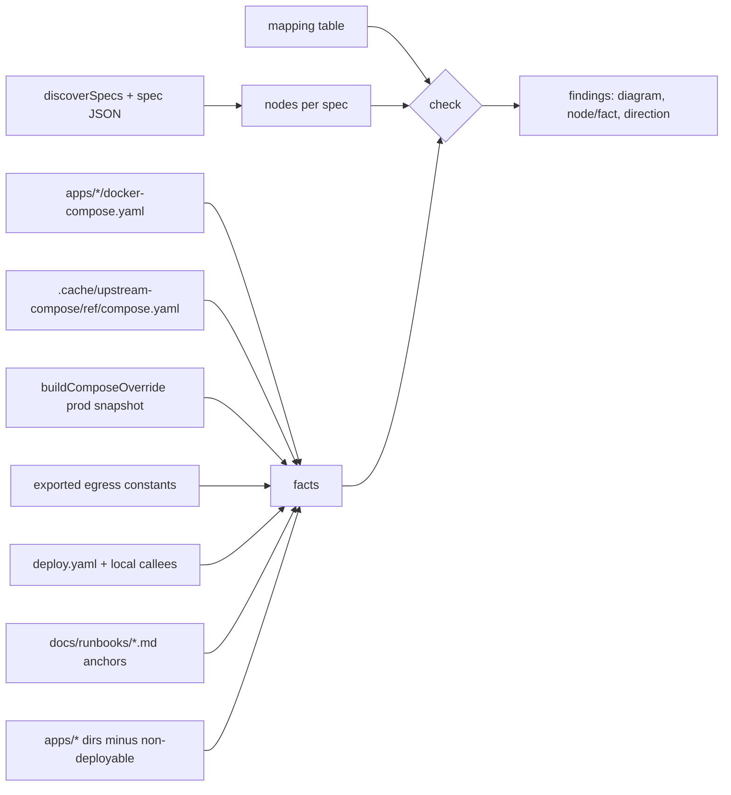

# feat: Fail CI when a published diagram drifts from the repo

## Overview

Add a drift check for the Archify diagrams published at `mrbro.dev/infra`. It fails CI when a diagram spec disagrees with the repo on a structural fact. A pure checker compares each spec against facts read from compose files, the gateway's upstream compose and override, the egress allowlist, the deploy workflows, and runbook headings. The comparison goes through an explicit mapping table and runs in every direction. CI and the autoheal run download the gateway's upstream compose file at the pinned ref, so the gateway facts are real. The same PR fixes the gaps the first run finds.

## Problem Frame

The 14 diagram specs in `apps/docs/diagrams/` are hand-written. The only freshness signal is the "spec last changed" label, which says when a spec was edited, not whether it is still true. A compose, workflow, egress or runbook change can leave a public diagram silently wrong (see origin: `docs/brainstorms/2026-11-03-diagram-drift-detection-requirements.md`).

## Requirements Trace

- R1–R4. Mapping table: one node may cover facts of several kinds. Illustrative and not-drawn entries need reasons. Egress hosts have no not-drawn entry. Labels, digests and pins are not checked.
- R5. Topology app nodes match the deployable `apps/*` directories.
- R6. Compose services and volumes match for broker, cliproxy, dashboard and umami. KeeWeb and VPN are declared to have no compose file.
- R7. The gateway diagram matches upstream `deploy/compose.yaml` at the pinned ref plus the production override.
- R8. Every workspace egress host is drawn.
- R9. Pipeline nodes match workflow jobs and the gate environment.
- R10. Runbook-map steps match heading anchors.
- R11–R12. Every direction is checked, and each failure names the diagram, the node or fact, and the direction.
- R13. The check runs in the CI test job.
- R14. The check never passes on a missing or empty source.
- Success criteria: every in-scope diagram passes after the PR, AE1–AE6 each have a mutation test, and a structure-free Renovate bump stays green.

## Scope Boundaries

- Labels, connection labels, card text, layout, image tags, digests and action pins are not checked.
- Gateway network membership is not checked.
- The `status-snapshot.dataflow` and `operator-path.sequence` diagrams are listed in the table as out of scope, with a reason.
- Runbook headings that no node maps to are not flagged, because a map draws one procedure, not the whole runbook.
- Source-line citations, "may be stale" flags, Fro Bot PR nudges and generated diagrams are out of scope.

### Deferred to Separate Tasks

- Mark `docs/plans/2026-11-01-001-feat-infra-docs-platform-plan.md` as `completed`. That is unrelated bookkeeping and goes in a separate docs change.

## Context & Research

### Relevant Code and Patterns

- `apps/docs/scripts/render-diagrams.ts`:
  - `discoverSpecs` defines the spec set the site renders.
  - Specs are named `<name>.<type>.json`. Architecture specs use `components`, and workflow specs use `nodes`.
- `apps/docs/scripts/render-diagrams.test.ts`:
  - It pins the 14 spec names and runs Archify validation, including layout (overlap and boundary wrapping).
  - It bans hostnames in spec text, so the egress node must use a generic label.
  - It has a hardcoded `MONITORED_APPS` topology assertion, which Unit 2 absorbs.
- `apps/gateway/src/deploy.ts` has no side effect on import:
  - `buildComposeOverride(opts)` returns YAML text and emits Caddy plus `caddy_data` and `caddy_config` when announce or the operator listener is enabled.
  - The egress allowlist is `CLIPROXY_EGRESS_HOST` plus `OPENCODE_CATALOG_HOSTS`, both module-private constants today.
  - `resolveUpstreamPin` reads `apps/gateway/upstream.json`, whose `ref` is a release tag.
  - Fixtures to reuse are in `apps/gateway/src/deploy.test.ts` (`OPERATOR_VPC_OVERRIDE_OPTS`, `GATEWAY_DIGEST`, `WORKSPACE_DIGEST`).
- `packages/cli/src/conventions.test.ts`:
  - The brokered-push set-equality test shows the missing / stale / duplicate failure-list style.
  - The router callee regex and `DEPLOY_NOTIFY_APPS` show how to parse the router.
- `apps/cliproxy/docker-compose.test.ts` parses compose with `Bun.YAML.parse`, so no YAML dependency is needed.
- fro-bot/agent's `deploy/` directory ships `*.test.mjs` files. `bun test --recursive` ignores `.gitignore` but skips dot-prefixed directories, so no upstream code may land in a non-dot path of the workspace.
- `.gitignore` already ignores `.cache/`.

### Institutional Learnings

- `docs/solutions/workflow-issues/shallow-ci-checkout-git-history-tests-skipif-2026-11-02.md`: the CI test job is shallow. This check needs only the working tree, so it never uses `skipIf`.
- `docs/plans/2026-04-16-001-feat-executable-conventions-tests-plan.md` (completed): use colocated Bun tests, resolve paths from `import.meta.dir`, and keep assertions plain.
- `docs/solutions/integration-issues/fro-bot-brokered-push-checkout-ref-2026-10-20.md`: read the checkout ref and anything that depends on it from one source.

## Prior-Art Survey

```json
{
  "schema_version": 2,
  "verdict": "build-new-within-scope",
  "scope": "apps/docs, apps/gateway, packages/cli/src, .github/workflows (repo tests and workflows)",
  "freshness": {
    "vcs_reference": "0e2195d8d185c1eb0e284a377c0033f9b38e1e0b"
  },
  "budget": {
    "max_search_passes": 3,
    "max_candidate_inspections": 10,
    "exhausted": false
  },
  "candidates": [
    {
      "path_or_symbol": "apps/docs/scripts/render-diagrams.test.ts: draws exactly the 7 monitored apps in the topology",
      "description": "Compares topology 'app-*' component ids against a hardcoded MONITORED_APPS list and asserts no app-agent.",
      "disposition": "insufficient",
      "insufficiency_reason": "Topology app nodes only, against a literal list rather than the apps/* directories; no mapping table, no compose, egress, pipeline or runbook checks, and no detection of a mapped fact that disappeared."
    },
    {
      "path_or_symbol": "apps/docs/scripts/render-diagrams.test.ts: diagram specs describe",
      "description": "Pins the 14 spec names, validates each with Archify, checks meta.output, runbook-map STOP/decision/irreversible tags, and bans hostnames and IP literals.",
      "disposition": "insufficient",
      "insufficiency_reason": "Schema and presentation checks only; none compares a node to a compose service, volume, job, egress host or heading anchor."
    },
    {
      "path_or_symbol": "packages/cli/src/conventions.test.ts: fro-bot.yaml: brokered-push app paths",
      "description": "Derives expected paths from apps/* directories and compares them to a workflow value with missing, stale and duplicate lists.",
      "disposition": "extend",
      "insufficiency_reason": "Reused as the pattern for multi-direction failure messages, not as code."
    },
    {
      "path_or_symbol": "packages/cli/src/conventions.test.ts: DEPLOY_NOTIFY_APPS and 'covers all seven apps the router fans out to'",
      "description": "Parses deploy.yaml, extracts callee apps from job 'uses' with a regex, and compares them to a literal list of 7 apps.",
      "disposition": "extend",
      "insufficiency_reason": "Its router parsing and callee regex are reusable for the pipeline check, but it never reads a diagram."
    },
    {
      "path_or_symbol": "apps/{broker,cliproxy,dashboard,umami}/docker-compose.test.ts",
      "description": "Per-app compose tests: digest pins, volume names, a line-based section() slicer or Bun.YAML.parse.",
      "disposition": "insufficient",
      "insufficiency_reason": "Pin and property checks on one compose file each; they never relate compose facts to a diagram and cover neither keeweb/vpn nor the upstream gateway compose."
    },
    {
      "path_or_symbol": "apps/gateway/src/deploy.test.ts: describe('buildComposeOverride') and describe('buildGatewayEnvFileContents')",
      "description": "Asserts override and env text with toContain for caddy, caddy volumes, secret mounts and the egress line.",
      "disposition": "insufficient",
      "insufficiency_reason": "String-contains checks; they do not parse the YAML, merge with the upstream compose, or compare to a diagram."
    },
    {
      "path_or_symbol": "apps/gateway/src/deploy.ts: buildComposeOverride, buildGatewayEnvFileContents, resolveUpstreamPin",
      "description": "Exported builders for the override YAML and the dotenv text carrying WORKSPACE_EGRESS_HOSTS, and the upstream.json reader.",
      "disposition": "reuse",
      "insufficiency_reason": "Called directly as fact sources; the egress constants are not exported, so the check parses the egress line from the env text."
    },
    {
      "path_or_symbol": "apps/docs/src/lib/runbook-links.ts: resolveRunbooks",
      "description": "Throws at build time when a service names a runbook slug with no file under docs/runbooks.",
      "disposition": "insufficient",
      "insufficiency_reason": "File existence only, not heading anchors, and it runs in the site build rather than the CI test job."
    },
    {
      "path_or_symbol": "packages/cli/src/commands/gateway/volume.ts (GATEWAY_COMPOSE_PROJECT_NAME) with volume.test.ts",
      "description": "Two-constant sync guard between the CLI volume naming and COMPOSE_PROJECT_NAME in apps/gateway/src/deploy.ts.",
      "disposition": "insufficient",
      "insufficiency_reason": "A single constant comparison, not a general consistency mechanism, and unrelated to diagrams."
    }
  ],
  "excluded_scopes": [
    {
      "scope": "packages/shared and packages/cli/src/status (status contract and AppId)",
      "reason": "Ties services to the status history schema, not diagram specs to compose, workflows or runbooks."
    },
    {
      "scope": "apps/docs/src components and Astro build gates (redaction gate, verify-status-output)",
      "reason": "Gate built output, not structural consistency between specs and sources; the hostname rule is recorded as a design constraint."
    },
    {
      "scope": "docs/solutions and docs/plans prior-art documents",
      "reason": "Covered by the separate past-work scan; the origin doc already records ideation #3 and its deferral."
    }
  ]
}
```

## Key Technical Decisions

- **Pure checker plus a thin real-repo wrapper.** The checker takes specs, a table and facts in memory and returns findings. The mutation tests feed it fixtures. The real-repo test reads files, calls the checker and asserts no findings. Tests never edit real files, which would race with parallel `bun test` workers, and gateway failures don't stop the other diagrams from being checked.
- **Facts are keyed by `(kind, file, id)`.** The kinds are app, service, volume, egress-host, job, environment and anchor. With the file in the key, the router's `deploy-keeweb` job and the callee's `deploy-keeweb` job are different facts. The `gate` node claiming a job's environment and the `deploy` node claiming the job itself can both be valid.
- **The table lives in the test file and is keyed by node.** Each node's value is either a list of facts or an illustrative reason, so "mapped and illustrative" can't be written. Not-drawn entries are a separate per-diagram list of facts with reasons. The checker reports only what the type can't rule out: a fact claimed by two nodes, a fact both mapped and not drawn, and duplicate node ids in a spec.
- **One node can cover several facts of several kinds.** For example, umami's `db` covers the `db` service and the `umami-db-data-pg18` volume, and each Caddy node covers the service and both Caddy volumes. This keeps the diagrams uncluttered. The only new nodes are gateway Caddy and a model-catalog egress node.
- **Gateway facts record which source they came from.** Upstream facts come from the downloaded upstream compose. Override facts come from `buildComposeOverride` with a production snapshot: announce, the operator listener and operator auth all enabled, as production runs today. The table documents that the Caddy facts hold while the operator listener is enabled; the test does not read production toggles. A service or volume the override declares but upstream doesn't define is accepted only when a table row claims it as an override fact. So an upstream rename of `workspace` still fails, because the override's `workspace` is then unclaimed by any override row and the new upstream name is undrawn.
- **Every rendered spec needs a table entry.** The spec set comes from `discoverSpecs`. A spec with no table entry fails, and so does a table entry with no spec. Specs outside v1 are listed as out of scope with a reason.
- **Egress facts come from exported constants and have no not-drawn option.** Export `CLIPROXY_EGRESS_HOST` and `OPENCODE_CATALOG_HOSTS` from `apps/gateway/src/deploy.ts`; nothing else in production code changes. The not-drawn type has no egress kind, and the checker never consults not-drawn entries for egress. Egress nodes use generic labels because spec text must not contain hostnames, and the table carries the host-to-node mapping.
- **Upstream compose is downloaded as a single data file, keyed by ref.** A run step reads `ref` from `apps/gateway/upstream.json`, rejects anything that isn't a release tag, and downloads fro-bot/agent's raw `deploy/compose.yaml` at that ref to `.cache/upstream-compose/<ref>/compose.yaml`. No checkout action and no third-party code land in the workspace, and `.cache` is dot-prefixed and already gitignored. Because the path carries the ref, a file fetched for an older pin is never read after a bump, so no stale-checkout guard is needed. The checker fails when the file for the current ref is missing or parses empty, and the message prints the exact download command.
- **Runbook anchors.** The heading text is rendered the way the site renders it: inline code, emphasis and link syntax are stripped, and fenced code (both ``` and ~~~) is skipped. The anchor comes from `github-slugger`, declared in `apps/docs` at the version Astro resolves, with one slugger per document so duplicates get the same `-1` suffix the site uses. The H1 is never an anchor, because `generate-content.ts` moves it to frontmatter. A mapped heading containing `<` fails, because `generate-content.ts` rewrites those.
- **Runbook-map steps are always mapped.** Every step maps to an anchor in its runbook. Several steps may share one anchor when a section covers more than one step. No runbook-map node is illustrative, so a renamed or removed heading can't fall out of the check.
- **The non-deployable app list is kept by name (`docs`, `agent`).** A new `apps/*` directory then fails until it is either drawn or added to the list. Deriving the list from the deploy workflows would silently ignore a new app that has no workflow yet.

## Open Questions

### Resolved During Planning

- Where the check lives: `apps/docs/scripts/`, next to the specs and `render-diagrams.ts`. CI's `bun test --recursive` already finds `apps/docs` tests.
- Whether the test may import from `apps/gateway`: yes. The rule that the CLI can't import app code applies to the published CLI bundle. This test lives in `apps/docs`, isn't published, and imports side-effect-free exports by relative path, which works under the isolated linker.
- Egress source: the two exported constants.
- Upstream source: the ref-keyed raw download (user decision), replacing the earlier sparse checkout of `deploy/`, which would have put upstream `*.test.mjs` files where `bun test --recursive` runs them.
- Slugger: declare `github-slugger` (user decision). `bun.lock` already resolves a single 2.0.0.
- Autoheal: the scheduled agent run in the `fro-bot-storage` job runs `bun test --recursive` from its prompt, so it gets the same download step (user decision).
- Broker `live`: illustrative. It is in-memory state with no compose volume.

### Deferred to Implementation

- Which runbook heading each runbook-map node maps to. That comes from reading each runbook against its spec, and the reviewer of the test diff decides.

## High-Level Technical Design

> _This illustrates the intended approach and is directional guidance for review, not implementation specification. The implementing agent should treat it as context, not code to reproduce._



Directions per checked spec:

1. A fact that is neither mapped nor listed as not-drawn fails. Egress facts have no not-drawn option. Runbook anchors skip this direction, because a map draws one procedure.
2. A mapped fact that no longer exists fails.
3. A spec node that is neither mapped nor illustrative fails.
4. A table row whose node isn't in the spec fails.
5. A fact claimed by two nodes, a fact both mapped and not drawn, and duplicate node ids fail.

## Implementation Units

- [ ] **Unit 1: Fact readers and pure checker**

**Goal:** Build the source readers and a pure `check` function that returns structured findings.

**Requirements:** R1–R12, R14

**Dependencies:** None

**Files:**

- Create: `apps/docs/scripts/diagram-drift.ts`
- Create: `apps/docs/scripts/diagram-drift.test.ts` (fixture-level tests)
- Modify: `apps/gateway/src/deploy.ts` (export `CLIPROXY_EGRESS_HOST` and `OPENCODE_CATALOG_HOSTS`)
- Modify: `apps/docs/package.json`, `bun.lock` (declare `github-slugger`)

**Approach:**

- Node extraction is per diagram type: `components` for architecture specs, `nodes` for workflow specs. An unknown type fails.
- Compose reader:
  - It parses with `Bun.YAML.parse` and reads names with `Object.keys` on `services` and `volumes`, because a `caddy_data:` entry with no body parses to null.
  - It fails on a null or empty parse, and on a top-level `include`.
  - Bind mounts are not volumes.
- Upstream reader: it resolves the repo root from `import.meta.dir`, reads the ref from `apps/gateway/upstream.json`, and reads `.cache/upstream-compose/<ref>/compose.yaml`. A missing file fails with the download command.
- Workflow reader:
  - It takes the router's local `uses:` callees and reads job ids per file. Anything it doesn't recognise fails closed.
  - It accepts `environment` as a string or as `{name}`.
  - Test for `on` keys with `in`, not truthiness, because `workflow_call:` parses to null.
- Runbook reader: produces anchors as described in Key Technical Decisions.
- Findings carry diagram, node or fact, and direction. Message text follows the acceptance examples. A gateway finding also names the three places to edit (the diagram spec, the table, and the `upstream.json` ref if the bump is the cause) and says that Fro Bot cannot push `apps/docs` changes, so a human makes the fix on a Renovate branch.

**Execution note:** Implement test-first: write a failing fixture test for each direction and each acceptance example before the checker logic (see `test-driven-development`).

**Patterns to follow:**

- `packages/cli/src/conventions.test.ts` brokered-push missing / stale / duplicate lists
- `apps/cliproxy/docker-compose.test.ts` (`Bun.YAML.parse`)

**Test scenarios:**

- Happy path: fixture specs, a table and facts that agree produce zero findings.
- AE1: a compose fixture gains a `redis` service and no node draws it. The finding is "apps-umami: compose service `redis` is neither drawn nor listed as not drawn."
- AE2: the router fixture renames `detect-changes`. A finding names node `detect`, `deploy.yaml` and the missing job.
- AE3: an upstream fixture gains a service, and a finding names it as undrawn. A second variant renames upstream `workspace` to `sandbox` while the override still declares `workspace`. It produces findings for `sandbox` undrawn and for the override's `workspace` not claimed by an override row.
- AE4: the egress fixture gains a host that no node draws, and a finding names it. Removing the egress branch from direction 1 makes this test fail.
- AE5: a spec fixture drops `certs` while its table row remains. The finding is "table row `certs` has no node in the spec."
- AE6: changing only an image digest in a compose fixture produces zero findings.
- Edge cases:
  - The same fact is claimed by two nodes.
  - A fact is both mapped and listed as not drawn.
  - A spec has duplicate node ids.
  - A node maps to a service plus a volume.
  - A `deploy-keeweb` job appears in both the router and a callee.
  - `environment: {name: x}`.
  - Inline-code, duplicate and `~~~`-fenced headings.
  - A fenced `# comment` is not an anchor.
  - Two runbook-map steps share one anchor.
- Error paths:
  - Empty or null compose parse.
  - A compose file with `include:`.
  - The upstream compose file for the current ref is missing, and the message names the download command.
  - A spec with no table entry, and a table entry with no spec.
  - A mapped heading containing `<`.
  - A declared no-compose app gains a compose file.

**Verification:**

- Each acceptance example and each direction has a fixture test that fails when the corresponding checker branch is removed (mutation-checked).

- [ ] **Unit 2: Mapping table, real-repo check, and day-one fixes**

**Goal:** Map every in-scope diagram, run the checker against the real repo, and fix the gaps the first run finds.

**Requirements:** R1–R13, success criteria

**Dependencies:** Unit 1. Locally it needs the upstream download, done by hand with the printed command or by Unit 3 in CI.

**Files:**

- Modify: `apps/docs/scripts/diagram-drift.test.ts` (the table and the real-repo test)
- Modify: `apps/docs/diagrams/apps/gateway.architecture.json` (add a gateway Caddy node and a model-catalog egress node)
- Modify: `apps/docs/scripts/render-diagrams.test.ts` (remove the `MONITORED_APPS` topology assertion, now covered here)

**Approach:**

- Gateway spec: add `caddy` at `pos [290,340]` inside the droplet boundary, and add it to that boundary's `wraps`. Add a `catalog` node with a generic label at `pos [1040,340]`. Add connections `caddy → gateway` and `mitm → catalog` (variant security). This combination passes Archify layout validation.
- Table rows by area:
  - Topology: every `app-*` node maps to its app, including `app-keeweb` and `app-vpn`. `gh-actions`, `operator-browser`, `ghcr`, `consumers` and `providers` are illustrative.
  - Each Caddy node maps to `caddy` plus `caddy_data` and `caddy_config`.
  - umami `db` maps to `db` plus `umami-db-data-pg18`.
  - cliproxy `auth` maps to `cliproxy_auth`.
  - broker `oidc`, `policy`, `mint` and `sweeper` map to the `broker` service. `live` is illustrative, since it is in-memory state.
  - dashboard `data` (bind mounts) is illustrative.
  - KeeWeb and VPN are declared to have no compose file. Every node inside their app diagrams is illustrative, with a reason, because no compose file defines them.
  - Gateway: `gateway`, `workspace`, `mitm`, `repos` and `certs` map to the upstream facts. The new Caddy node maps to the override facts, and `cliproxy` plus the new `catalog` node map to the three egress hosts. `webhook`, `dashboard`, `ghcr`, `discord` and `state` are illustrative. `state` is env-derived object storage.
  - Pipeline:
    - `detect` maps to `deploy.yaml#detect-changes`.
    - `reusable` maps to the 7 router callers.
    - `notify` maps to the 7 callee `notify` jobs.
    - `deploy` maps to the 7 callee deploy jobs.
    - `gate` maps to their 7 environments.
    - `push`, `discord` and `host` are illustrative.
    - `build-images`, `scan-images` and `validate-inputs` are not drawn: they are app-specific pre-deploy jobs that the generic pipeline diagram leaves out.
  - Runbook maps: every node maps to an anchor in its named runbook file.
  - `status-snapshot.dataflow` and `operator-path.sequence`: out of scope for v1, since neither has a single repo source of structural facts.
- Every illustrative, not-drawn and out-of-scope entry carries a reason.

**Patterns to follow:**

- `apps/docs/scripts/render-diagrams.test.ts` (spec fixtures, `REPO_ROOT` from `import.meta.dir`)

**Test scenarios:**

- Integration: the real-repo check returns zero findings with the upstream download present for the pinned ref.
- Integration: the override snapshot sanity check confirms that the snapshot emits `caddy`, `caddy_data` and `caddy_config`.
- Integration: the existing Archify validation in `render-diagrams.test.ts` still passes for the edited gateway spec, and the hostname ban still holds.

**Verification:**

- `bun test --recursive` passes with the download present, and fails with the download command without it.
- The rendered gateway diagram shows the new nodes, and the site build's redaction gate stays clean.

- [ ] **Unit 3: Upstream download in CI and autoheal**

**Goal:** Every CI and autoheal test run has the pinned upstream compose file, and no upstream code enters the workspace.

**Requirements:** R7, R13, R14

**Dependencies:** None (can land alongside Unit 1)

**Files:**

- Modify: `.github/workflows/ci.yaml` (test job: one download step before `bun test`)
- Modify: `.github/workflows/fro-bot.yaml` (`fro-bot-storage` job: the same step before `Run Fro Bot`)
- Test: `packages/cli/src/conventions.test.ts`

**Approach:**

- One run step, identical in both workflows. It reads `ref` from `apps/gateway/upstream.json` with `jq` and rejects a value that isn't a release tag. It then downloads `https://raw.githubusercontent.com/fro-bot/agent/<ref>/deploy/compose.yaml` to `.cache/upstream-compose/<ref>/compose.yaml`, failing on any HTTP error. It uses no token and no action.
- In `fro-bot-storage`, place the step after the dependency install and before `Run Fro Bot`, with a name other than `Checkout repository`. Leave the storage job's step-order constraints, AWS credential steps and git push step untouched.

**Patterns to follow:**

- `deploy-gateway.yaml` (`jq -r .ref apps/gateway/upstream.json`), and the existing `fro-bot.yaml` conventions tests

**Test scenarios:**

- Happy path: conventions tests assert that both jobs have the download step, read the ref from `apps/gateway/upstream.json`, validate it, and write under `.cache/upstream-compose/`. They also assert the step uses no `uses:` and no token.
- Edge case: a mutation that drops the ref validation, or swaps the download for a checkout action, fails the conventions test.

**Verification:**

- actionlint is clean, and the PR's CI test job downloads the file and passes the drift test.

- [ ] **Unit 4: Docs**

**Goal:** Document how to maintain the table and run the check locally.

**Requirements:** R12, R14 (operator ergonomics)

**Dependencies:** Units 1–3

**Files:**

- Modify: `apps/docs/AGENTS.md` (drift check: what it covers, how to update the table when a diagram or source changes, the out-of-scope diagrams)
- Modify: `AGENTS.md` (COMMANDS: the local download command, since `bun test --recursive` needs it)

**Approach:**

- The failure message and the root AGENTS.md COMMANDS line carry the download command. `apps/docs/AGENTS.md` covers table maintenance and points to the COMMANDS line rather than repeating it.
- No pinned versions in prose.

**Test scenarios:**

- Test expectation: none. This unit is documentation only.

**Verification:**

- The COMMANDS line matches the command the failure message prints.
- Prettier is clean on the touched docs, or no worse than baseline for files that already fail.

## System-Wide Impact

- **Interaction graph:**
  - The CI test job and the `fro-bot-storage` autoheal run each gain one download step. Only a YAML data file is written.
  - Every local `bun test --recursive` now needs the download, and fails with the command until it is done. After a gateway pin bump, the local run fails again until the new ref is downloaded.
- **Renovate:**
  - A gateway pin bump's CI downloads the new upstream compose, so a structural upstream change fails the Renovate PR until a human updates the diagram and the table on that branch.
  - Digest and version bumps that change no structure stay green.
- **Unchanged invariants:**
  - `deploy.ts` behavior is unchanged; it only gains two exports.
  - The `fro-bot.yaml` storage job ordering and credential handling are unchanged.
  - The site build pipeline and redaction gates are unchanged.
  - Archify spec schema conformance is kept, since no mapping data goes into the specs.

## Risks & Dependencies

| Risk | Mitigation |
| --- | --- |
| The raw download fails (outage or path moved upstream) | The step fails loudly in CI, and the checker's missing-file message names the cause. A moved path shows up on the Renovate PR that brings it |
| The local run is red until the download is done | The failure message prints the exact command, and root AGENTS.md carries it |
| The heading-to-node mapping is subjective | The diff reviewer checks it once. Later drift is caught by anchor existence |
| The override snapshot diverges from production toggles | Accepted and documented in the table: the Caddy facts hold while the operator listener is enabled. Disabling it is a deliberate operator change that should also update the diagram |

## Documentation / Operational Notes

- No deploy. The merge touches `.github/workflows/ci.yaml` and `fro-bot.yaml` only through one added download step each. `apps/gateway/src/deploy.ts` gains exports, so the router's gateway path filter starts a no-op gateway deploy at its gate, which can be approved or rejected.

## Sources & References

- **Origin document:** [docs/brainstorms/2026-11-03-diagram-drift-detection-requirements.md](../brainstorms/2026-11-03-diagram-drift-detection-requirements.md)
- Related code: `apps/docs/scripts/render-diagrams.ts`, `apps/gateway/src/deploy.ts`, `.github/workflows/deploy-gateway.yaml`
- Related past work: `docs/ideation/2026-10-31-infra-docs-platform-ideation.md` (#3, recorded as unexplored). This plan implements its conventions-test half.
- Related PRs: #1781 (requirements)
