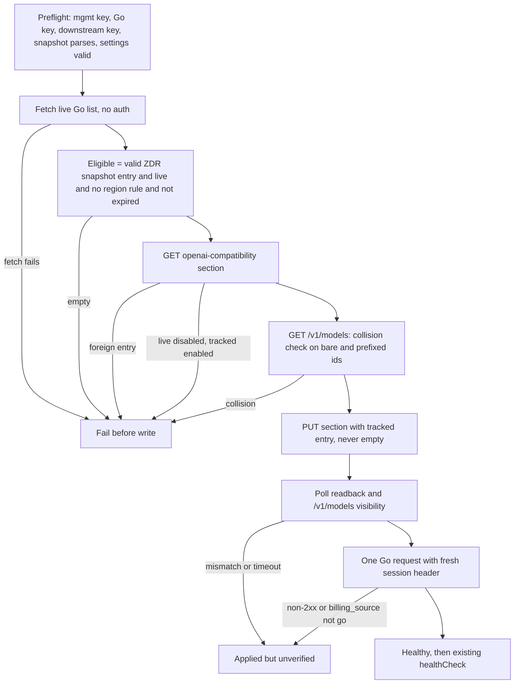

# feat: OpenCode Go behind CLIProxyAPI, Phase 1 (proxy route)

## Overview

This plan makes OpenCode Go models available through the CLIProxyAPI key each repo already holds.

- **Upstream entry:** the deploy owns one OpenAI-compatible upstream entry named `opencode-go`.
- **Model exposure:** a reviewed privacy snapshot decides which models are exposed. A scheduled workflow refreshes the snapshot through a PR.
- **Repo opt-in:** repos opt in through `agent setup`. The gateway workspace already accepts a Go model routed through the proxy.
- **Status and alerts:** the monitor and status treat the Go route as its own observation with its own alert.
- **Deferred:** broker-minted keys wait on a contract change in fro-bot/agent. Phase 2 (the direct route and the Console CLI) is out of scope.

## Problem Frame

See the origin document. Three things are missing today:

- cheaper agent runs
- a model path that keeps working when the proxy loses a provider credential
- a choice of Go models next to Claude and GPT

The provider set is hard-coded to Anthropic and OpenAI, so none of these are possible.

## Requirements Trace

Origin Phase 1 requirements R1–R15:

| Origin requirement                                    | Covered by                                    |
| ----------------------------------------------------- | --------------------------------------------- |
| R1 config-only upstream                               | Units 2, 3                                    |
| R2 no id collision                                    | Unit 3                                        |
| R3 guarded section write and readback                 | Units 2, 3                                    |
| R4 real billed request after apply                    | Unit 3                                        |
| R5–R7 snapshot-driven, fail-closed exposure           | Units 1, 3, 6                                 |
| R8 session header                                     | Units 3, 5                                    |
| R9 agent setup                                        | Unit 4                                        |
| R10 gateway                                           | Unit 7                                        |
| R11 broker                                            | Deferred in the origin (see Scope Boundaries) |
| R12 `cliproxy models` filter                          | Unit 4                                        |
| R13 separate status observation, public output limits | Unit 5                                        |
| R14 separate monitor state                            | Unit 5                                        |
| R15 quota and billing reasons                         | Unit 5                                        |

These success criteria carry forward unchanged:

- A real task with tool calls runs on Go through a repo's proxy key, and also from the gateway workspace.
- Switching a repo's model to Go keeps it running when the proxy loses Claude.
- A Go outage, a plan-limit hit or billing to the pay-as-you-go balance alerts on its own, without changing Claude's alert.

## Scope Boundaries

- No automatic failover. Each route is fixed at setup.
- No features for personal keys, plan status, remaining limits, budgets or credits. The Console has no API for any of them.
- Go is served only to the operator's own repos and agents.
- No custom executor, plugin or custom image.
- No direct Go access from the gateway workspace. Its egress allowlist gains no OpenCode inference host.
- Region-gated models are never exposed. That keeps DeepSeek out (origin R7).
- No new validation of the gateway `small_model`. Egress already blocks a direct Go `small_model`.

### Deferred to Separate Tasks

- **Broker-minted Go (origin R11).** I'll draft a fro-bot/agent issue proposing a versioned mint response that carries the proxy base URL, and you approve it before it's posted. Broker responses stay Anthropic+OpenAI until that contract lands.
- **Phase 2 (origin R16–R21).** This covers the billing probe, the direct route, service-account key lifecycle, the usage report and the Go status command. It gets its own plan after the probe.
- **A Go row on the public status site.** Phase 1 records `provider-route-go` in status and history and fixes the site's route selection, but the site shows no Go row yet.

## Context & Research

### Relevant Code and Patterns

- **Field-scoped apply:** `applyOAuthModelAliasStep` and `preflightManagementKeyCheck` in `apps/cliproxy/src/deploy.ts`, plus `packages/shared/cliproxy/management.ts`. This is the pattern to copy:
  - a bare-body PUT
  - readback that retries at 0, 500 and 1000 ms, only on a mismatch
  - set-equality comparison
  - no key material in errors
  - placement after `compose up --wait` and before `healthCheck`
- **Script-driven PR:** the `deploy-dashboard.yaml` "Open audit PR for compose pin" step. It uses the App token, a stable branch and `--force-with-lease`, and closes superseded PRs.
- **Pinned tokenless fetch:** `apps/docs/scripts/fetch-upstream-compose.ts`. It validates the ref, writes to a temp file and renames it, and takes an injectable `fetch`.
- **Hard-coded provider set:**
  - `agent/setup-core/providers.ts`: the zod enum, a private `MODEL_ID_RE` copy, `parseProviders` error strings, `PROVIDER_DEFAULTS`, prompt options and placeholder text.
  - `validation.ts`: the exported `MODEL_ID_RE`, `PROVIDER_ID_PATTERNS`, and `verifyModelsAvailable`. Its presence check matches ids only, and its OpenAI check is hard-coded.
  - `templates.ts`: `PROVIDER_ORDER`.
  - `index.ts`: the destructive-change confirmation, the default `['anthropic']` fallbacks, help text and examples.
  - `cliproxy/models.ts`: `VALID_PROVIDERS`, `PROVIDER_ID_PATTERNS`, `deriveProvider` and the unknown-provider error.
  - The `cliproxy/setup/*.ts` files are re-export shims, and their tests cover setup-core.
- **Gateway guard:** `buildGatewayEnvFileContents` in `apps/gateway/src/deploy.ts` doesn't care which provider is used. It requires `provider[<model prefix>].options.baseURL` to be on `cliproxy.fro.bot` and end in `/v1`.
- **Probe, monitor and status:**
  - `runProviderAuthProbe` in `cliproxy/status.ts`
  - `cliproxyMonitorAction` in `cliproxy/monitor.ts`, which reconciles one route only
  - `readMonitorState` and `parseProbeLine` in `status/monitor-state.ts`. These return one observation and reject repeated probe lines. `PROBE_REASON_STATE` is pinned by an exact-equality test.
  - `githubObservationsFor` in `status/github-reads.ts`, `StatusDependencies` in `commands/status-snapshot.ts`, and `commands/__fixtures__/status-dependencies.ts`
- **Status schema:** `packages/shared/status/history-schema.ts`. Reasons are slugs, observation ids are open strings, detail keys are a closed set, and `OBSERVATION_KINDS_BY_ID` must match `DECLARED_OBSERVATIONS`.
- **Public view:** `apps/docs/src/lib/history-view.ts`. `endToEndView` uses the first `end-to-end` observation, and `cellFor` takes the worst result across a kind.
- **Router filters:** in `deploy.yaml`, `packages/shared/cliproxy/**` triggers both the cliproxy deploy and the broker deploy. `renovate-changesets` excludes `packages/shared/**`.

### Institutional Learnings

- `docs/solutions/best-practices/cliproxy-management-api-field-apply-2026-06-20.md`
  - Whole-document `config.yaml` writes are banned.
  - Make one auth probe first and keep management calls serial, because 5 bad keys ban the IP.
- `docs/solutions/workflow-issues/opencode-v2-gateway-rollout-deploy-checks-do-not-prove-provider-routing-2026-10-31.md`: config readback doesn't prove routing. Send a real request.
- `docs/solutions/integration-issues/cliproxy-unpruned-image-store-disk-full-truncated-oauth-2026-10-31.md`: losing a provider shows up as `model_not_found`, which must count as dead.
- **Auth monitor rules.** It has three states: healthy, dead and unknown. Only definitive results change the issue, state is saved before Discord is called, and an unknown result never closes an outage.
- `docs/solutions/best-practices/upstream-data-file-download-not-checkout-bun-test-discovery-2026-11-04.md`: fetch only the one data file you need. Never check out the upstream repo.

### External References and Probe Results

- **CLIProxyAPI v8.0.54, read in source and confirmed against a local container on 2026-11-04:**
  - **`/v1/models`** lists both `glm-5.3` and `opencode-go/glm-5.3`, each with `owned_by: opencode-go`. Both forms route, and the response `model` is always the bare id.
  - **Session header.** `headers: {x-opencode-session: "$X-Opencode-Session"}` copies the client's header. Without that header, Go returns a 400 `MissingSessionID`, and the proxy passes the upstream body through unchanged.
  - **Billing fields.** `usage.opencode.billing_source: "go"` survives the proxy, and so do `list_cost` and `allowance`.
  - **Unknown or retired model id.** Bare or prefixed, it gets a local 400 with `code: model_not_found` and the message "unknown provider for model …". That costs nothing upstream.
- **Management API.**
  - **GET** returns `{"openai-compatibility":[...]}`. Each key entry gets an `auth-index`, `disabled` is always present, and the keys are in clear.
  - **PUT** accepts a bare array and replaces the whole list. **A bare `[]` is accepted and clears the section.** Only `{items: []}` is rejected, so the client guard is the only protection against wiping it.
  - **PATCH** `{name, value: {disabled: true}}` disables an entry. Its models leave `/v1/models` in about 180 ms, while the management GET still lists the entry. Requests then get `model_not_found`.
  - **Reload** after a PUT or PATCH takes about 180 ms.
  - **Logs.** Container logs at `debug: true` showed no key material.
- **Errors in general.** The status code survives the proxy, but non-passthrough bodies may be rewritten. A 429 or 402 can trigger retries and credential cooling.
- **OpenCode Go.**
  - `GET /inference/go/v1/models` needs no auth. It lists 28 ids, with no privacy fields.
  - Plan-limit errors are undocumented. A 402 means the balance is exhausted.
- **OpenCode client.** With the built-in `opencode-go` provider and a baseURL override, it sends the bare model id and adds the session header itself.
- **Privacy source.** The table in anomalyco/opencode `services/www/src/docs/content/console/go.mdx`. Region and expiry details live in prose footnotes.

## Prior-Art Survey

```json
{
  "schema_version": 2,
  "verdict": "extend",
  "scope": "marcusrbrown/infra: apps/cliproxy, apps/broker, apps/gateway, apps/docs, packages/shared/cliproxy, packages/shared/status, packages/cli (agent setup-core, cliproxy, status), .github/workflows",
  "freshness": {
    "vcs_reference": "origin/main 9d33e44"
  },
  "budget": {
    "max_search_passes": 3,
    "max_candidate_inspections": 10,
    "exhausted": true
  },
  "candidates": [
    {
      "path_or_symbol": "apps/cliproxy/src/deploy.ts#applyOAuthModelAliasStep",
      "description": "Deploy-owned field-scoped management apply with readback retry, set-equality, fail-closed, no key in errors, placed after compose up and before healthCheck",
      "disposition": "extend"
    },
    {
      "path_or_symbol": "apps/cliproxy/src/deploy.ts#preflightManagementKeyCheck",
      "description": "Pre-SSH management-key check with ban-aware 403 handling and early fail when tracked config needs the key",
      "disposition": "extend"
    },
    {
      "path_or_symbol": "packages/shared/cliproxy/management.ts",
      "description": "Management HTTP primitives plus alias-specific apply, readback and set-equality; no generic section helper",
      "disposition": "extend"
    },
    {
      "path_or_symbol": ".github/workflows/deploy-dashboard.yaml#Open audit PR for compose pin",
      "description": "Script-driven PR from the App token on a stable branch with force-with-lease and superseded-PR cleanup",
      "disposition": "extend"
    },
    {
      "path_or_symbol": "apps/docs/scripts/fetch-upstream-compose.ts",
      "description": "Pinned, tokenless single-file fetch with ref validation, atomic write and injectable fetch",
      "disposition": "extend"
    },
    {
      "path_or_symbol": "packages/cli/src/commands/agent/setup-core/",
      "description": "Provider set hard-coded to anthropic and openai across enum, defaults, order, id patterns, model verification and templates",
      "disposition": "extend"
    },
    {
      "path_or_symbol": "packages/cli/src/commands/cliproxy/models.ts",
      "description": "Model listing with VALID_PROVIDERS and owned_by-first provider derivation",
      "disposition": "extend"
    },
    {
      "path_or_symbol": "apps/gateway/src/deploy.ts#buildGatewayEnvFileContents",
      "description": "Provider-agnostic guard requiring provider[prefix].options.baseURL on cliproxy.fro.bot/v1",
      "disposition": "reuse"
    },
    {
      "path_or_symbol": "packages/cli/src/commands/cliproxy/status.ts#runProviderAuthProbe",
      "description": "Single-route probe with a fixed Claude model, no extra headers and no usage parsing",
      "disposition": "extend"
    },
    {
      "path_or_symbol": "packages/cli/src/commands/cliproxy/monitor.ts#cliproxyMonitorAction",
      "description": "Single-instance issue and Discord reconciler with fixed labels, markers, title, text and probe-line prefix",
      "disposition": "extend"
    },
    {
      "path_or_symbol": "packages/cli/src/status/monitor-state.ts",
      "description": "Reads one provider-route observation from one monitor job log; rejects multiple matching probe lines",
      "disposition": "extend"
    },
    {
      "path_or_symbol": "apps/broker/src/server.ts#buildAuthJson",
      "description": "Mint response is a bare auth.json map with no config or base URL channel",
      "disposition": "insufficient",
      "insufficiency_reason": "Cannot carry a proxy base URL, so Go cannot be minted without the upstream contract change; R11 is deferred"
    }
  ],
  "excluded_scopes": [
    {
      "scope": "apps/dashboard, apps/umami, apps/vpn, apps/keeweb, apps/agent",
      "reason": "Not on the Go route, snapshot, status or monitor path"
    },
    {
      "scope": "fro-bot/agent harness-integrate",
      "reason": "External consumer of the broker mint; handled by the deferred contract issue"
    }
  ]
}
```

## Key Technical Decisions

- **The deploy owns one entry and writes the section with guards.** There is no endpoint that creates an entry, so the deploy PUTs the whole `openai-compatibility` list with these guards:
  - If any live entry has a name other than `opencode-go`, the deploy stops before writing.
  - An empty live section means bootstrap.
  - The client refuses to send an empty list, because the server would accept it and clear the section.

  `apps/cliproxy/AGENTS.md` records this as the one section infra owns outright. The ban on whole-document writes stays.

- **The session header is mapped, never forwarded wholesale.** The entry sets `x-opencode-session: "$X-Opencode-Session"`. OpenCode clients send their own, and every probe we run sends a fresh one.
- **Secrets are repo-level.** The deploy-cliproxy caller job in `deploy.yaml` has no environment, so it can't resolve Environment-scoped secrets (actions/runner#4453).
  - `CLIPROXY_OPENCODE_GO_KEY` (new) and `CLIPROXY_API_KEY` (already used by the monitor) are repository secrets, passed explicitly from the router to `deploy-cliproxy.yaml`.
  - `deploy.ts` only gives them to its own HTTP calls. The environment handed to `ssh` and `scp` children never contains either key.
- **Fail-closed eligibility.** A model is eligible only when all of these hold:
  - The snapshot entry is valid and says zero-retention and no training.
  - The model is in the live Go list.
  - It has no region requirement.
  - Any agreement expiry is on or after the deploy date, comparing UTC dates with the expiry day included.

  An invalid field excludes only that model. Each of these fails the deploy before any write:
  - A snapshot file that doesn't parse.
  - A failed live-list fetch.
  - An empty eligible set.

  A live model that isn't in the snapshot is printed as excluded, and the deploy carries on. Expiry is enforced when the deploy runs. Between deploys, the monitor alerts on drift.

- **The monitor alerts on exposure drift.** Each Go probe compares what `/v1/models` shows under `owned_by: opencode-go` with what is eligible today, using the snapshot on `main`. If any exposed model isn't eligible, the route is dead with reason `privacy-noncompliant`.
  - If a snapshot PR that removes a model is merged but its deploy isn't approved yet, this fires. That's correct: the model is exposed and no longer eligible.
- **Failures after the write are "applied but unverified".** After a successful PUT, any of these fails with a distinct error that points at the runbook:
  - The readback doesn't match.
  - The models don't appear within the bounded poll. A reload takes about 180 ms, so the poll is a few seconds.
  - The smoke request fails.
  - The response doesn't carry `billing_source: go`.
- **Emergency disable without a deploy.** The runbook sends a PATCH with `{name: "opencode-go", value: {disabled: true}}`, then confirms the models are gone from `/v1/models`. The tracked `enabled` setting then goes to false in a PR.
  - The next deploy fails if the live entry is disabled while the tracked setting is still enabled.
  - While Go is disabled, the monitor reports `provider-missing` and the Go issue stays open as the record of the disable.
  - A suspected key leak also means rotating the Go key at the OpenCode Console.
- **Probe classification for Go:**

| Result                                            | Reason                                   | State   |
| ------------------------------------------------- | ---------------------------------------- | ------- |
| 2xx with `billing_source: go`                     | `ok`                                     | healthy |
| 2xx with any other or missing `billing_source`    | `billing-not-go`                         | dead    |
| `model_not_found`, or no eligible Go model listed | `provider-missing`                       | dead    |
| An exposed model that isn't eligible              | `privacy-noncompliant`                   | dead    |
| 429 or 402                                        | `quota-or-billing`                       | dead    |
| 401, or 503 matching the auth-unavailable marker  | `auth-401` / `auth-unavailable-503`      | dead    |
| A 400 `MissingSessionID`                          | `probe-misconfigured`                    | unknown |
| Any other non-2xx, a timeout or a network error   | `unrelated-http` / `timeout` / `network` | unknown |

Go documents plan windows (5 h, weekly, monthly), not per-minute limits. A 429 or 402 is therefore treated as a plan or balance limit, and the next healthy probe closes the alert. Go gets its own reason map, so a Claude probe line can never carry a Go reason, and the reverse holds too.

- **The probe model is picked from the live list.** Each probe lists `/v1/models`, keeps the ids owned by `opencode-go` that are also eligible, and prefers `settings.defaultProbeModel` when it's present. If none are left, the route is `provider-missing`. A model retired upstream therefore can't silence the route.
- **One monitor job covers both routes.** The same scheduled job probes Claude and Go.
  - Each route has its own probe-line prefix (`CLIProxy Go monitor probe:` for Go), label, identity marker, issue title and Discord text.
  - The routes reconcile independently, so a failure on one can't block the other.
  - `readMonitorState` returns one observation per route: `provider-route` and `provider-route-go`. A malformed line affects only its own route.
- **The public view selects routes by id.** `history-view.ts` builds the end-to-end cell, verdict and stale flag from `provider-route` by id. That way the Go observation can't blend into the Claude cell, and older samples that lack `provider-route-go` render exactly as they did before.
- **Snapshot and settings live in `packages/shared/opencode-go/`, which is outside `packages/shared/cliproxy/**`.**
  - The router's cliproxy filter gains this path and the broker filter doesn't, so a merged snapshot PR triggers only a gated cliproxy deploy.
  - `renovate-changesets` still excludes the path.
  - The package `exports` map gains the new subpaths. JSON is imported statically, so the CLI bundle inlines it.
- **Snapshot refresh.** A daily workflow, which can also be run on demand, does the following:
  1. Resolves the current `dev` head SHA of anomalyco/opencode.
  2. Fetches `go.mdx` at that SHA without a token.
  3. Parses it, failing closed on any row or footnote it can't map.
  4. Writes the snapshot with the source commit.
  5. Mints a scoped App token, then force-pushes the stable branch `opencode-go-privacy` with `--force-with-lease` and creates or edits the PR.

  The rules around that:
  - The App token gets `permission-contents: write` and `permission-pull-requests: write`, and only after the parse succeeds.
  - Checkout keeps `persist-credentials: false`. The token is given only to the push and `gh pr` steps.
  - The PR body lists model changes plus a compare link between the old and new source commits, so the review can check against the source.
  - Auto-merge stays off.

- **Setup uses the built-in provider.** `agent setup` writes `provider.opencode-go.options.baseURL` pointing at the proxy and an `opencode-go` auth entry holding the repo's existing proxy key. The model id is `opencode-go/<bare id>`.
- **Allowance budget.** A Go probe is one request at `max_tokens: 1`, costing about $0.00006 of allowance.
  - The monitor probes 96 times a day.
  - The deploy sends one request, and `cliproxy status` sends one per run.

  The runbook records these numbers.

## Open Questions

### Resolved During Planning

- **Wire model id:** bare. No forced prefix is needed.
- **Session header:** mapping works through the proxy. Confirmed in the local probe.
- **`billing_source` through the proxy:** preserved. Confirmed in the local probe.
- **Signal for a disabled entry or retired model:** `model_not_found`, matching `provider-missing`. Confirmed in the local probe.
- **Gateway change needed:** none. Only tests and docs.
- **Broker:** deferred behind the contract issue. This was your decision.
- **Deploy credential:** pass `CLIPROXY_API_KEY` as a repository secret. Your decision, made repo-level because of #4453.
- **Region-gated models:** never exposed. Your decision, keeping origin R7.
- **Quota alerting:** a 429 or 402 is dead with `quota-or-billing`. Your decision.

### Deferred to Implementation

- **Footnote grammar.** The exact grammar the parser accepts depends on the current `go.mdx`. The parser fails closed on anything it can't map.
- **Readback normalization.** It drops `auth-index` and treats `disabled: false` as the default. Implementation confirms nothing else differs on the live server.
- **Live section.** Check whether the live section is empty today. Preflight handles both cases. A read-only GET during implementation confirms which case applies at bootstrap.

## High-Level Technical Design

> _This illustrates the intended approach and is directional guidance for review, not implementation specification. The implementing agent should treat it as context, not code to reproduce._



## Implementation Units

- [x] **Unit 1: Privacy snapshot, settings and eligibility**

**Goal:** Add the tracked snapshot and settings, plus one pure eligibility module that the deploy, the monitor and the refresh script all share.

**Requirements:** R5, R6, R7

**Dependencies:** None

**Files:**

- Create: `packages/shared/opencode-go/privacy-snapshot.json`
- Create: `packages/shared/opencode-go/settings.json`
- Create: `packages/shared/opencode-go/eligibility.ts`
- Create: `packages/shared/opencode-go/parse-privacy-table.ts`
- Create: `packages/shared/opencode-go/__fixtures__/go.mdx`
- Create: `packages/shared/opencode-go/__fixtures__/go.expected.json`
- Modify: `packages/shared/package.json` (`exports` entries for the new modules and JSON)
- Test: `packages/shared/opencode-go/eligibility.test.ts`
- Test: `packages/shared/opencode-go/parse-privacy-table.test.ts`

**Approach:**

- **Snapshot.** It records the source repo, path and commit. Each model entry carries zero-retention, trains-on-data, region requirement and agreement expiry. The file is checked with a strict zod schema. A model whose entry fails validation becomes ineligible on its own, and a file that doesn't parse fails outright.
- **Settings.** `settings.json` carries `enabled` and an optional `defaultProbeModel`.
- **Parser.** It maps the Markdown table and its footnotes to snapshot entries, and fails on any row or footnote it can't map.
- **Eligibility.** It takes the snapshot, the live id list and today's UTC date. It returns the eligible ids plus the excluded ids, each with a reason. It never returns a partial result on bad input.
- **First snapshot.** It is generated from the current file and reviewed by hand in this change.

**Execution note:** Test-first.

**Patterns to follow:**

- the strict zod schemas in `packages/shared/status/history-schema.ts`

**Test scenarios:**

- Happy path: a zero-retention, no-training model that is present in the live list is eligible.
- Edge case: a model that trains on data is excluded.
- Edge case: a region-gated model is always excluded.
- Edge case: an expiry dated today is eligible. An expiry dated yesterday is excluded.
- Edge case: a live model missing from the snapshot is excluded with a reason. A snapshot model missing from the live list is excluded.
- Edge case: one entry with an invalid field is excluded, and its siblings stay eligible.
- Error path: a malformed snapshot file fails to parse.
- Error path: the parser fails on an unmapped footnote, a missing column, or zero rows.
- Integration: the fixture `go.mdx` parses to exactly `go.expected.json`. Both fixture files stay fixed, and no test compares them with the committed snapshot, so a refresh that changes the snapshot never invalidates the parser tests.
- Integration: the committed snapshot passes the schema, records a 40-hex source commit, and lists at least one eligible model.

**Verification:**

- The committed snapshot parses.
- Eligibility against a fixture of the real live list returns a non-empty set with no DeepSeek model in it.

- [x] **Unit 2: Management primitives for the upstream section**

**Goal:** Add generic GET, PUT, PATCH-disable, normalization and comparison for `openai-compatibility`.

**Requirements:** R1, R3

**Dependencies:** None

**Files:**

- Modify: `packages/shared/cliproxy/management.ts`
- Test: `packages/shared/cliproxy/management.test.ts`

**Approach:**

- **GET** unwraps `{"openai-compatibility": [...]}`.
- **PUT** sends a bare array. It throws before any request if the list is empty.
- **PATCH** sends `{name, value: {disabled}}`.
- **Normalization** drops `auth-index` and defaults `disabled: false` before comparing. Models compare as a set.
- **Errors** name fields and entries only, never an `api-key` value.
- Every function accepts an injectable `fetch`.

**Patterns to follow:**

- `applyOAuthModelAlias`, `readBackOAuthModelAlias` and `setEqualOAuthModelAlias`

**Test scenarios:**

- Happy path: the PUT body equals the tracked entry. A readback carrying `auth-index` and `disabled: false` compares equal.
- Edge case: models listed in a different order compare equal.
- Error path: a PUT with an empty list throws before any request. The fake fetch records no request.
- Error path: a 4xx or 5xx produces an error that contains no fixture key value.
- Happy path: the PATCH disable body is exactly `{name, value: {disabled: true}}`.

**Verification:**

- Tests pass, and every error path carries a key-leak assertion.

- [x] **Unit 3: Deploy step and secret wiring**

**Goal:** The cliproxy deploy applies the Go entry with a full preflight, verifies it, and proves routing works.

**Requirements:** R1, R2, R3, R4, R7, R8

**Dependencies:** Units 1 and 2

**Files:**

- Modify: `apps/cliproxy/src/deploy.ts`
- Test: `apps/cliproxy/src/deploy.test.ts`
- Modify: `.github/workflows/deploy-cliproxy.yaml`
- Modify: `.github/workflows/deploy.yaml` (secret pass-through; cliproxy filter gains `packages/shared/opencode-go/**`)
- Test: `packages/cli/src/conventions.test.ts`

**Approach:**

- **Preflight before SSH.** When tracked `enabled` is true, preflight runs before any SSH, the same way the alias block does. It requires:
  - `CLIPROXY_OPENCODE_GO_KEY` and `CLIPROXY_API_KEY`
  - a snapshot that parses
  - valid settings
  - a non-empty eligible set
- **Placement.** The step runs after the alias step and before `healthCheck`, in the order shown in the High-Level Technical Design. Management calls stay serial and rely on the existing single management-key probe.
- **Collision check.** Before the write, `/v1/models` is read with the downstream key. The deploy fails if any eligible bare or prefixed id is already served under a different `owned_by`.
- **Visibility poll.** After the write, the deploy polls until every eligible id appears in both forms, each exactly once and with `owned_by: opencode-go`.
- **Smoke request.** It sends one non-streaming request at `max_tokens: 1` to the chosen probe model, with a fresh session id, and requires a 2xx with `billing_source: go`.
- **Disabled setting.** When tracked `enabled` is false, the entry is applied with `disabled: true`, the smoke request is skipped, and visibility expects zero Go ids.
- **Workflow secrets.** `deploy-cliproxy.yaml` declares both secrets as optional `workflow_call` secrets and passes them into the Deploy step env. `deploy.ts` preflight is the only gate on them, and the workflow doesn't validate them separately. `getDeployEnv` and `DeployEnv` gain both names, and the `ssh`/`scp` spawn env leaves them out.
- **Output.** The step prints the eligible count, the excluded ids with their reasons, and a success line. It never prints a key or session id.

**Execution note:** Test-first. Start with preflight and the guards that run before the write.

**Patterns to follow:**

- `applyOAuthModelAliasStep`
- the URL-routed `makeAliasFetch` fake
- `noopSleep`

**Test scenarios:**

- Happy path: an empty live section bootstraps. The PUT carries the entry with the session mapping, readback matches, both id forms become visible, and the smoke returns a 2xx with `billing_source: go`. The deploy passes.
- Edge case: a live entry already identical to the tracked one is PUT again and verified (idempotent).
- Edge case: a live model that is not in the snapshot is printed as excluded, and the deploy still passes.
- Edge case: `enabled: false` applies `disabled: true`, sends no smoke request, and expects no Go ids.
- Error path: each of these fails before the PUT:
  - a foreign live entry (the error names it and leaks no key)
  - a live entry that is disabled while tracked `enabled` is true
  - a failed live-list fetch
  - an empty eligible set
  - an unparseable snapshot
  - a collision with a Claude id
- Error path: a readback mismatch, a visibility timeout, a smoke non-2xx, or a 2xx with `billing_source: balance` or none each produce "applied but unverified".
- Error path: a missing Go key or downstream key while `enabled` is true fails in preflight, before SSH.
- Integration:
  - Every Go and smoke request carries a non-empty `x-opencode-session`.
  - Every management call carries `x-management-key`.
  - The `ssh`/`scp` spawn env contains neither key.
  - No captured log line contains any key.
- Conventions:
  - The callee declares both secrets and puts them in the Deploy env.
  - The router passes them explicitly.
  - The cliproxy filter includes `packages/shared/opencode-go/**`, and the broker filter does not.

**Verification:**

- After merge, the live deploy prints its success line.
- `/v1/models` lists the eligible ids under `owned_by: opencode-go`.

- [x] **Unit 4: `agent setup` and `cliproxy models` provider**

**Goal:** Let repos choose Go routed through the proxy, and let model listing filter to Go.

**Requirements:** R9, R12

**Dependencies:** Unit 3 must be deployed before live verification. Implementation doesn't depend on it.

**Files:**

- Modify: `packages/cli/src/commands/agent/setup-core/providers.ts`
- Modify: `packages/cli/src/commands/agent/setup-core/validation.ts`
- Modify: `packages/cli/src/commands/agent/setup-core/templates.ts`
- Modify: `packages/cli/src/commands/agent/setup-core/index.ts`
- Modify: `packages/cli/src/commands/cliproxy/models.ts`
- Test: `packages/cli/src/commands/cliproxy/setup/providers.test.ts`
- Test: `packages/cli/src/commands/cliproxy/setup/validation.test.ts`
- Test: `packages/cli/src/commands/cliproxy/setup/templates.test.ts`
- Test: `packages/cli/src/commands/cliproxy/setup.test.ts`
- Test: `packages/cli/src/commands/cliproxy/models.test.ts`
- Create: `.changeset/opencode-go-provider.md`

**Approach:**

- **Provider list.** `opencode-go` joins the enum, the order, the defaults, both `MODEL_ID_RE` copies, the prompt options and the error strings.
- **Model check.** `verifyModelsAvailable` looks for the chosen model with `owned_by: opencode-go`. That is a code change, because today the check matches on id only. When the model is missing, the hint names the cliproxy deploy.
- **Templates.** They add `provider.opencode-go.options.baseURL` and an `opencode-go` auth entry that uses the same proxy key.
- **Confirmation.** Adding Go goes through the existing confirmation for destructive changes.
- **`cliproxy models`.** It accepts `opencode-go` and filters by `owned_by`, keeping the command's existing id display.
- **Changeset.** Minor.

**Patterns to follow:**

- the `openai` opt-in

**Test scenarios:**

- Happy path: `--providers anthropic,opencode-go --model opencode-go/glm-5.3` writes both providers' base URLs, plus auth for both under one key.
- Edge case: an `opencode-go/...` model without `opencode-go` in `--providers` is rejected.
- Edge case: the check passes when `glm-5.3` is listed with `owned_by: opencode-go`. When it isn't, the check fails with the deploy hint.
- Edge case: `cliproxy models opencode-go` lists only `opencode-go`-owned entries. The unknown-provider error names all three providers.
- Happy path: the anthropic-only and openai cases are unchanged.
- Integration: the MCP tools list is unchanged.

**Verification:**

- After the deploy, a dry-run of setup against a scratch repo shows the expected config and auth.

- [x] **Unit 5: Two-route probe, monitor and status**

**Goal:** Go gets its own probe, alert state, and status observation, and the public view stops mixing routes.

**Requirements:** R8, R13, R14, R15

**Dependencies:** Unit 1

**Files:**

- Modify: `packages/cli/src/commands/cliproxy/status.ts`
- Modify: `packages/cli/src/commands/cliproxy/monitor.ts`
- Modify: `packages/cli/src/status/monitor-state.ts`
- Modify: `packages/cli/src/status/github-reads.ts`
- Modify: `packages/cli/src/status/declared.ts`
- Modify: `packages/shared/status/history-schema.ts`
- Modify: `packages/cli/src/commands/status-snapshot.ts`
- Modify: `packages/cli/src/commands/__fixtures__/status-dependencies.ts`
- Modify: `apps/docs/src/lib/history-view.ts`
- Test: `packages/cli/src/commands/cliproxy/status.test.ts`
- Test: `packages/cli/src/commands/cliproxy/monitor.test.ts`
- Test: `packages/cli/src/status/monitor-state.test.ts`
- Test: `packages/cli/src/status/declared.test.ts`
- Test: `apps/docs/src/lib/history-view.test.ts`
- Create: `.changeset/opencode-go-status.md`

**Approach:**

- **Probe.** The probe takes a route (Claude or Go). The Go route does the following, using the classification table in Key Technical Decisions:
  1. List `/v1/models`.
  2. Check drift against eligibility.
  3. Pick the probe model.
  4. Send one request with a fresh session id.
  5. Classify the result.
- **Separate reason maps.** Each route has its own reason union and state map, so the exact-equality tests pin both.
- **Monitor.** Route-specific constants hold the label, identity marker, title, Discord text and probe-line prefix.
  - Each route is probed and reconciled on its own.
  - The exit code reflects an operational failure in either route.
- **Monitor state.** `readMonitorState` returns one observation per route. `githubObservationsFor` and `StatusDependencies` are updated to match.
- **Declared observations.** `provider-route-go` is declared as `end-to-end`, with source `monitor`.
- **Public output.** It carries route state and reason class only. Cost and usage never become detail keys.
- **Public view.** `history-view.ts` builds the end-to-end cell, verdict and stale flag from `provider-route` by id.

**Execution note:** Test-first. Start with the Go classification table.

**Patterns to follow:**

- `runProviderAuthProbe`
- `formatMonitorProbeLine`
- the `provider-missing` precedent from 2026-10-31

**Test scenarios:**

- Happy path: a Go 2xx with `billing_source: go` is `ok`/healthy. Both probe lines print, and neither issue is touched.
- Error path: every dead row in the Go classification table opens a Go issue and sends Discord, and leaves the Claude issue alone:
  - `provider-missing`, from an empty list or `model_not_found`
  - `privacy-noncompliant`
  - `billing-not-go`
  - `quota-or-billing` (429 or 402)
  - `auth-401`
  - `auth-unavailable-503`
- Edge case: a 400 `MissingSessionID` is `probe-misconfigured`/unknown, and the issue isn't changed.
- Edge case: a Go recovery after `quota-or-billing` closes the Go issue.
- Edge case: when the preferred probe model is missing from the live list, the next eligible id is used. When no eligible id is left, the result is `provider-missing`.
- Edge case: Claude dead and Go healthy reconcile independently. A Go reconciliation failure doesn't block Claude.
- Integration: every Go probe request carries a non-empty `x-opencode-session`.
- Integration: two probe lines in one job log yield two observations. A malformed Go line makes only `provider-route-go` unknown. A Claude line carrying a Go-only reason is rejected.
- Integration: history merges older samples that lack `provider-route-go`.
- Integration: the public view's cliproxy end-to-end cell comes from `provider-route` alone. A `provider-route-go` fail doesn't change it.
- Integration: no cost or usage value appears anywhere in the output.

**Verification:**

- After the deploy, a monitor run started by dispatch prints both probe lines.
- The next status snapshot carries `provider-route-go`.

- [x] **Unit 6: Scheduled privacy-snapshot refresh workflow**

**Goal:** Reviewed snapshot changes arrive by PR, with no hand-editing.

**Requirements:** R6

**Dependencies:** Unit 1

**Files:**

- Create: `apps/cliproxy/scripts/refresh-go-privacy.ts`
- Test: `apps/cliproxy/scripts/refresh-go-privacy.test.ts`
- Create: `.github/workflows/opencode-go-privacy.yaml`
- Modify: `package.json` (root script `refresh:go-privacy`)
- Test: `packages/cli/src/conventions.test.ts`

**Approach:**

- **Script.** It resolves the `dev` head SHA without a token and validates it as 40 hex characters. It then fetches `go.mdx` at that SHA from `raw.githubusercontent.com`, parses it with the Unit 1 parser, and writes the snapshot atomically only when the parse succeeds.
- **Workflow token and checkout.** These follow the snapshot refresh rules in Key Technical Decisions.
- **PR.** The PR body lists added, removed and changed models with their privacy fields, plus the source compare link. A failed parse fails the run and opens no PR.
- **Conventions.** SHA-pinned actions with version comments, a concurrency group, no `secrets: inherit`.

**Patterns to follow:**

- the `deploy-dashboard.yaml` audit-PR step, for branch and PR handling only. Not its checkout, which persists the token.
- `fetch-upstream-compose.ts`

**Test scenarios:**

- Happy path: an unchanged table writes nothing and exits 0.
- Happy path: a changed row writes a new snapshot with the new source commit.
- Integration: after a refresh writes a snapshot with an added, removed and changed model, the Unit 1 parser and snapshot tests still pass without any fixture edit.
- Error path: a fetch failure, a parse failure or zero rows leaves the existing snapshot untouched and exits non-zero.
- Error path: a SHA from the API that isn't hex is rejected before the raw fetch.
- Conventions:
  - Every action is pinned.
  - Checkout uses `persist-credentials: false`.
  - The App token is minted after the parse step with exactly `permission-contents: write` and `permission-pull-requests: write`.
  - The branch name is a single fixed name.
  - The workflow doesn't enable auto-merge.
  - The changed path sits under the `renovate-changesets` exclude pattern.

**Verification:**

- A dispatched run with no upstream change exits clean.
- A fixture change in the script test produces the expected PR body.

- [x] **Unit 7: Gateway Go acceptance pins**

**Goal:** Prove the gateway accepts Go routed through the proxy and still rejects direct Go, without changing the guard.

**Requirements:** R10

**Dependencies:** None

**Files:**

- Test: `apps/gateway/src/deploy.test.ts`
- Modify: `apps/gateway/AGENTS.md`

**Approach:**

- Tests only. Document the three workspace values for proxy-routed Go:
  - `WORKSPACE_OPENCODE_MODEL=opencode-go/<id>`
  - `WORKSPACE_OPENCODE_CONFIG`, carrying the `opencode-go` proxy base URL
  - `WORKSPACE_OPENCODE_AUTH`, carrying an `opencode-go` entry with the scoped key

**Test scenarios:**

- Happy path: `opencode-go/glm-5.3` with the proxy `/v1` base URL passes.
- Error path: the same model with a direct OpenCode base URL is rejected.
- Error path: the same model with no `opencode-go` provider block is rejected.
- Edge case: the egress hosts line is unchanged.

**Verification:**

- The tests pass against the unchanged guard, and mutating its host check makes them fail.

- [ ] **Unit 8: Docs, runbook and rule amendment**

**Goal:** Record the new rule, the secrets, the rollout steps and the operator procedures.

**Requirements:** R3 (rule record); R13–R15 (operator surface)

**Dependencies:** Units 3–6

**Files:**

- Modify: `apps/cliproxy/AGENTS.md`
- Modify: `AGENTS.md`
- Modify: `packages/cli/AGENTS.md`
- Modify: `README.md`
- Modify: `apps/cliproxy/README.md`
- Modify: `apps/broker/AGENTS.md`
- Modify: `docs/solutions/best-practices/cliproxy-management-api-field-apply-2026-06-20.md`
- Create: `docs/runbooks/cliproxy-opencode-go.md`

**Approach:**

- **`apps/cliproxy/AGENTS.md`:** describe the Go entry and the rule for writing the guarded section, the two repository secrets, the monitor's second route, and the config shapes for three providers. Fix the existing text that wrongly calls the SSH and management keys Environment-scoped.
- **Root `AGENTS.md`:** add the new secret to the NOTES list and update the `cliproxy models` row.
- **Runbook:** cover these operator procedures:
  - Enablement order.
  - Go key rotation.
  - Emergency disable and re-enable. A suspected key leak means disable plus rotation. A privacy or billing issue means disable only. The management key is supplied through an env var, never argv.
  - The expiry limitation.
  - The allowance per probe.
  - The window between a snapshot merge and its deploy.
- **Broker note:** Go is deferred until the agent contract exists.

**Test expectation:** none. This unit is docs only.

**Verification:**

- The frontmatter test, prettier and the redaction source gate pass.
- Each new secret name appears in both AGENTS.md files and in the runbook.

## System-Wide Impact

- **Interaction graph:**
  - The cliproxy deploy gains two repository secrets and depends on OpenCode's public Go list.
  - The monitor gains one Go request per run.
  - Unified status gains `provider-route-go`.
  - A merged snapshot PR triggers only the gated cliproxy deploy.
- **Error propagation:**
  - A failure before the write leaves the live proxy unchanged.
  - A failure after the write is reported as "applied but unverified".
  - Go monitor results never touch the Claude issue.
- **State lifecycle risks:**
  - A live disabled entry blocks re-enabling until the tracked setting agrees.
  - Expiry is enforced at deploy time, and the monitor alerts on drift between deploys.
- **API surface parity:**
  - `status --json` gains an observation, which the schema allows.
  - `cliproxy models` gains a provider value.
  - The MCP tools list is unchanged.
- **Unchanged invariants:**
  - The ban on whole-document `config.yaml` writes.
  - Ownership of the api-keys.
  - The alias step.
  - Broker responses and the broker deploy trigger.
  - The gateway guard and egress allowlist.
  - The Claude probe's model and reasons.
  - The public site's Claude cell.

## Risks & Dependencies

| Risk | Mitigation |
| --- | --- |
| The section PUT removes a hand-added upstream entry | The deploy refuses to write on any foreign entry, and the client never sends an empty list |
| Privacy table format changes upstream | The parser fails closed, the refresh opens no PR, and the deploy keeps the reviewed snapshot |
| A parsed footnote maps wrong and marks a model zero-retention | A human reviews the PR with the source compare link, and auto-merge stays off |
| A model with an expiry stays exposed between deploys | The monitor reports `privacy-noncompliant` as dead, and the runbook covers disable |
| Management-key holders, including the broker, can read the Go key in clear | That key already reads downstream api-keys in clear and can rewrite any upstream section, so the Go key adds a paid credential to an existing blast radius. Removing the broker's need for the management key is outside this plan. |
| A 429 or 402 alerts on a transient limit | The next healthy probe closes the alert, and Go documents plan windows rather than per-minute limits |
| Probe allowance use | About 100 single-token requests a day, recorded in the runbook |

## Documentation / Operational Notes

**Rollout:**

1. The operator adds the `CLIPROXY_OPENCODE_GO_KEY` repository secret.
2. Merge the implementation PR.
3. Approve the cliproxy gate.
4. Verify:
   - The deploy success line.
   - `/v1/models` lists the eligible Go ids.
   - A monitor run started by dispatch prints both probe lines.
   - A real agent task with tool calls runs on a Go model through a scratch repo's proxy key.
   - A gateway workspace run on a Go model succeeds.
   - A Claude request through the same key still reaches Claude.

**Also:** draft the fro-bot/agent broker contract issue for you to approve. It won't be posted without your approval.

## Sources & References

- **Origin document:** [docs/brainstorms/2026-11-04-opencode-go-behind-cliproxy-requirements.md](../brainstorms/2026-11-04-opencode-go-behind-cliproxy-requirements.md)
- **Related past work:**
  - `docs/brainstorms/2026-05-25-fro-bot-openai-routing-opt-in-requirements.md`, recorded as completed. It added a second OAuth provider. This plan adds an API-key upstream with privacy gating.
  - `docs/plans/2026-08-01-001-feat-agent-s3-durable-storage-plan.md`, recorded as completed. It made `agent setup` the owner of model credentials, and this plan extends that.
- **External:**
  - CLIProxyAPI v8.0.54 source, plus a local container probe on 2026-11-04
  - OpenCode Console Go and inference docs
  - anomalyco/opencode `services/www/src/docs/content/console/go.mdx`
