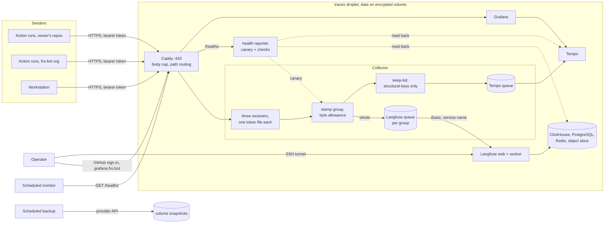
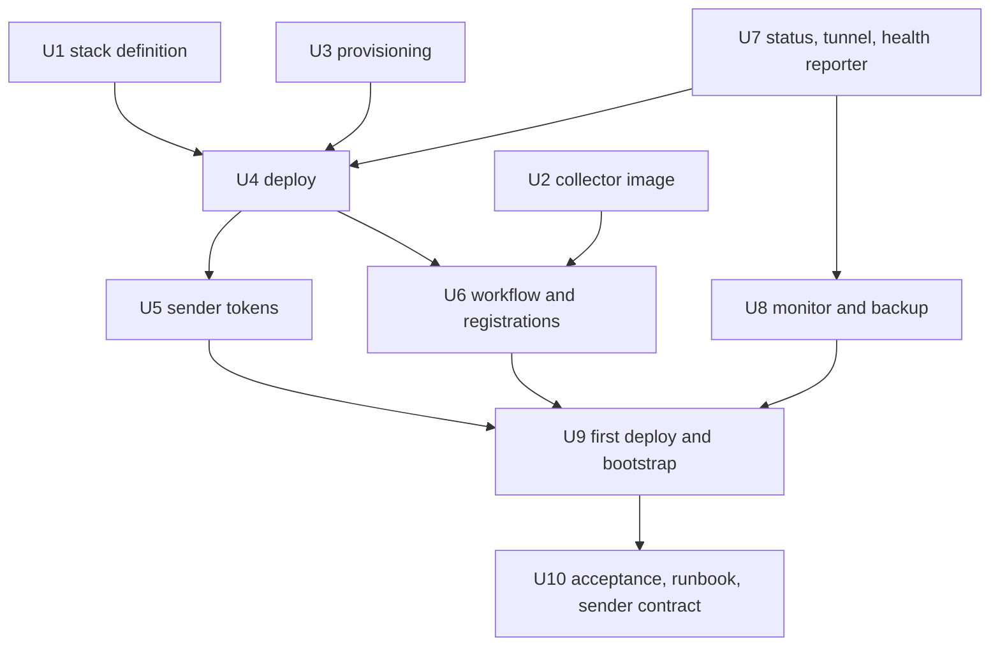

# feat: Add a trace collection stack for agent runs (collector, Langfuse, Tempo, Grafana)

## Overview

Add a new app, `apps/traces`, on its own droplet. A collector accepts OTLP over HTTP on one public hostname, tells three sender groups apart by bearer token, limits each group by bytes, and sends every trace two ways: whole to self-hosted Langfuse, and with content removed to Tempo. Grafana reads Tempo on a public hostname limited to one GitHub account. Langfuse is reached through an SSH tunnel only. Nothing is built until this plan is approved.

## Problem Frame

`fro-bot/agent` is gaining opt-in tracing of OpenCode runs. Its plugin records each model call, tool call and subagent as `gen_ai` spans with their content and posts them to a collector the operator controls (see `fro-bot/agent` `docs/brainstorms/2026-11-19-opencode-run-tracing-requirements.md`, which puts the collector and backends outside that repository). This repository has no collector, no trace store and no host large enough for one. The senders are GitHub-hosted runners and a workstation, so ingest must be public, and a credential on a runner can leak. Traces hold prompt text, private repository content, other people's text and any secret that scrubbing missed.

## Requirements Trace

- R1. A collector accepts OTLP/HTTP JSON at a public HTTPS endpoint with a publicly trusted certificate and forwards every trace to Langfuse and Tempo. No gRPC.
- R2. Self-hosted Langfuse at a current release is where runs are read: a readable transcript, grouped by root session.
- R3. Tempo stores trace structure and is queried from Grafana.
- R4. One ingest credential per sender group (the owner's repositories, the fro-bot organisation, the workstation), write-only and revocable alone. Senders hold only a collector credential. The collector holds the backend credentials.
- R5. A request size cap and a per-credential byte limit. The collector does not truncate content on its way to Langfuse. The plan states every effective limit.
- R6. 30-day retention in both backends.
- R7. Langfuse and Grafana are for the operator only. Ingest is the only path open to senders.
- R8. Stores are encrypted at rest where the platform supports it, have no public read path, and use no third-party service. Backups are handled like the data.
- R9. The stack follows this repository's conventions for compose, secrets, proxy, TLS, DNS, deploy, pins, Renovate and monitoring.
- R10. Monitoring and alerting cover ingest errors, queue depth, disk and the losses a sender cannot see.
- R11. A runbook covers issuing and revoking a sender credential, sender-side configuration and ingest health. A rollback removes everything.
- R12. Trace data is backed up daily, and a restore is proven.
- R13. A privacy notice is published before any real sender is enabled.

**Acceptance examples**

- AE1. A test sender posts one trace of 20 spans, each with a 500 KB JSON-string content attribute, using a sender token. All 20 spans are readable in Langfuse with the attribute intact, and the trace is found in Grafana by id with 20 spans.
- AE2. The same request with no token, a revoked token, another group's token, or a body over the cap is refused (401, 401, 401, 413).
- AE3. A sender token presented to Langfuse, Grafana and Tempo reads nothing. Tempo and every store port are unreachable from outside.
- AE4. A GitHub account other than the operator's completes sign-in to Grafana and gets no session.
- AE5. A trace carrying unique markers in a content key, an unlisted attribute, a span-event attribute and a span name reaches Langfuse with all of them. In Tempo only the span name's marker is present.
- AE6. A volume restored from a snapshot onto a scratch host starts the stack and serves a trace that existed when the snapshot was taken.

## Scope Boundaries

- No change to `fro-bot/agent`. The sender contract in this plan is handed to it as a document.
- No metrics or logs pipelines. Traces only.
- No copy of trace data outside DigitalOcean. Snapshots do not survive losing the account or the region.
- No per-group deletion promise. A compromise is contained by revoking the token; removing what it wrote is a manual delete by sender group in Langfuse and a wait for expiry in Tempo.
- No zero-loss deploys. A collector restart takes longer than the sender's end-of-run window.
- No managed service and no vendor collector.

### Deferred to Separate Tasks

- Gateway as a fourth sender group: a new receiver, path and token, plus the ingest hostname in the gateway workspace egress list (`apps/gateway/src/deploy.ts`, `WORKSPACE_EGRESS_HOSTS`), which recreates the gateway services. Separate plan when gateway tracing ships.
- Sender-side issue on `fro-bot/agent` carrying the contract. Posted only with the owner's approval.

## Context & Research

### Relevant Code and Patterns

- `apps/umami`: the closest stack (several stateful services, one host). Its deploy starts private services, rotates the default credential, then opens Caddy. Follow that ordering.
- `apps/broker/config/Caddyfile`: path-scoped public routes with a catch-all 404.
- `packages/cli/src/commands/cliproxy/keys.ts` and `cliproxy open`: runtime keys managed over the wire, and an SSH session opened by a CLI command.
- `packages/cli/src/commands/vpn/client.ts`: a named roster synced to an Environment secret over stdin.
- `.github/workflows/deploy-gateway.yaml` `build-images`: images built in CI, pushed to GHCR, passed to deploy by digest. On-host builds are banned.
- `packages/cli/scripts/go-privacy-alert.ts` and `.github/workflows/cliproxy-auth-monitor.yaml`: one issue plus Discord on state transitions, from a scheduled workflow with repository-level secrets and no SSH.
- `ARCHITECTURE.md` "Where to Add New Code" and invariant 14 (fail-closed probes with sentinels).
- `packages/shared/server/droplet-helpers.ts` `pinHostKeys`, `writeRemoteFile`.

### Institutional Learnings

- `docs/solutions/integration-issues/cliproxy-unpruned-image-store-disk-full-truncated-oauth-2026-10-31.md`: a full root disk truncated a credential, and the images were in the containerd store, not under Docker's data root. Prune images before pull; check where images land.
- `docs/plans/2026-10-23-001-fix-gateway-workspace-memory-cap-plan.md`: a swapless host under memory pressure stalls without an OOM kill.
- `docs/solutions/integration-issues/dashboard-caddy-bind-mount-stale-reload-2026-07-26.md`: a single-file bind mount keeps the old inode after an atomic replace. Mount directories.
- `docs/solutions/workflow-issues/reusable-workflow-permission-parity-startup-failure-2026-09-01.md`: caller and callee job permissions must match.
- The umami and broker first deploys needed several passes because the GitHub Environment did not exist with protection before the workflow merged.
- A container on a droplet cannot reach its own public hostname. The collector reaches Langfuse and Tempo by service name.
- Two outages this month went unseen for days (VPN box, privacy refresh). A failure that the sender cannot see needs its own alert.

### External References

Versions planned: Langfuse 4.83.0, OpenTelemetry Collector 0.165.0 with contrib components, Grafana Tempo 3.1.1, Grafana 13.3.1, Caddy 2.11.9, ClickHouse 26.3, PostgreSQL 17, Redis 7.

**Measured on a throwaway 16 GB droplet (since destroyed), synthetic sender:**

| Fact | Result |
| --- | --- |
| Langfuse OTLP path and auth | `/api/public/otel/v1/traces`, Basic `public:secret`. The `x-langfuse-ingestion-version: 4` header made no difference on a fresh install |
| Langfuse fidelity | Byte-exact up to a 4 MB attribute and a 10 MB trace |
| Langfuse transcript | The current GenAI attributes render as a chat transcript with no collector transform. Subagents nest under their tool span and late children attach |
| Langfuse session grouping | `langfuse.session.id`, then `session.id`, then `gen_ai.conversation.id` |
| Langfuse API key roles | No ingest-only role. "Application" ingests, reads prompts, skills and project details, and gets 403 on observations and scores. The bootstrap key has full access |
| Langfuse retention | The project setting is an enterprise feature. A ClickHouse TTL on `events_full` and `events_core` works, and a bucket lifecycle rule on `events/otel/` is safe |
| Langfuse silent loss | Under ClickHouse memory pressure the worker drops rows after the sender got 200 |
| Collector auth | `bearertokenauth` re-reads its token file within about 1.2 s with no restart. Several lines allow overlap |
| Collector outage behaviour | Langfuse down: sender still gets 200, Tempo still receives, Langfuse gets everything after restart, no duplicates. Queue full: 503 at once, no `Retry-After` |
| Collector acknowledgement | 324 requests of 4.0 MB, four concurrent: p95 0.43 s, slowest 0.82 s, on loopback |
| Byte limiter | Elastic `ratelimit` processor built into the collector: 429 at once, per pipeline, other groups unaffected |
| Tempo defaults | Attributes cut at 2,048 bytes with no marker. A trace over 5 MB loses spans. Both answer 200 |
| Memory | Idle 3.4 GiB. 1.08 GB sustained ingest peaked at 5.25 GiB with no loss. Capped near 7 GB it lost 3 to 12 percent of spans |
| Disk | Langfuse 1.5 to 2.3 times the bytes sent. Tempo about 1 percent when content is cut. Images about 9 GB |
| Outbound calls | Langfuse web contacts `langfuse.com` for an update check when the UI loads. Grafana needs the plugin pre-installer disabled to make none |

**Read from source at the release tags, not run:**

- Grafana can deny every GitHub account but one with a strict role rule on the numeric GitHub user id.
- Langfuse has no allowlist by GitHub user. Its open-source build has no API or sign-in rate limiting.
- The collector's `forward` connector lets one pipeline feed another, so a step can run on one branch only. Its `redaction` processor keeps a named list of attribute keys and drops the rest.
- DigitalOcean encrypts attached volumes and their snapshots at rest, with keys it holds. It does not encrypt droplet root disks.

**Stated by the owner for the real sender:**

- Every request body is under 4,000,000 bytes. One request is in flight per run, in batches of at most 32 spans.
- A request is abandoned after 10 seconds. 429 and 5xx are retried with the exporter's own backoff; `Retry-After` is not honoured. After three failed batches in a row the sender stops for the rest of the run.
- At the end of a run the sender has about 3 seconds.
- A turn of six model rounds was 6 MB. Trace size grows with the square of model requests, so a long turn is tens of megabytes sent over a few minutes.
- Langfuse web answered 200 while its worker was down.

## Prior-Art Survey

```json
{
  "schema_version": 2,
  "verdict": "build-new-within-scope",
  "scope": "marcusrbrown/infra main: apps/*, packages/{cli,shared}, .github/workflows, docs/runbooks, docs/solutions",
  "freshness": {
    "vcs_reference": "ac71c8a78edb5e277ce1a0d41b38050d81829656"
  },
  "budget": {
    "max_search_passes": 8,
    "max_candidate_inspections": 9,
    "exhausted": false
  },
  "candidates": [
    {
      "path_or_symbol": "apps/broker (src/server.ts handleMint, src/rate-limit.ts, config/Caddyfile)",
      "description": "Public mint endpoint authenticated by GitHub OIDC, rate-limited per repository in process, behind a path-scoped Caddyfile",
      "disposition": "insufficient",
      "insufficiency_reason": "Hands out a credential rather than receiving data; stores no payload; no per-sender credential and no size cap. Its Caddyfile shape is reused as a pattern only."
    },
    {
      "path_or_symbol": "packages/cli/src/commands/cliproxy/keys.ts",
      "description": "Operator add, list and remove of bearer API keys held at runtime by CLIProxyAPI",
      "disposition": "insufficient",
      "insufficiency_reason": "Keys gate CLIProxyAPI only, carry no label or quota, and list prints live bearers. The lifecycle shape is followed; the code cannot issue keys for another service."
    },
    {
      "path_or_symbol": "apps/gateway/src/deploy.ts buildCaddyfile (POST /v1/announce)",
      "description": "Public webhook ingress authenticated by one shared HMAC secret",
      "disposition": "insufficient",
      "insufficiency_reason": "One secret for all senders, so no per-sender revocation; stores nothing; no body cap."
    },
    {
      "path_or_symbol": "apps/umami (docker-compose.yaml, src/deploy.ts)",
      "description": "Stateful multi-service stack that receives public events and is read privately",
      "disposition": "insufficient",
      "insufficiency_reason": "Collection is unauthenticated and unlimited. The deploy ordering and stateful guards are followed as patterns."
    },
    {
      "path_or_symbol": "apps/vpn (packages/cli/src/commands/vpn/peers.ts)",
      "description": "Named per-peer credentials with a roster and revoke on redeploy",
      "disposition": "insufficient",
      "insufficiency_reason": "Protects a UDP tunnel, not HTTP ingest, and revocation waits for a gated deploy. Its sync of a roster to an Environment secret is followed as a pattern."
    },
    {
      "path_or_symbol": "apps/*/config/Caddyfile",
      "description": "Reverse-proxy configs that terminate TLS and path-scope routes",
      "disposition": "insufficient",
      "insufficiency_reason": "None sets a request body limit or authenticates a sender."
    }
  ],
  "excluded_scopes": [
    {
      "scope": "fro-bot/agent and fro-bot/dashboard source",
      "reason": "Other repositories; their ingest paths are application-specific and deployed here only as image pins."
    },
    {
      "scope": "docs/plans, docs/brainstorms, docs/ideation",
      "reason": "Intent documents, searched separately for overlapping past work; none covers trace collection."
    }
  ]
}
```

## Key Technical Decisions

**Topology**

- One new droplet, `s-4vcpu-16gb-amd` in `nyc1`, default VPC, with a 100 GB attached volume. About $94 a month ($84 plus $10), plus a few dollars for snapshots. Rationale: the measured stack peaks at 5.25 GiB and loses data silently when capped near 7 GB; no existing droplet exceeds 2 GB.
- Public ports are 22, 80 and 443, set by a cloud firewall created in provisioning. SSH is key-only. Caddy is the only container that publishes to all interfaces. Langfuse web publishes to `127.0.0.1` only. No store port is published; Docker publishing bypasses the host firewall.
- Two container networks. Caddy and the collector share an edge network with Langfuse web, Tempo, Grafana and the health reporter, and nothing else. ClickHouse, PostgreSQL, Redis and the object store are on a second network the collector is not on. Rationale: the collector is internet-facing and custom-built; this bounds what a compromise of it can reach.
- Hostnames: `traces.fro.bot` (ingest and a health path) and `grafana.fro.bot`. Langfuse has no hostname.
- Ingest URL: `https://traces.fro.bot/<group>/v1/traces` with `<group>` one of `marcusrbrown`, `fro-bot`, `workstation`. Caddy routes each path to that group's receiver and answers 404 for everything else.

**Collector**

- A custom collector image built in CI with the official builder: the OTLP receiver, `bearertokenauth`, `file_storage`, `health_check`, the `otlp_http` exporter, the `forward` connector, the resource and `redaction` processors, and Elastic's `ratelimit` processor. Rationale: no stock image has a byte limiter, and a request-count limit does not bound storage when a request can be 4 MB.
- One receiver, one token file and one intake pipeline per group. The intake pipeline stamps `sender.group`, applies the byte limit once, then feeds two branches. The Langfuse branch has no processor and its own on-disk queue per group. The Tempo branch is one shared pipeline that keeps a named list of attribute keys, drops every other attribute, and has one on-disk queue.
- The Tempo keep-list holds structural keys only: operation, provider, model, token counts, finish reasons, tool name and call id, agent name, session id, the run identity fields, error type and `sender.group`. Span names, status messages and exception messages stay. Rationale: a list of keys to delete fails open when the sender adds or renames a content key; a keep-list fails closed. Cost: a new structural attribute is invisible in Grafana until it is added here.
- No `batch` or `transform` processor anywhere, and nothing that alters data on the Langfuse branch.
- A 200 from the collector means queued, not stored by both backends. Delivery is at-least-once and the two backends can differ.
- Token files are mounted as a directory and replaced atomically. An empty or missing token file must leave the group refusing everything; that is proven before ingest opens.
- A fourth, private receiver serves the health canary. Caddy does not route to it and the limiter does not apply to it.

**Limits (initial values)**

| Limit                     | Value                       | Enforced by       | Sender sees      |
| ------------------------- | --------------------------- | ----------------- | ---------------- |
| Request body              | 4.5 MiB as received         | Caddy             | 413              |
| Decompressed body         | 8 MiB                       | Collector         | 400              |
| Per-group allowance       | 1 GiB, refilled at 32 KiB/s | Collector limiter | 429              |
| Langfuse queue, per group | 1 GiB                       | Collector         | 503 when full    |
| Tempo queue, shared       | 256 MiB                     | Collector         | 503 when full    |
| Attribute size, Langfuse  | None found up to 4 MB       | n/a               | n/a              |
| Attribute size, Tempo     | 2,048 bytes (default)       | Tempo             | 200; metric only |
| Trace size, Tempo         | 20 MB after content removal | Tempo             | 200; metric only |

- The allowance is shaped as a quota, not a smooth rate. Because the sender ignores `Retry-After` and stops after three failed batches, a 429 or a 503 can end tracing for the rest of that run. The allowance is sized so ordinary use never meets it: a group can send 1 GiB at once and about 2.7 GiB a day after that.
- Worst case with all three groups at their allowance: about 3 GiB at once, then about 8 GiB a day, which is about 19 GiB a day on disk in Langfuse. From the 70 percent disk alert the volume then has about 36 hours. The limiter bounds how fast a leaked token can write; the alert and a revoke bound how long.
- At 6 MB a turn and 2.3 times on disk, the 70 percent alert corresponds to about 140 turns a day held for 30 days. The volume can be grown online and cannot be shrunk.
- Caddy and collector timeouts are set so an acknowledgement stays well under the sender's 10 seconds; the values go in the runbook.
- All of these are first values with no real traffic behind them.

**Backends**

- Langfuse: one project. The collector holds one "Application" key. The sender group, repository and run id are filterable fields. Rationale: the open-source build creates projects only in the UI, has no cross-project view, and separate projects add no isolation because the collector is the only key holder.
- Langfuse is reached only through an SSH tunnel opened by a CLI command, with one password user and sign-up disabled. Rationale: it holds the full content, has no allowlist by GitHub user and no rate limiting.
- Tempo holds structure only, with default attribute truncation. Trace metadata in Tempo (repository, run id, session, model and tool names, timing, error text) is the accepted worst case if Grafana's sign-in rule fails.
- Grafana is public at `grafana.fro.bot` with GitHub sign-in limited to the operator's numeric GitHub id by a strict role rule. The login form, basic auth, anonymous access, public dashboards, snapshots, the metrics endpoint, Gravatar, the news feed and the plugin pre-installer are off. The built-in admin gets a random password that is never used.
- Telemetry and update checks are off wherever a setting exists. Langfuse's update check on UI load has no setting and is recorded as a known outbound call, with the two badge and asset hosts the browser fetches.

**Credentials**

- Sender tokens live in the collector's token directory on the encrypted volume and, as a copy, in one `traces` Environment secret. A CLI command group adds, lists and revokes them: it changes the host first, proves the result against the live endpoint, then updates the copy. Rationale: revocation takes effect in seconds without a gated deploy; the copy lets a rebuilt host accept the same tokens.
- Deploy writes tokens to the host only when the host's token directory is empty. It never replaces or removes a token on a host that has any. A restore from a snapshot ends with the CLI re-applying the current copy, so a token revoked after the snapshot does not return.
- `list` shows group, fingerprint and creation date, never a token. `add` hands the token to its destination once: piped to `gh secret set` for a repository, or for the organisation with selected-repository visibility, or printed once for the workstation.
- Metadata inside a group is untrusted. A token read by an agent in one run can write spans that claim any repository or run.
- The Langfuse key pair, the Grafana OAuth client, the store passwords and the long-lived application secrets (`NEXTAUTH_SECRET`, `SALT`, `ENCRYPTION_KEY`, Grafana's secret key) are `traces` Environment secrets, written to the host as files over SSH stdin. Deploy never generates or regenerates one.
- The Langfuse bootstrap variables are removed from the host after bootstrap, so a restart cannot recreate the full-access key.

**Storage, retention and encryption**

- Everything that can hold content lives on the volume: Docker's data root and the containerd store (so images, named volumes, writable layers and container logs), the app directory with its secret files, and the collector queues. Provisioning verifies where images and layers land. No swap. Core dumps off. The host journal is size-capped and holds no content.
- Docker starts only when the volume is mounted and carries a sentinel file. Deploy verifies the mount source and the data root before anything else and fails closed.
- The volume's encryption keys are held by the provider. That protects lost or reused media, not a compromised host.
- "30 days" means: ClickHouse rows become eligible 30 days after span start and are removed at the next merge; object-store batches expire by lifecycle rule at 30 days; Tempo blocks expire at 720 hours. Every deploy asserts and reads back all three and fails if a trace table it expects is missing.

**Backups**

- A scheduled workflow snapshots the volume daily with a DigitalOcean token scoped to volume snapshots, keeps seven, and alerts if the newest is older than 36 hours. One snapshot captures every store at the same instant.
- A snapshot is taken before any deploy that changes a stateful image.
- Snapshots are encrypted at rest by the provider, have no public path, and stay in the same account and region. A trace therefore exists for up to 37 days.
- A restore is proven once on a scratch host (AE6) before the backup is relied on.

**Operations**

- Order of opening: private services up and migrated; retention asserted; Langfuse key in place and the bootstrap key proven dead; the health canary passing in both backends; then the Grafana route; then AE4 with a second GitHub account; then the ingest route. No sender token exists until AE4 has passed, so Grafana is public only while Tempo holds nothing but canary traces.
- No sender token is issued before the privacy page is published.
- A deploy that restarts the collector can lose the last spans of a run that ends during it. Accepted by the owner; the runbook says to deploy when no run is active.

## Open Questions

### Resolved During Planning

- Does Langfuse need a collector transform for a readable transcript? No.
- Which attribute groups a session? `langfuse.session.id`, carrying the root session id, on every span.
- Does an ingest-only Langfuse key exist? No. The collector holds the narrowest key and senders hold none.
- Can the stack share a host or fit 8 GB? No.
- One project or three? One.
- Does Tempo hold content? No. Structure only, by keep-list.
- Are traces backed up? Yes, by daily volume snapshot.

### Deferred to Implementation

- Whether the `redaction` keep-list also covers span-event attributes and resource attributes at the pinned version. AE5 decides; if it does not, the Tempo branch drops events' attributes by another step and the plan's owner is told.
- Whether `LANGFUSE_INIT_*` can create the organisation, project and user without creating a key.
- Whether Langfuse hashes API keys with `SALT`, which decides how strongly the "never regenerate" rule is worded in the runbook.
- The limiter's exact settings for a 1 GiB allowance at the pinned version, and which bytes it counts.
- Whether a ClickHouse TTL survives a Langfuse migration. The deploy re-asserts it either way.
- Acknowledgement latency over TLS from a GitHub-hosted runner.
- The real sender's backoff schedule and what it counts as a failed batch, measured against an exhausted allowance and a full queue.
- The Langfuse trace URL form through the tunnel, for the runbook and the sender side.
- Cold first-boot time, to set the deploy wait.
- Whether a volume snapshot of the running stores restores cleanly. AE6 decides.

### For the owner

- A second GitHub account for AE4. The `fro-bot` account would do.

## Dependencies / Prerequisites

From the owner, before the first deploy:

- **DNS:** A records for `traces.fro.bot` and `grafana.fro.bot` pointing at the new droplet. DNS here is manual.
- **GitHub OAuth app** for Grafana, with callback `https://grafana.fro.bot/login/github`. Its client id and secret become Environment secrets.
- **GitHub Environment** `traces` (required reviewer, main only), created before the workflows merge.
- **A DigitalOcean token scoped to volume snapshots**, stored as a repository secret for the backup workflow. The existing account-wide token stays provisioning-only.
- **Approval of the spend:** about $94 a month plus snapshots.
- **One Langfuse step in the browser** during bootstrap: create the "Application" key through the tunnel.

The monitor reuses the existing repository-level Discord webhook, `CLIPROXY_AUTH_MONITOR_DISCORD_WEBHOOK`.

## Output Structure

    apps/traces/
      AGENTS.md
      README.md
      package.json
      docker-compose.yaml
      collector/
        builder-config.yaml
        Dockerfile
      config/
        Caddyfile
        otelcol.yaml
        tempo.yaml
        clickhouse/
        grafana/
      server/
        provision.ts
      src/
        deploy.ts
        host.ts
        health-report.ts
        retention.ts
      scripts/
        send-test-trace.ts
    packages/cli/src/commands/traces/
    packages/cli/scripts/traces-monitor.ts
    packages/cli/scripts/traces-backup.ts
    .github/workflows/deploy-traces.yaml
    .github/workflows/traces-monitor.yaml
    .github/workflows/traces-backup.yaml
    apps/docs/src/content/docs/trace-privacy.md
    docs/runbooks/trace-collection.md

## High-Level Technical Design

> _This illustrates the intended approach and is directional guidance for review, not implementation specification. The implementing agent should treat it as context, not code to reproduce._



Sender-visible states:

| Collector state                            | Sender gets    | Outcome                                   |
| ------------------------------------------ | -------------- | ----------------------------------------- |
| Healthy                                    | 200            | Queued; backends may still differ         |
| Group allowance used up                    | 429            | Three in a row end tracing for that run   |
| A queue is full                            | 503            | Three in a row end tracing for that run   |
| Collector restarting                       | 502 from Caddy | Retried; can exceed the end-of-run window |
| Bad or revoked token, over cap, wrong type | 401, 413, 415  | Dropped by the sender                     |

## Implementation Units



### Phase 1: Build

- [ ] **Unit 1: Stack definition**

**Goal:** The compose stack and every service config, with both public routes closed by default.

**Requirements:** R1, R2, R3, R5, R7, R9

**Dependencies:** None

**Files:**

- Create: `apps/traces/package.json`, `apps/traces/docker-compose.yaml`, `apps/traces/config/Caddyfile`, `apps/traces/config/otelcol.yaml`, `apps/traces/config/tempo.yaml`, `apps/traces/config/clickhouse/`, `apps/traces/config/grafana/`, `apps/traces/AGENTS.md`, `apps/traces/README.md`
- Modify: `bun.lock`
- Test: `apps/traces/docker-compose.test.ts`, `apps/traces/config/Caddyfile.test.ts`, `apps/traces/config/otelcol.test.ts`

**Approach:**

- Start from the Langfuse compose file at the release tag and change only what must change: pin every image by tag and digest, drop the AI gateway service, publish nothing but Caddy and loopback Langfuse web, add healthchecks, set a log size limit on every service, split the two networks.
- Caddy: the ingest hostname has three path routes, a health path proxied to the reporter, the body cap, and a 404 catch-all. The Grafana hostname is a second site. Each route is switched by an environment value so deploy can keep it closed.
- Collector config follows the intake, Langfuse branch and Tempo branch shape in Key Technical Decisions. Tokens and backend credentials are read from files, never from tracked text.
- ClickHouse system log tables get a short TTL so they cannot outlive the trace data.
- No memory limit on ClickHouse. The measured loss came from capping it.

**Patterns to follow:** `apps/umami/docker-compose.yaml`, `apps/broker/config/Caddyfile`, `apps/umami/docker-compose.test.ts` (assert a pin's format, never copy the pin).

**Test scenarios:**

- Happy path: every image reference matches `name:tag@sha256:<64 hex>`.
- Happy path: only Caddy publishes 80 and 443; Langfuse web publishes to `127.0.0.1`; no other service has a `ports` entry.
- Happy path: the collector is on the edge network only; ClickHouse, PostgreSQL, Redis and the object store are not on it.
- Happy path: the Caddyfile has exactly three ingest paths, the health path and the catch-all, sets the body cap on the ingest site, and has no route to the canary receiver.
- Edge case: with the ingest switch off, the rendered Caddyfile has no ingest route; with the Grafana switch off, no Grafana site.
- Happy path: each group has one receiver with its own token file and one intake pipeline whose processors are exactly the group stamp and the limiter.
- Happy path: the Langfuse branch pipelines have no processor.
- Happy path: the Tempo pipeline's only processor is the keep-list, and the list contains none of the six content keys.
- Error path: a config with a `batch` or `transform` processor in any pipeline fails the test.
- Happy path: every exporter has a persistent queue sized in bytes.
- Happy path: Tempo config sets the trace limit and 720-hour retention, leaves the attribute limit at its default, and disables usage reporting.
- Happy path: Grafana environment disables the login form, basic auth, anonymous access, sign-up by form, public dashboards, snapshots, metrics, analytics, update checks, Gravatar, the news feed and the plugin pre-installer.

**Verification:** `docker compose config` accepts the file with dummy values, and the three test files pass.

- [ ] **Unit 2: Collector image**

**Goal:** A reproducible collector image with the byte limiter, built in CI and addressed by digest.

**Requirements:** R5, R9

**Dependencies:** None

**Files:**

- Create: `apps/traces/collector/builder-config.yaml`, `apps/traces/collector/Dockerfile`
- Modify: `.github/renovate.json5`
- Test: `apps/traces/collector/builder-config.test.ts`

**Approach:**

- The manifest lists only the components the config uses, with the builder and every component at one compatible version set.
- The image is built by a `build-images` job in the deploy workflow (Unit 6), pushed to GHCR, and its digest is passed to deploy. Nothing is built on the host.
- Renovate tracks the manifest versions as one group that needs approval, so the core and the limiter cannot drift apart.

**Patterns to follow:** `.github/workflows/deploy-gateway.yaml` `build-images` and its digest hand-off.

**Test scenarios:**

- Happy path: every component named in `apps/traces/config/otelcol.yaml` appears in the manifest, including the connector and the keep-list processor.
- Error path: a manifest whose core components carry different versions fails.
- Happy path: the Dockerfile pins its base images by digest.

**Verification:** A local build of the image starts with the Unit 1 config and answers its health check.

- [ ] **Unit 3: Provisioning**

**Goal:** A host whose content-bearing paths are all on the encrypted volume, and which refuses to run the stack without it.

**Requirements:** R8, R9

**Dependencies:** None

**Files:**

- Create: `apps/traces/server/provision.ts`, `apps/traces/src/host.ts`
- Modify: `package.json` (`provision:traces`), `.github/known_hosts`, `packages/cli/src/resources/known_hosts`
- Test: `apps/traces/server/provision.test.ts`, `apps/traces/src/host.test.ts`

**Approach:**

- Create the droplet, the volume and a cloud firewall with base rules for 22, 80 and 443. Droplet backups stay off; the volume is snapshotted instead.
- Format and mount the volume by filesystem identity, write a sentinel file, move Docker's data root, the containerd store and the app directory onto it, and make Docker's unit require the mount and the sentinel. A missing volume leaves the host reachable over SSH with Docker stopped.
- Disable swap, core dumps and SSH password sign-in. Cap the journal.
- Pin host keys and print the operator's next steps and the values to set as secrets.
- Support `--check-exists`, as the other provisioners do.

**Patterns to follow:** `apps/umami/server/provision-droplet.ts`, `apps/gateway/server/provision-droplet.ts` `setupOperatorFirewall` (base rules included, or SSH is locked out), `packages/shared/server/droplet-helpers.ts`.

**Test scenarios:**

- Happy path: the firewall request contains inbound 22, 80 and 443 and nothing else.
- Happy path: the droplet request uses the planned size and region and does not enable droplet backups.
- Error path: a volume that fails to attach stops provisioning before any Docker change.
- Edge case: a second run on a provisioned host changes nothing and does not reformat the volume.
- Error path: the mount check reports a failure when the mount point exists but the sentinel is absent.
- Error path: the storage check reports a failure when Docker reports an image or layer path outside the volume.
- Happy path: host validation rejects a value starting with `-` or containing characters outside the allowed set.

**Verification:** After a reboot with the volume detached, Docker is not running and SSH works. After reattaching and rebooting, the stack directory, Docker data root and image store are on the volume.

- [ ] **Unit 4: Deploy**

**Goal:** A deploy that brings the stack up privately, proves each gate, and only then opens a public route.

**Requirements:** R1, R6, R7, R8, R9

**Dependencies:** Units 1, 3, 7

**Files:**

- Create: `apps/traces/src/deploy.ts`, `apps/traces/src/retention.ts`
- Modify: `package.json` (`deploy:traces`)
- Test: `apps/traces/src/deploy.test.ts`, `apps/traces/src/retention.test.ts`

**Approach:**

- Order: validate inputs; DNS preflight; verify the volume mount, sentinel and storage paths; write secret files over SSH stdin; upload configs; prune images; pull; start the stores and Langfuse; wait for readiness; assert and read back retention; start Tempo, Grafana, the collector and the reporter; run the gates; render Caddy with the routes the gates allow.
- Gates for both routes: the Langfuse key pair is set; the reporter's canary (Unit 7) passes in both backends, including the keep-list check; a request with the bootstrap key is refused and the bootstrap variables are absent from the host.
- Extra gate for the Grafana route: an unauthenticated request matrix returns no data, and the built-in admin's default credentials are refused on the login and API paths.
- Extra gate for the ingest route: an operator-set switch that is turned on only after AE4, and a token directory per group. A group with no token refuses everything.
- Retention: set the TTL on the known trace tables and the lifecycle rule on the object store, and read each back. Fail if a known table is missing.
- Tokens: if the host's token directory is empty and the Environment copy holds tokens, write them. Otherwise leave the directory untouched.
- Every remote probe prints a sentinel and requires exit 0 plus a recognised sentinel.
- All SSH calls share one multiplexed connection.

**Execution note:** Implement the gate logic test-first; each gate has a failing case that must keep the route closed.

**Patterns to follow:** `apps/umami/src/deploy.ts` (private start, rotate, then expose; fingerprint sentinel), `apps/dashboard/src/remote-deploy.ts` (free-space gate, digest check on the running image).

**Test scenarios:**

- Error path: the mount check returns an unrecognised answer; deploy stops before writing anything.
- Error path: the Langfuse key pair is unset; deploy completes with both routes closed and says so.
- Error path: the canary reaches Tempo but not Langfuse; both routes stay closed.
- Error path: the canary's content marker is found in Tempo; both routes stay closed.
- Error path: the bootstrap key still authenticates; both routes stay closed.
- Error path: the bootstrap variables are still present on the host; both routes stay closed.
- Happy path: all gates pass with the ingest switch off; the rendered Caddyfile has the Grafana site and no ingest route.
- Happy path: all gates pass with the ingest switch on; the rendered Caddyfile contains the ingest routes.
- Error path: the default admin credentials are accepted by Grafana; the Grafana route stays closed.
- Error path: the TTL readback differs from 30 days; deploy fails.
- Error path: a known trace table is missing; deploy fails and names it.
- Happy path: the lifecycle readback shows the 30-day rule on the batch prefix.
- Edge case: a token directory holds a token; after deploy the file is byte-identical, whatever the Environment copy holds.
- Happy path: the token directories are empty and the Environment copy holds three tokens; after deploy each group's file holds its token.
- Error path: the collector image digest on the host differs from the one built; deploy fails.
- Happy path: secret bytes reach the host only through stdin; no SSH argument contains one.

**Verification:** A deploy to an empty host ends with both routes closed and a message naming the missing gates. A second deploy after bootstrap opens Grafana only.

- [ ] **Unit 5: Sender tokens**

**Goal:** Issue, list, rotate and revoke a sender token in seconds, with the result proven against the live endpoint and the copy kept in step.

**Requirements:** R4, R11

**Dependencies:** Unit 4

**Files:**

- Create: `packages/cli/src/commands/traces/sender.ts`
- Modify: `packages/cli/src/commands/traces/index.ts`, `packages/cli/src/conventions.test.ts` (`SENSITIVE_MCP_COMMANDS`), `opencode.jsonc`, `packages/cli/src/__snapshots__/cli.test.ts.snap`
- Test: `packages/cli/src/commands/traces/sender.test.ts`

**Approach:**

- `add <group>` generates a high-entropy token locally, appends it to the group's file on the host by atomic replace, proves it with one authenticated request, then updates the Environment copy. It delivers the token once: to `gh secret set` over stdin, or to the terminal.
- `list` prints group, fingerprint and creation date, read from the host.
- `revoke <group> <fingerprint>` removes the line on the host, proves the token now gets 401, then updates the copy. It reports each of the three states. It says "revoked" after the proof, and says plainly if the copy could not be updated.
- `sync` rewrites the Environment copy from the host, and with `--to-host` re-applies the copy after a restore.
- Rotation is `add`, update the sender, `revoke`. Two tokens overlap in one file.
- The whole group is denied to MCP in both layers.

**Patterns to follow:** `packages/cli/src/commands/cliproxy/keys.ts`, `packages/cli/src/commands/vpn/client.ts` (CLI-only, stdin to `gh secret set`, roster sync).

**Test scenarios:**

- Happy path: `add` writes one new line to the right group's file, the proof request returns 200, and the copy gains the token.
- Error path: the proof request after `add` returns 401; the command fails and says the token is not live.
- Happy path: `list` output contains fingerprints and no token.
- Happy path: `revoke` removes exactly the matching line, the proof returns 401, and the copy loses the token.
- Error path: the proof after `revoke` returns 200; the command fails and does not print "revoked".
- Error path: the copy update fails after a proven revoke; the command exits non-zero, says the host is revoked and the copy is stale, and names `sync`.
- Edge case: `revoke` of the last token leaves an empty file and the group refuses every request.
- Error path: `add` for a group that does not exist is refused before any SSH call.
- Happy path: the token reaches the host and `gh secret set` on stdin and appears in no argument or log line.
- Happy path: `sync --to-host` after a restore removes a token that the copy no longer holds.

**Verification:** Against a local collector, a token added by the command is accepted within two seconds and refused within two seconds of revocation.

- [ ] **Unit 6: Deploy workflow, registrations and privacy page**

**Goal:** A gated deploy through the router, every place that lists the apps knows about `traces`, and the privacy page is published.

**Requirements:** R9, R13

**Dependencies:** Units 2, 4

**Files:**

- Create: `.github/workflows/deploy-traces.yaml`, `packages/cli/src/commands/traces/index.ts`, `packages/cli/src/commands/traces/deploy.ts`, `packages/cli/src/commands/traces/host.ts`, `apps/docs/diagrams/apps/traces.architecture.json`, `apps/docs/fixtures/history/apps/traces.json`, `apps/docs/src/content/docs/trace-privacy.md`
- Modify: `.github/workflows/deploy.yaml`, `.github/workflows/fro-bot.yaml`, `.github/renovate.json5`, `packages/cli/src/cli.ts`, `packages/cli/src/commands/mcp.ts`, `packages/cli/src/conventions.test.ts`, `packages/shared/status/history-schema.ts`, `apps/docs/src/data/services.ts`, `apps/docs/scripts/diagram-drift.test.ts`, `apps/docs/redaction/hostname-allowlist.json`, `AGENTS.md`, `ARCHITECTURE.md`, `STRUCTURE.md`, `README.md`
- Test: `packages/cli/src/conventions.test.ts`, `apps/docs/scripts/diagram-drift.test.ts`, `packages/cli/src/commands/traces/deploy.test.ts`

**Approach:**

- The callee has a `notify` job, a `build-images` job and an environment-gated deploy job. The router gains a path filter and a caller job that grants `packages: write` alongside `contents: read`.
- Register the app in each hard-coded list: workflow concurrency, notify apps, daily-report sections and its count, brokered-push paths, `APP_IDS`, the docs services table, the topology diagram and drift table.
- Renovate: stateful images (ClickHouse, PostgreSQL, Redis, the object store, Tempo) and Langfuse need dashboard approval and never automerge. PostgreSQL for this app is held at its current major. Grafana security releases are not held back.
- Allowlist both hostnames for the docs gate.
- The privacy page says what a trace contains, that it can include other people's text, who can read it, where it is stored, that Langfuse holds full content and Tempo holds structure, the 30-day expiry and the 7 further days in snapshots, the known outbound calls, and how to ask for earlier removal.
- Regenerate the project docs with the `generating-project-docs` skill.

**Patterns to follow:** `.github/workflows/deploy-gateway.yaml`, `.github/workflows/deploy-broker.yaml`, the vpn and broker entries in `SENSITIVE_MCP_COMMANDS`.

**Test scenarios:**

- Happy path: the conventions suite passes with `traces` in every list it checks, including permission parity between the router job and the callee.
- Happy path: the diagram drift test maps every compose service and volume of the app to a node or a reasoned "not drawn" entry.
- Error path: removing `traces` from the brokered-push paths fails the set-equality test.
- Happy path: `traces deploy` dispatches the workflow by default and runs the local script with `--local`.
- Happy path: the docs build includes the privacy page and both redaction passes are clean.

**Verification:** `bun test --recursive`, lint, type check, the docs build with both redaction passes, and `actionlint` are clean. The router run for the PR starts and creates jobs, which shows permission parity holds.

- [ ] **Unit 7: Status, tunnel and health reporter**

**Goal:** One health verdict produced on the host, and the operator commands that read its detail and open Langfuse.

**Requirements:** R7, R10

**Dependencies:** Unit 1

**Files:**

- Create: `apps/traces/src/health-report.ts`, `packages/cli/src/commands/traces/status.ts`, `packages/cli/src/commands/traces/logs.ts`, `packages/cli/src/commands/traces/open.ts`
- Modify: `apps/traces/docker-compose.yaml`, `packages/cli/src/status/declared.ts`, `packages/cli/src/status/public-probes.ts`, `packages/cli/src/commands/status.ts`, `packages/cli/src/commands/__fixtures__/status-dependencies.ts`
- Test: `apps/traces/src/health-report.test.ts`, `packages/cli/src/commands/traces/status.test.ts`, `packages/cli/src/commands/traces/open.test.ts`

**Approach:**

- The reporter is a small service in the stack on a pinned runtime image, with no Docker socket. On a timer it reads the collector's metrics, Tempo's metrics, the Langfuse web and worker health endpoints, the ingestion queue lengths in Redis, the retention readbacks, and free space on the volume and the root disk (mounted read-only).
- On the same timer it runs a canary: one small trace through the collector's private receiver, carrying a unique marker in a content key, an unlisted attribute, a span-event attribute and the span name. It confirms the trace and all markers in Langfuse's store, and in Tempo confirms the trace and that only the span-name marker is present.
- The reporter reads Langfuse's store with a read-only ClickHouse user. That credential can read trace content and exists only on the host.
- It serves the health path: 200 with one word when every check passed within the last interval, 503 otherwise. A reporter that has stopped also reads as 503. The detail never leaves the host by this path.
- `traces status` asks the reporter for its detail over SSH and prints a table. `traces open` opens the tunnel to Langfuse. `traces logs` streams a service's logs with the sensitive-data warning.
- The public status page shows the health path's result and deploy state only.

**Patterns to follow:** `packages/cli/src/commands/umami/status.ts`, `packages/cli/src/commands/cliproxy/open.ts`, the gateway `workspace-memory` resource observation.

**Test scenarios:**

- Happy path: metrics text with zero failures and a read-back canary yields a passing verdict and 200.
- Error path: the canary is missing from Langfuse after the wait; the verdict fails, with the Langfuse branch named in the detail and Tempo healthy.
- Error path: the worker health endpoint fails while web answers; the verdict fails and names the worker.
- Error path: the content-key marker or the unlisted-attribute marker is found in Tempo; the verdict fails and names the key.
- Error path: a non-zero enqueue-failure or Tempo discard counter since the last run fails the verdict.
- Edge case: free space below the threshold fails the verdict and gives the percentage in the detail.
- Error path: a metrics endpoint that cannot be read makes that check "unknown", and the verdict fails.
- Edge case: the last successful run is older than two intervals; the health path answers 503.
- Happy path: the health path's body is one fixed word and contains nothing from the detail.
- Happy path: `traces open` builds an SSH command that forwards only the Langfuse port from loopback.
- Error path: `traces status` with a host value starting with `-` is refused.

**Verification:** Stopping the Langfuse worker on a test stack turns the health path to 503 within two reporter runs, and `traces status` names the worker.

- [ ] **Unit 8: Monitor and backup**

**Goal:** A scheduled check that alerts when the stack degrades, and a daily snapshot that alerts when it is missing.

**Requirements:** R10, R12

**Dependencies:** Unit 7

**Files:**

- Create: `.github/workflows/traces-monitor.yaml`, `.github/workflows/traces-backup.yaml`, `packages/cli/scripts/traces-monitor.ts`, `packages/cli/scripts/traces-backup.ts`
- Modify: `.github/settings.yml` (labels), `packages/cli/src/conventions.test.ts`, `packages/cli/scripts/go-privacy-alert.ts` (extract the shared issue-and-Discord transition logic)
- Test: `packages/cli/scripts/traces-monitor.test.ts`, `packages/cli/scripts/traces-backup.test.ts`

**Approach:**

- Monitor, every 15 minutes: one unauthenticated GET of the health path, the certificate's days remaining, and a 401 check on an ingest path. No SSH and no Environment.
- Monitor alert: the health path failing or unreachable for two runs, a certificate near expiry, or ingest answering anything but 401 without a token. One issue per outage, a Discord message when it opens and when it closes, fixed text only. A re-run never updates the alert.
- Backup, daily: snapshot the volume through the provider's API with the scoped token, then delete snapshots of this volume beyond the newest seven. It also runs on demand, which the deploy workflow uses before a stateful image change.
- Backup alert: the newest snapshot is older than 36 hours, or a snapshot call fails. It uses the same issue-and-Discord logic under its own label.
- The backup job deletes only snapshots whose source is this volume and whose name carries its prefix.

**Patterns to follow:** `packages/cli/scripts/go-privacy-alert.ts` and its tests; `.github/workflows/cliproxy-auth-monitor.yaml`; `packages/cli/scripts/prune-untagged-packages.ts` for a bounded, name-scoped delete.

**Test scenarios:**

- Happy path: a 200 health path with no open issue does nothing.
- Happy path: a 503 for the second run in a row opens one issue and requests one notification.
- Edge case: a 503 on one run only opens nothing.
- Happy path: recovery closes the issue and requests one notification.
- Error path: an ingest path answers 200 without a token; the monitor alerts at once.
- Error path: a run attempt above 1 makes no API call.
- Happy path: issue and message text contain no token and nothing from the health detail.
- Happy path: with nine snapshots of the volume, the backup creates one and deletes the three oldest.
- Edge case: a snapshot of another volume, or one without the prefix, is never deleted.
- Error path: the create call fails; nothing is deleted and the backup alert opens.
- Error path: the newest snapshot is 40 hours old; the backup alert opens.
- Error path: giving either job a contents or pull-request write permission fails the conventions test.

**Verification:** A rehearsal dispatch of each workflow opens, comments on and closes a marked issue, with one Discord message at each transition. A manual backup run lists one new snapshot.

### Phase 2: Bring-up and proof

- [ ] **Unit 9: First deploy and bootstrap**

**Goal:** The stack live, with each public route opened only after its gate is proven on the real host.

**Requirements:** R1 to R8, R12, R13

**Dependencies:** Units 5, 6, 8, and the owner's prerequisites

**Files:**

- Modify: `.github/known_hosts`, `packages/cli/src/resources/known_hosts`
- Test: none; this unit is the operational run of earlier units.

**Approach:**

1. Provision. Commit the pinned host keys. Reboot once with the volume detached and once attached, and confirm the mount guard.
2. First deploy. Both routes stay closed.
3. Through the tunnel: sign in to Langfuse, create the "Application" key, set the key pair as Environment secrets, delete the bootstrap key if one exists.
4. Redeploy. The gates pass and the Grafana route opens. Ingest stays closed and no sender token exists.
5. Sign in to Grafana as the operator. Sign in with a second GitHub account and confirm no session (AE4). If AE4 fails, close the route and stop.
6. Take a snapshot, restore it to a scratch host, and confirm a canary trace is served (AE6). Destroy the scratch host and its volume.
7. Confirm the privacy page is live. Turn the ingest switch on and redeploy.
8. Issue the three sender tokens.
9. Rehearse the monitor and the backup alert.

Each step leaves a safe state if the run stops there: nothing public before step 4, only an empty Grafana before step 7, and no accepted sender before step 8.

**Test expectation:** none -- operational steps; each has its proof in Units 4, 5, 7 and 8, and the results are recorded in the runbook's first-deploy section.

**Verification:** `infra status` shows `traces` reachable and deployed; `traces status` is all healthy; both rehearsals opened and closed their issues.

- [ ] **Unit 10: Acceptance, runbook and sender contract**

**Goal:** The owner's "done" list proven with saved evidence, and the documents the sender side and the operator need.

**Requirements:** R11, AE1 to AE5

**Dependencies:** Unit 9

**Files:**

- Create: `apps/traces/scripts/send-test-trace.ts`, `docs/runbooks/trace-collection.md`
- Modify: `apps/traces/AGENTS.md`, `AGENTS.md`
- Test: `apps/traces/scripts/send-test-trace.test.ts`

**Approach:**

- The test sender builds one trace of 20 numbered spans, each with a 500,000-byte JSON string in `gen_ai.input.messages`, and posts it as several JSON requests under 4,000,000 bytes. It can also send the refusal cases and the marker trace.
- AE1: read all 20 spans back from Langfuse with a read key created for the test and deleted afterwards, and compare length and hash; find the trace in Grafana by id and confirm 20 spans and no content attribute.
- AE2: no token, a revoked token, another group's token, an over-cap body. Revocation is timed from the command's own proof.
- AE3: present a sender token to Grafana's API and to Langfuse through the tunnel; scan the droplet's public address for every store, collector and reporter port.
- AE5: the marker trace through the public endpoint, read back from both backends.
- With the real sender: run it against the `workstation` group, confirm full content in Langfuse and none in Tempo for the trace ids the owner supplies, list every attribute key seen, and add any missing structural key to the keep-list. Measure what an exhausted allowance and a full queue do to a run.
- The runbook covers: issue, rotate and revoke a token; where the URL and token go for each sender kind; reading `traces status`; finding a run by repository and run id and following a session across traces; emergency close of ingest; deleting by sender group after a compromise; restore from a snapshot, ending with `sync --to-host`; rotating the Langfuse key, the Grafana OAuth secret and the store passwords; repeating AE4 after a Grafana upgrade or sign-in change; upgrade notes for stateful images; teardown.
- The sender contract is a section of the runbook: URL form, headers, the limits table, what each status means for a run, the proxy and collector timeout values, the Langfuse trace URL form, and the attribute names below.

**Sender contract (attribute names confirmed on the probe):**

| Purpose | What the sender emits |
| --- | --- |
| Session grouping | `langfuse.session.id` with the root session id, on every span |
| Run identity as filters | `langfuse.trace.metadata.<key>` on every span, with keys `repository`, `run_id`, `run_attempt`, `job`, `trigger` |
| Trace input and output | `gen_ai.input.messages` and `gen_ai.output.messages` on the root `invoke_agent` span |
| System instructions | `gen_ai.system_instructions` as an array of parts, each with `content` |
| Follow-on trace | The first trace's id in `langfuse.trace.metadata.<key>`; Langfuse shows no span links |
| Span names | Operation and a model, tool or agent name only; never free text |
| Request body | Under 4,000,000 bytes |

**Test scenarios:**

- Happy path: the builder produces 20 spans sharing one trace id, each attribute exactly 500,000 bytes, in requests each under 4,000,000 bytes.
- Edge case: a span that would push a request over the bound starts a new request.
- Happy path: the over-cap case produces a body just over 4.5 MiB with valid JSON.
- Happy path: the marker trace carries a distinct marker in each of the four positions.
- Error path: the reader reports a span whose attribute hash differs, naming the span.

**Verification:** Evidence for AE1 to AE6 is saved outside the repository and summarised in the PR that closes this plan.

## System-Wide Impact

- **Interaction graph:** A new deploy job in the router; two new scheduled workflows; a new CLI command group; a new entry on the public status page and docs site; a new repository secret for snapshots.
- **Error propagation:** Backend failures stay inside the collector's queues until they fill, then become 503 to the sender, which can end that run's tracing. Losses after a 200 never reach the sender and surface only through the canary and the reporter's counters.
- **State lifecycle risks:** Sender tokens exist on the host and as a copy; the CLI is the only writer of both and reports when they differ. A snapshot restore can bring back a revoked token until `sync --to-host` runs.
- **API surface parity:** `traces status` joins the MCP allowlist. Deploy, logs, open and sender commands are denied in both MCP layers.
- **Integration coverage:** The volume mount guard across reboot, token hot reload on the real mount, the Grafana one-account rule, the keep-list on real traces, a snapshot restore, and the 30-day expiry are proven on the host, not by unit tests. The expiry is proven by readback at deploy and by the first rows ageing out, which the reporter's retention check watches.
- **Unchanged invariants:** No existing app, droplet or workflow changes behaviour. The gateway's egress list is untouched until gateway tracing is planned. The account-wide DigitalOcean token stays out of scheduled workflows.

## Risks & Dependencies

| Risk | Mitigation |
| --- | --- |
| Langfuse drops rows after answering 200 | 16 GB host with ClickHouse uncapped; canary readback and worker health in the verdict; alert |
| A run meets the allowance or a full queue and stops tracing | Allowance sized as a quota far above normal use; 1 GiB Langfuse queues; measured with the real sender in Unit 10; values tuned after the first week |
| A leaked token fills the volume | Byte allowance per group; disk in the health verdict at 70 percent; revoke in seconds; emergency close of ingest |
| Content reaches Tempo under a key nobody listed | Keep-list fails closed; marker check in every canary; default 2,048-byte attribute limit |
| Free text in status and exception messages is visible in Grafana | Kept at the owner's request; bounded by the attribute limit; Grafana limited to one account |
| The volume is not mounted after a reboot | Docker requires the mount and sentinel; deploy verifies before writing; tested by detaching it |
| A Langfuse upgrade renames trace tables or changes key roles | Renovate approval; snapshot before the deploy; deploy fails on a missing table; the canary reads back through the new version |
| The custom collector's components drift apart | One Renovate group for the manifest; manifest test |
| A snapshot of running databases does not restore | AE6 before the backup is relied on; if it fails, the backup step quiesces the stores first |
| Local-disk Tempo is documented for development use | Single node, structural data only, snapshotted daily; revisit if it loses blocks |
| First deploy needs several passes | Environment created first; both routes closed by default; each step leaves a safe state |
| The monitor itself stops | The public status page still shows the health path and deploy state; noted as a limit |
| A stolen workstation or SSH key reads everything | Accepted; the same key already administers the host |

## Documentation / Operational Notes

**Rollback and teardown, in order:**

1. Turn tracing off in each sender, or accept that their runs log undelivered batches. A dead endpoint never fails a run.
2. Close ingest with the deploy switch.
3. Delete the sender tokens from the repository and organisation secrets and the workstation settings file.
4. Destroy the droplet, the volume, its snapshots and the firewall with `doctl`, after a dry-run listing.
5. Remove the two DNS records, the Grafana OAuth app and the snapshot token.
6. Delete the Environment and the collector image from GHCR.
7. Revert the registration commit: workflows, lists, Renovate rules, docs, CLI group, known hosts.

A deploy rollback short of teardown is a pin revert for stateless services. A stateful image is rolled forward, or the pre-upgrade snapshot is restored.

**What the owner gets at the end:** the ingest URL per group, the Langfuse trace URL form, the timeout values, and for each sender token its group, fingerprint and where it is stored. No token value appears in a PR, issue or comment.

## Sources & References

- Sender requirements and plan: `fro-bot/agent` `docs/brainstorms/2026-11-19-opencode-run-tracing-requirements.md` and `docs/plans/2026-11-19-001-feat-opencode-run-tracing-plan.md` (another repository).
- Related code: `apps/umami`, `apps/broker/config/Caddyfile`, `packages/cli/src/commands/cliproxy/keys.ts`, `packages/cli/src/commands/vpn/client.ts`, `.github/workflows/deploy-gateway.yaml`, `packages/cli/scripts/go-privacy-alert.ts`.
- Related past work: `docs/plans/2026-05-17-001-feat-gateway-deployment-plan.md`, recorded completed. It excluded an observability stack; this plan adds trace collection only.
- External docs: Langfuse self-hosting and OpenTelemetry pages; OpenTelemetry Collector configuration, `forward` connector and `redaction` processor; Elastic `ratelimit` processor; Grafana Tempo 3.1 configuration; Grafana GitHub OAuth; DigitalOcean volume snapshots; OpenTelemetry GenAI semantic conventions.
- Probe evidence is kept outside the repository by the owner.
